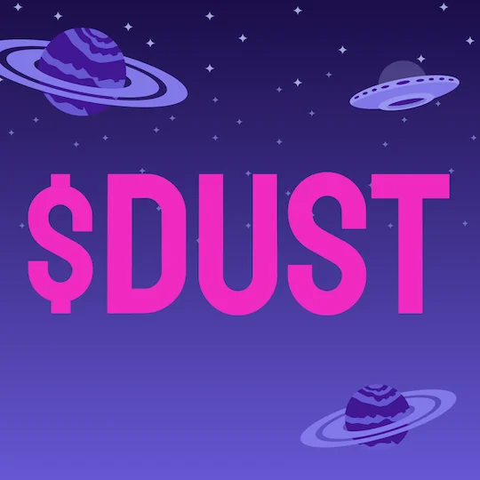
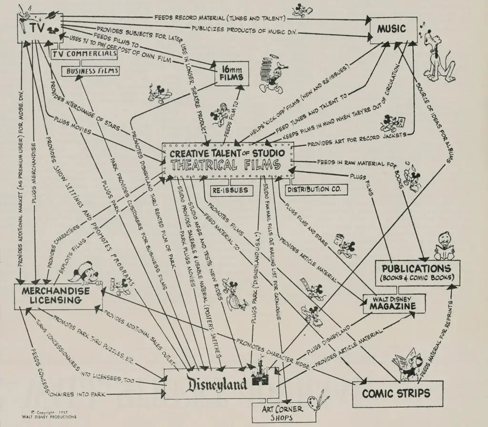
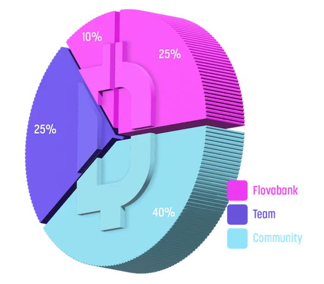
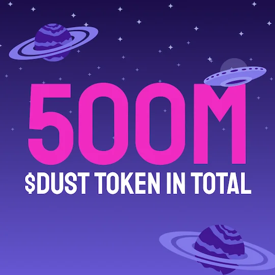
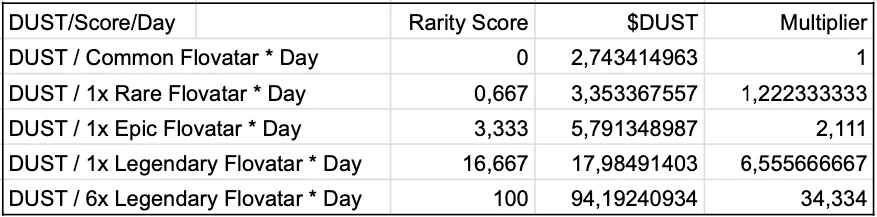

We know the community is eager to learn more about the $DUST tokenomics and distribution mechanism. However, before jumping into the numbers, we would love to share some updates on our vision for [Flovatar](https://flovatar.com) and what is to come.

<figure class="img"></figure>

## The Big Picture

When we first started developing [Flovatar](https://flovatar.com) we knew from the very beginning that we were not just your ordinary PFP project. Similarly, CryptoKitties is still one of the most innovative NFT takes compared to today’s standard. With the fully on-chain animated assets using SVG, composable NFT with wearable accessories, and highly customizable on-chain logic that allowed [this epic prank](https://twitter.com/flovatar/status/1520509399466483716), Flovatar is barely scratching the surface of what can be done.

We have been intentionally avoiding talking about our own Flovatar metaverse, because we think it has become more like a marketing buzzword, and we don’t want to make promises that we are not confident we can deliver in the medium term. On the other hand, the more we move forward the clearer are the signs that we’re definitely heading in that direction, so we thought it would be a good time to start talking a bit more in detail about the Flovatar world.

### Vision

So where do we see ourselves in 3 or even 10 years?

Over the last months, we’ve been asked this question many times but it’s never easy to fully communicate it with the usually short amount of time available, so in the effort of condensing it into a single phrase to be used as an “elevator pitch”, we derived the following concise summary for Flovatar.

> Flovatar aims to become the Lego + Disney of Web3, with a very radically new and community-centric approach that empowers people to express their own creativity and build together this massive universe.

Obviously we would need days if not weeks to tell you all details what our big vision is, but it will have to wait for another time because this article would become way too long!

To dig just a bit more into it, this is where we see ourselves in 3 and 10 years from now.

_It’s 2025 and Flovatar is now an established platform across three worlds — gaming, entertainment and business._

_From its origin as an NFT startup back in 2021, Flovatar has branched out across sponsorships, retail and edutainment to embrace multiple daily touchpoints in users’ lives. The unique ownership and participation offered by Flovatar means personal creativity is the main driver, transforming passive media consumption into adventurous imagining and realization._

_As a singular signature of human ownership, Flovatar helps to transform the Internet of Things into a Metaverse of People._

_It’s 2032. From its origin as an NFT innovation back in 2021, Flovatar has now grown into a transmedia experience spanning digital and real worlds._

_As virtual and augmented reality have realized the metaverse over the last decade, people have used their Flovatars to not only express themselves but to compete in games, conduct commerce, socialize, educate themselves and contribute to worthwhile causes. As cyberphysical experiences dominate the way we now live, Flovatar provides a launching pad for personal identity and a stage set for personal transformation throughout age groups and cultures._

### Trans-media and collaborative stories

<figure class="img"><figcaption>Original Disney Master Plan</figcaption></figure>

Flovatar at its core is a collaborative generative project and we really want to keep this at the forefront of our minds while we are building the story world and defining the way the community will interact with it. We should always remember the Fun component in everything we build.

Over the last couple of months we have been secretly working on not just writing a simple story about the Flovatars, but building a whole framework where the story will live and where you will have the ability to shape it and have a very active role in it.

We’re not referring to some afterthought add-on where you will just decide whether to go left or right, but to the fact that it will be a fully immersive experience where you will have the chance to genuinely shape the direction of the narrative and build out this massive universe together. Please stay tuned for an upcoming article that will dive deeper into this topic.

## $DUST

### Utilities

It’s important to give everyone a high-level overview of some of the upcoming utilities for $DUST. In addition to the utilities we mentioned in [this previous article](https://blog.flovatar.com/flovatar-the-master-plan-3b5b4fae4723), we’ve added a few more important ones that will be implemented over time and will play a crucial role in making $DUST much more interesting.

To recap, below are the utilities we already announced:

- Naming the Flovatar
- Creating a bio for the Flovatar
- Flobits upgrade mechanism (burning)
- Flovatar 3D upgrade mechanism
- Special swag purchases
- Participate in the Ultimate 1/1 Flobit auction
- Metaverse/gaming unlocks
- DAO voting participation

On top of all these we still have two very important additions we haven’t announced yet. With $DUST, you will be able to mint brand new NFTs for future series and also be able to stake it in the form of Frozen $DUST NFTs!

### $DUST NFT Builder

Very similarly to how the current builder works, the new generation builder will burn $DUST tokens to mint new NFTs, instead of Spark or Boosters for the upcoming series. The interesting part is that the price for each trait you choose will be dynamically updated. It will depend on the base value of the trait to start with (i.e. legendary will be more expensive than common ones) but is also affected by the frequency a specific trait will be used. After each usage, the trait will become progressively more expensive in terms of $DUST. This will give early mints a whole new dimension to play with.

Using $DUST in the Builder will definitely make things much easier for any newcomer to the Flovatar world to be onboarded, get quickly started, and will also add that extra depth of dynamic pricing that will be unique and special like everything else we do.

We envision the $DUST NFT Builder to be a core part of the project in the future because it will allow $DUST owners to choose from a wide range of possibilities for their next NFT. It could be a cat, a dog, an alien friend, or maybe even products like a car or a house!

The beauty of all this is that to take advantage of this whole new world of new NFT series; you will exclusively be able to do it with the $DUST token. As Flovatar owner, you will receive daily free $DUST airdrop for the next 10 years. That is if you own a Flovatar series one, of course!

### Frozen $DUST NFT

There have been many requests from the community on the possibility to lock up their $DUST to earn additional rewards similar to the veToken style (e.g. Curve). So we came up with the idea of the Frozen $DUST NFT. Is it a new icecream? a token? an NFT? a staking mechanism? Well, a bit of everything really (except the icecream, at least for now :) ).

The basic principle is that if you want to stake your $DUST token because you believe in the long term of the project, you will be able to go to a special “$DUST Freezer” webpage where you can enter the amount of $DUST you want to “freeze” and for how long (1 week to 3 years). The lock-up length will impact the multiplier of the reward you will receive, i.e. the longer the period the larger the reward multiplier.

By doing so, you will receive in exchange a brand new, freshly minted NFT that will represent $DUST amount that you staked, not too dissimilar to LP tokens.

You won’t be able to unlock the locked $DUST until the expiration date you previously selected. Still, you will be able to trade the NFT representing your locked asset freely on the Marketplace because it will be treated as any liquid NFT. The integration are limitless, for example the Frozen NFT could be used on [Flowty](https://flowty.io/) portal as collateral to obtain a loan in stablecoins, without having to give up on the locked $DUST tokens. This allows Flovatar to have a staking mechanism that can be much more flexible and liquid in case some emergency happens and you suddenly need to tap into the liquidity of your locked $DUST.

<figure class="img"><figcaption>$DUST distribution</figcaption></figure>

### Deflationary nature

We decided from the start that we wanted to have a deflationary structure for the token.

> The total supply will be capped at 500M $DUST and bootstrapped at genesis.

As people will start using $DUST with all the different utilities in the future, they will burn $DUST in the process. These burned tokens will be taken out of circulation forever. For this reason, the more utilities we build out together, the lower the total supply of $DUST will be available over time.

<figure class="img"></figure>

## $DUST Distribution

### Preface

Ok, after all this reading, you finally deserve to know exactly how much $DUST you will get from your Flovatar. As you saw from [this previous article](https://blog.flovatar.com/flovatar-milestone-updates-c779bffd1f1a), we will allocate 40% of the total $DUST to the community (the Flovatar owners), and it will be distributed over a period of 10 years on a daily basis. Another 35% will be allocated to the Treasury that will be used to fund the project development and future initiatives, including community grants. So in total, 75% of the total token supply will be used to the benefit of the community — for you all, the Flovatar owners.

Regarding the 40% allocated to Flovatar owners, our main focus is to have the $DUST distribution as fair as possible while keeping in consideration all the following factors:

- Distribution needs to be significant for common Flovatars because everyone deserves to live the full experience and enjoy the benefits of being a member of the community
- We need to reward Legendary, Epic, and Rare Flovatars adequately to acknowledge their rarity status
- Try to limit unwanted side effects to Spark, Boosters, and Flovatars as well
- Make sure the distribution is sustainable over a period of 10 years and not just on the short term

As you can imagine, finding the right balance between important factors is not an easy task. Some compromises need to be made among all parties for the project’s long-term success.

### Core distribution function

After a lot of thinking, and listening to the community opinions as much as possible, we decided to use the following formula for calculating the $DUST score multiplier for each Flovatar.

> $DUST score = 3 + Rarity Score Multiplier

This means that any Flovatar will range from a $DUST score of 3 up to 103.

Each rarity score point translates to approximately 0,914471 additional $DUST token reward that can be claimed each day on top of the 2,743414 $DUST token assigned to every Flovatar by default.

So following these simple rules, this is what the daily distribution will look like for some different rarity levels.

<figure class="img"><figcaption>$DUST distribution chart</figcaption></figure>

As you can see Epic and Legendary Flovatars will still have a great benefit, by being able to accumulate from 2x and up to 34x compared to a common Flovatar.

Beyond $DUST, there will be also additional perks for Epic and Legendary Flovatar holders, because after all they have some special hidden super powers ;)

### OG Bonus

Another thing we wanted to be sure about, is that the early community members (those with the lowest mint number), would be rewarded properly for believing in the project from the very beginning and for holding onto their Flovatars.

For this reason, we decided that an extra $DUST bonus should be applied to every Flovatar owner at the time of the drop. To avoid abuse and last immediate resell of Flovatars, we will not pre-announce the snapshot time publicly. All we can say is that it will happen between now and the actual release of the token.

Any Flovatar with a mint number lower than 6000 will be able to claim the following amount of $DUST token from day 0 of the release! Please note that Flovatar owners at the time of the snapshot, not the original creators, will be receiving the one-time bonus.

> Total $DUST bonus = (6000 — mint number) x 0,02 $DUST

<figure class="img"></figure>

### Wen $DUST?

First and foremost, we want people to think about $DUST as a super-utility token that will give them access to a whole new world of possibilities. And as always, the best way to do this is to lead by example, like we always did to date. We want to ensure there will be enough use cases for $DUST before releasing the token, so right now, the priority is BUILDING, BUILDING, BUILDING.

That said, the ideal scenario is to release the $DUST token by the end of Q3 2022, but we can’t give any guarantees yet.

## Conclusions

There is so much more to share, including some super secret projects we are undertaking to bring mainstream awareness to [Flovatar](https://flovatar.com). However, this article has already become too long, so we want to leave you with a simple question.

What will YOU [build](https://flovatar.com/builder) next? Send us any suggestions or proposal, we have a Treasury for that purpose ;)
