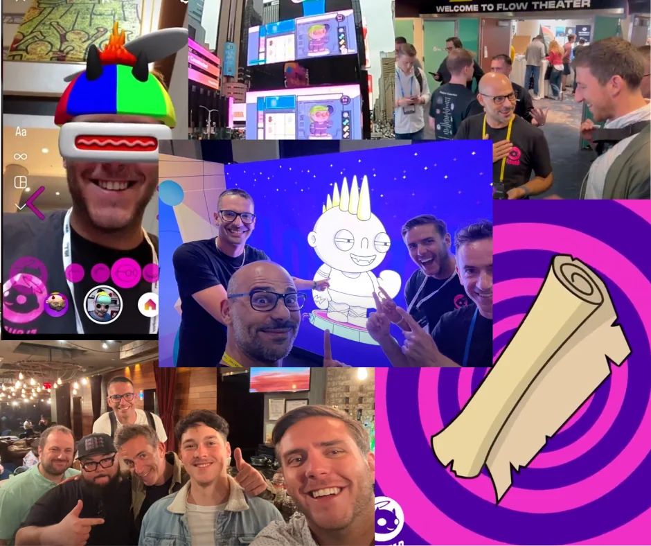
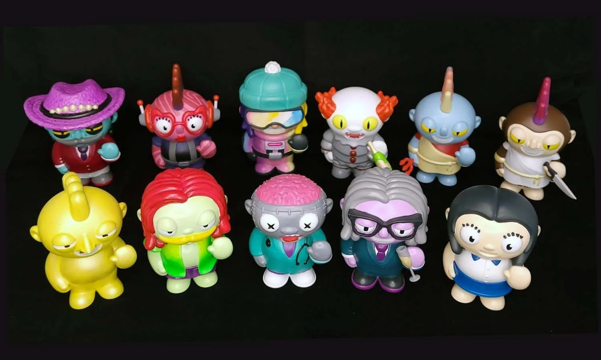
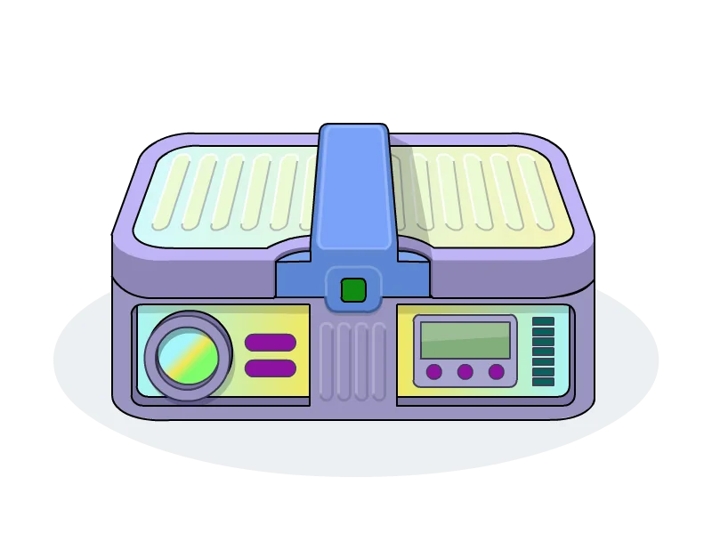
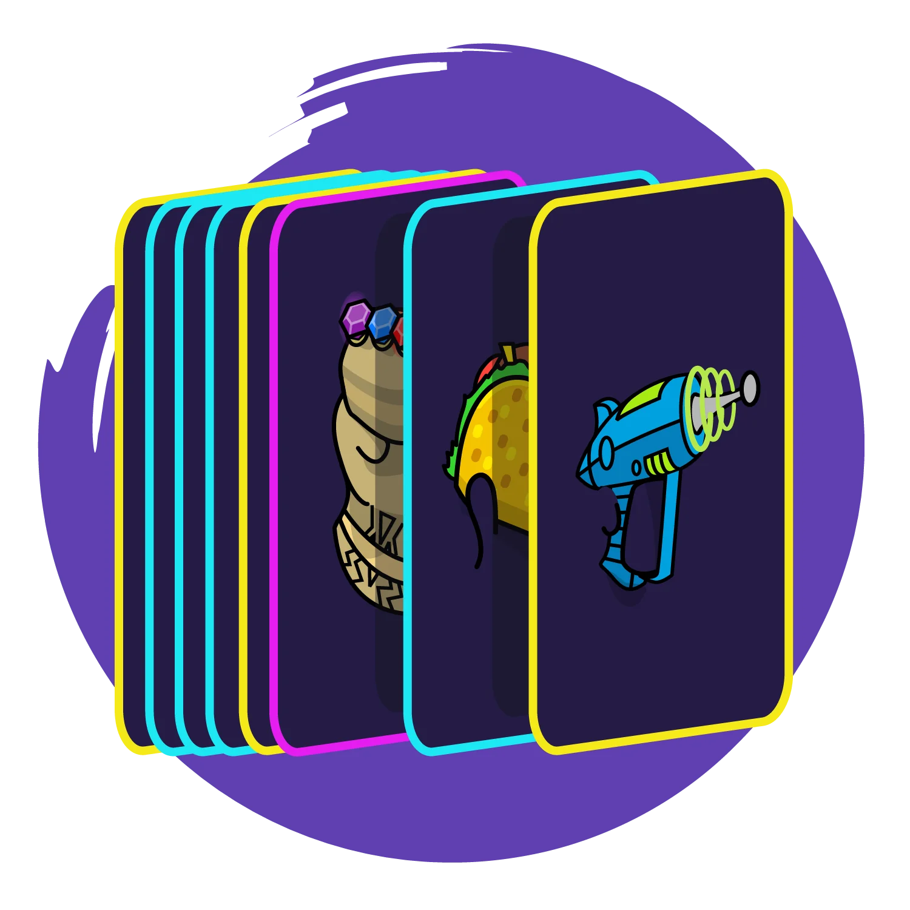
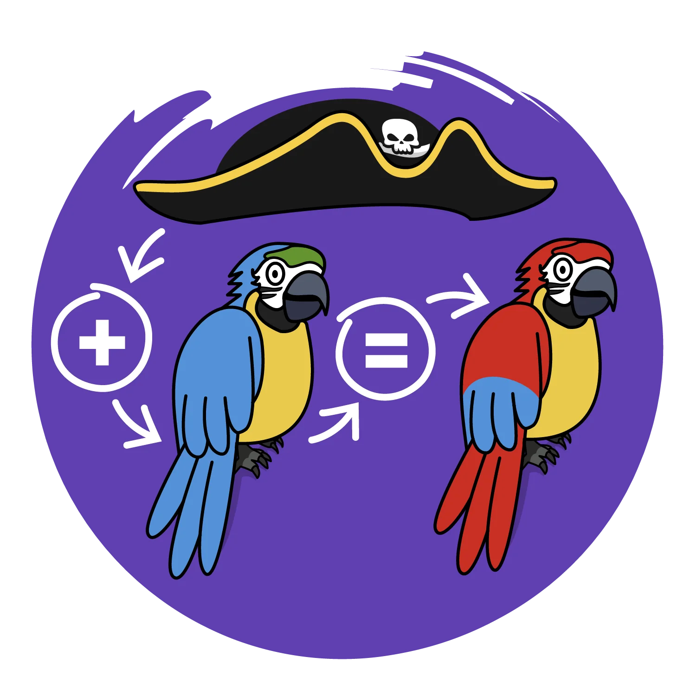

* * *

Our team at Flovatar has been hard at work creating some BIG things behind the scenes! You know when our team is quiet that magic is being worked on in secret for all of you! One of the releases we’ve been working on is the second series for our Flobits and we can’t wait to share more info with all of you! Before the excitement, let’s start with a recap update for what’s been accomplished recently.

## Recap of Updates

Since our last article so many things have happened, and it’s about time we did a proper recap before talking about all the exciting news involving the Flovatar world!

<figure class="img"></figure>

### IRL in NFT NYC

We recently [gathered in NFT NYC](https://www.youtube.com/watch?v=LoaMZBEuAsM&t=2s) with our first in real life (IRL) event with the FLOW of a party in New York City! It was so awesome to gather so many community members and finally meet in person! We shared great drinks and food, had a blast, distributed swag items, and formed even stronger relationships which only make our team work even harder to bring you more value. We can’t do any of the Flovatar magic without each of you.

### Instagram AR Filters

We also released two [new Instagram filter effects](https://www.youtube.com/shorts/UjbOhfg31Q8) which allow you to add Flobits to your face and bring your Flovatars to life! Our community has really been enjoying it, and it’s a further demonstration of the power of your creativity using tools like the [meme maker](https://flovatar.com/meme-maker) we’ve built. Plus we have some more super secret tools coming soon to really empower your creativity! Now that Flow has announced the integration of the wallets with Meta and Instagram, we can’t wait to bring it to the next level! Once again, we are showing how ahead of the curve we always are by leading in this space with our own IG AR filters launch a few months ago.

### First Treasure Hunt on Flow

A number of weeks ago, we also had an epic [treasure hunt](https://flovatar.com/treasure-hunting) that ignited our discord server and had a huge participation with more than ~400 people solving the big and really hard puzzles that we prepared for them. It showed our trans-media approach and it will be the first of many more to come that will keep everyone engaged and rewarded for their efforts. We also airdropped some Deluxe and Standard packs along with loads of Flobits for the first 200 participants, so make sure you won’t miss the next one!

### WTF is an NFT Video

Recently we also released a funny educational video titled “[WTF is an NFT](https://www.youtube.com/watch?v=Wt_cEPx3xvc&t=4s)”, that once again serves as proof of concept of the many applications Flovatar can have in order to become the fully fledged franchise we are envisioning.

### 3D Models

We also delivered the first 3D printed and painted floor models to some of our most engaged community members. We can’t wait to deliver many more soon once the $DUST token will unlock it for everyone.

<figure class="img"></figure>

### Dapper Wallet Integration

We’ve been working very hard to integrate the Dapper wallet into Flovatar, so that our community will be able to grow and expand by also including people that are more familiar with credit cards instead of crypto tokens. We are sure that this will be a big step forward to unlock the second level of community growth and we can’t wait to welcome all the new people into our world!

### New Mobile app released

We also released a brand new version of the mobile app featuring an awesome AR functionality and great new ways to interact with your collection. Currently it has been approved on [Google Play](https://play.google.com/store/apps/details?id=com.flovatar.mobileapp&hl=en_US&gl=US) for all Android devices and we are crossing fingers to get it approved by Apple on iOS very soon as well!

Now that we have all our 3D assets integrated in the Unity framework, we can’t wait to start releasing many more updates and even some videogames, so stay tuned for more info on this front!

## Unpacking the Flobits Series 2 Pack Sale

Our team has been hard at work on designing the Series 2 Flobits, the accessories that can be equipped on every Flovatar NFT, and we have [just launched a new pack sale for the Series 2 Flobits to the public](https://flovatar.com/pack).

For those that still don’t know it, Flobits are accessories that allow Flovatar owners to give their NFTs a whole new look and feel while also making them even more unique and increase their value. Flobits can be swapped out with different ones at any time to coordinate with user preferences, seasonal changes, and more! In the future, you can even merge multiple Flobits to unlock higher tiers or something magical.

<figure class="img"></figure>

### Contents of the Packs

The Flovatar Flobit S2 Pack Sale will include 66 brand new Rare, Epic and Legendary Flobits. Each pack will be priced at 39 FLOW and it will contain 8 randomly selected Flobits with the guarantee of finding at least one Epic in each pack.

<figure class="img"></figure>

Because we’re a real community-centric company, the vast majority of these Flobits were inspired by, or directly created by, members of the Flovatar community and on top of them we applied the most advanced and fully on-chain SVG technology that is our trademark and that sets us apart from any other NFT project out there. You will be amazed to find out what these new Flobits are capable of and how we keep redefining and raising the bar to show everyone what fully on-chain NFT are capable of.

Empowering your creativity is the most important thing at Flovatar, so let your ideas go wild and we’ll make them become a reality!

<figure class="img"></figure>

### Hidden Easter Eggs

With the new Flobits, you can unlock hidden easter eggs when you combine them with different traits and other Flobits, making your Flovatar truly one of a kind!

Every one of the new Epic and Legendary Flobits are fully animated, and if the animation is not apparent at first, you may need to unlock it by combining it with something else. Using the [Flovatar Builder](https://flovatar.com/builder), Flobits can be combined and tested with other Flobits and traits to unlock the hidden easter eggs.

<figure class="img"></figure>

### Limited Pack Supply

1,000 packs will be minted but there are only 420 available to the public sale on Tuesday 23rd of August at 4pm UTC (12pm ET, 9am PT). The remaining packs will be kept aside for an important collaboration that we’re coordinating with Dapper Labs and we will release an announcement in the next two weeks to share more details about it. More information can be found on the [Flovatar Flobit Pack Sale page](https://flovatar.com/pack) to learn how to claim the new packs while they are still available.

If you’re curious to see how awesome the new Flobits are, make sure to jump to the [Flovatar Builder](https://flovatar.com/builder) page and start having fun with them!

## We are NFT trailblazers

We are constantly leading the charge for what a web3 project can accomplish and what NFT technologies can be used to create. Flovatar is the only NFT project using fully on-chain SVG technologies to create the interactive unique traits, accessories, and animations that unlock certain abilities.

Many NFT and web3 projects are still playing catch up from what Flovatar has already released months ago! We will always try to lead the way in the web3 space and bring something new and innovative to the table instead of just copying what others did.

We always push the envelope technologically, but we are also known for rewarding our community with surprise airdrops, regular challenges every week, games, exclusive access to unique opportunities, unique utilities, and more! When the $DUST token launches in late 2022, the value and adoption of Flovatar will only skyrocket.

Thank you for your love and support! We appreciate every one of you and are looking forward to the future. This is truly the beginning of a lot of exciting updates to come this year. So be sure to get notified about the [Flobit pack sale](https://flovatar.com/pack) when it goes live, and stay tuned for our other exciting releases coming soon!

May the Flobits be in your favor!
