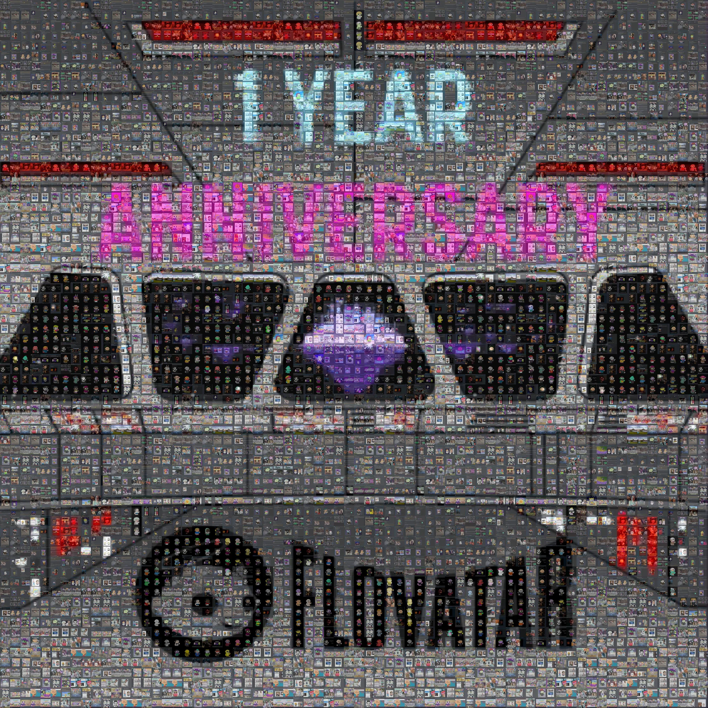
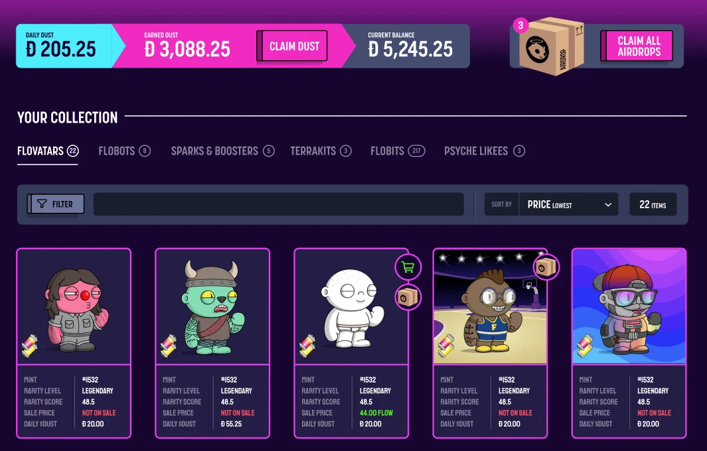
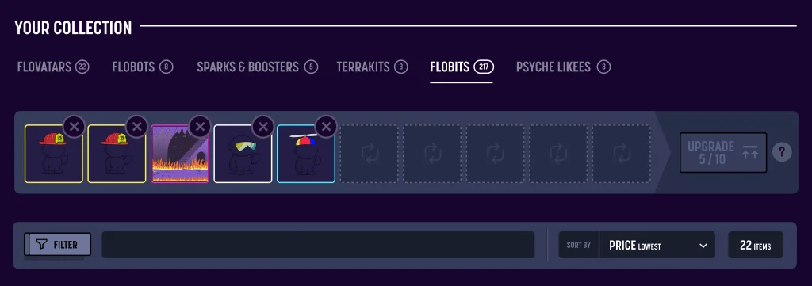
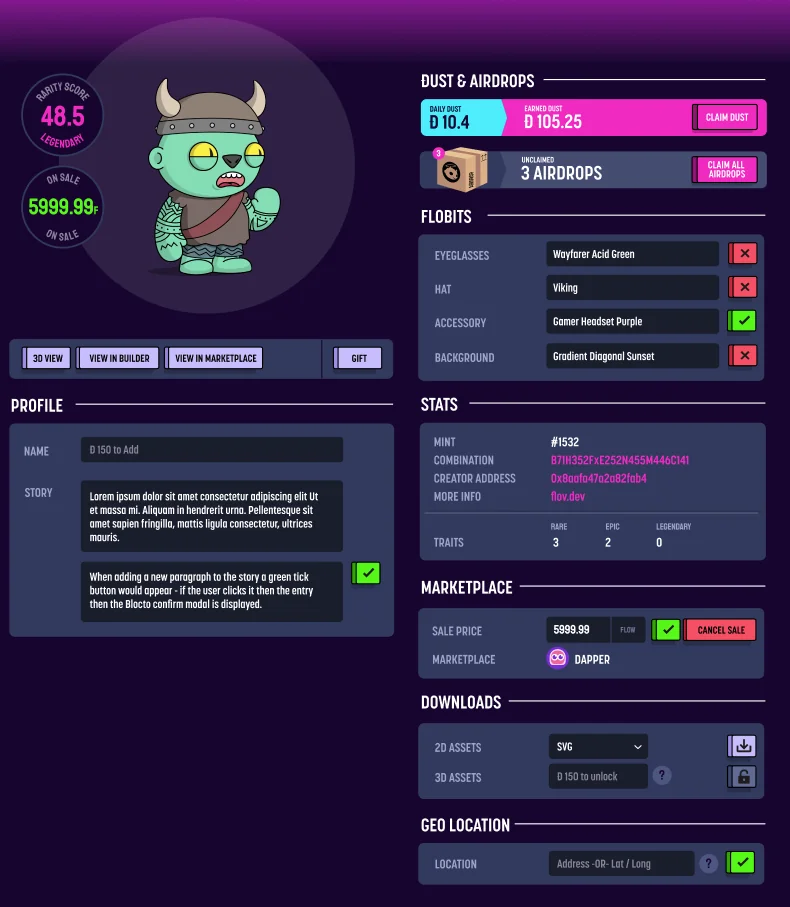
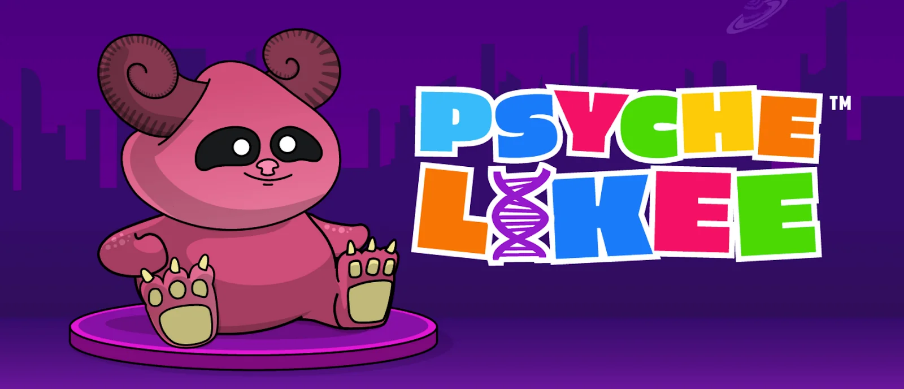
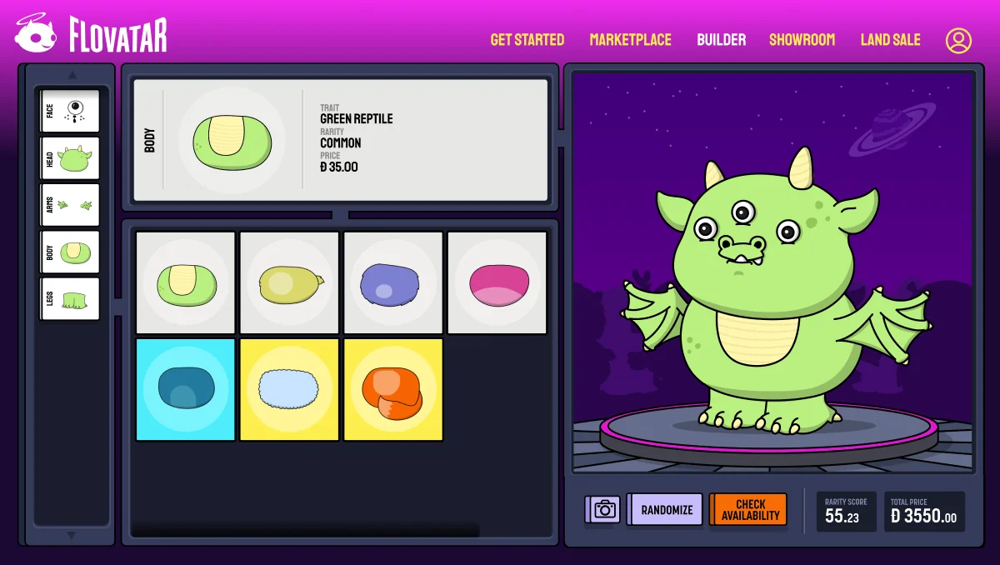

Exactly 1 year ago around this time I remember very vividly my sweaty hands typing very very slowly and accurately the commands on the terminal that would trigger a script and ultimately mint the 9999 Sparks along with all the Boosters and Flobits. It’s hard to describe the thrill, the pressure and the feeling of creating something immutable that would live forever in the blockchain (including the SVG artworks!) and it is definitely something that I will bring with me for the rest of my life.

<figure class="img"></figure>

The revolutionary part about Flovatar though is the fact that I actually didn’t create any Flovatar at all, but I just minted the tools that would allow anyone to create them. At first this might seem a simple technicality, but in reality this is what makes Flovatar so unique and different from anything else; every single one of the 6k+ Flovatars minted so far are the result of a creative process that has no match when compared to a cold randomization algorithm.

If you stop for a second to think about it, for 6,000 times people went into our awesome [Builder](https://flovatar.com/builder) and spent time and creative effort to choose among the 10B+ combinations the exact one they loved the most at that specific time. This is probably the single best and biggest achievement I am the proudest of, and for that I want to really thank our awesome community from the bottom of my heart. This proves more than anything else the value that Flovatar has today thanks to being shaped and organically grown by every single one with the diversity and quirkiness that is our core trademark.

As it often happens with the best things of your life, looking back it feels like time has flown away so fast and yet so many things happened that brought us where we are now, also as different people compared to who we were and with so many new strong friendships that were consolidated along the way.

I tried to write down a list of the biggest milestones that we achieved so far and it’s really staggering to see the number of things we were able to accomplish. There are probably a few I forgot, but nonetheless this feels like an impressive list.

- Genesis drop: first fully on-chain composable animated NFT
- Christmas airdrop
- Background airdrop with first interactive combo NFT
- Find integration
- Poker tournaments
- New website
- 3D models (print and WebGL)
- Scavenger hunt
- Meme maker
- Wildturkey’s prank
- Treasure hunting
- 3D prints giveaways
- WTF is an NFT short animation
- NYC NFT party + swag
- Mobile App with AR technologies
- Flowty integration
- Instagram filters
- Dapper and Lilico Wallet integration
- Flobit S2
- NFT Day celebration
- Terrakit: Flobot, asteroid, FUB
- Cryptopharaoh and Solarpups collab
- Gaia Marketplace
- Halloween airdrop
- Cryptokitties collab
- NFL 4 charity
- Flovatar of the week
- Mint Nights
- Hundreds of calls for potential collaborations and internal meetings
- Airdropped 136 times prizes and giveaways to Flovatar owners (every 2.7 days!)

To celebrate all these great achievements, we prepared a short video that tries to encapsulate 365 days in 60 seconds

<figure class="embed"><a class="yt" href="https://www.youtube.com/watch?v=kPleZo7eR48" data-yt="kPleZo7eR48">Play video: 1-Year Anniversary Achievements</a></figure>

## Looking forward

As many of you well know, it’s not in our nature to relax on our accomplishments and drop our guard, so for the year ahead we’ve raised the bar even higher and set quite a few important milestones that we’re targeting to achieve and the main four are the following:

- $DUST token, NFT Series and Utilities
- Storyworld release
- FUB and Asteroid Islands
- Mysterious Top Secret project

## Wen $DUST?

I know many of you have been asking this question lately and are more and more eager to know the answer, so time has finally come to share more details and to plan its official release now that we have almost completed its implementation.

Even though it might seem trivial to launch the token in itself (it actually is from a smart contract point of view!), as you dive deeper into the details you discover that there are hundreds of moving parts that revolve around it and that are dependent on it: implementing all the different utilities, producing and coding a whole new NFT series, creating a claiming system to distribute the daily supply, defining the tokenomics variables, and so many more!

For this reason we preferred to remain flexible on the release date, because we knew that the work to be done was a lot, but step by step we are now almost there to put all the pieces of the puzzle together.

Let’s go through the main aspects of the $DUST token and what to expect in the coming weeks.

## Claiming $DUST and Airdrops

We’ve been working on a totally revamped Collection page that will allow you to easily see how much $DUST you are accumulating each day, how much is currently claimable, and how much is currently in your wallet. With the simple click of a button you will be able to claim your $DUST and transfer it to your wallet.

Alongside the $DUST panel you will also see an airdrop pack that will show up when your wallet or any of your Flovatar receive a reward or gift. By clicking on the button you will be able to unpack the gift box and reveal its contents.

<figure class="img"></figure>

## Flobit Upgrade

Also in the Collection page, you will be able to select 10 different Flobits of the same rarity and spend X$DUST to burn and upgrade them in exchange for 1 brand new Flobit of a higher rarity tier. It’s important to note that if you provide 10 Flobits of the same category (hat, eyeglasses, accessory or background), you will get in return a Flobit belonging to the same category as well!

<figure class="img"></figure>

## Flovatar Detail Page

As you can see the Flovatar detail page will also be radically different thanks to the large amount of utilities that we can now provide.

<figure class="img"></figure>

On the left side you will be able to spend 100 $DUST and give a unique and immutable Name to your Flovatar and also write small Bio stories (300 characters for 50 $DUST) that you can add indefinitely and that will be stored forever on-chain like everything else we do!

On the right side you will be able to claim the accumulated $DUST and also the airdropped Flobits for that particular Flovatar.

After the already familiar Flobits, the Stats and the Marketplace panels, you will find an updated Download section that will allow you now to unlock the 3D assets for your Flovatar and then allow you to save it on your device, ready to be 3D printed!

Finally at the very bottom you will be able to choose a geo location to put your Flovatar anywhere on the world map!

We strongly believe that all these great tools will allow people to unleash their creativity even more and bring their Flovatar characters to the next level by adding even more depth to them.

## $DUST Series

Last but not least, $DUST can be used to generate a brand new form of life and the first of many to come are the super cute Psyche Likees!

Flova Labs also released a dedicated page for them, so make sure to check it out [here](https://flovalabs.com/psyche-likee) and learn all about them.

<figure class="img"></figure>

The mechanics of how you will be able to mint a new Psyche Likee are very simple and will have the same familiar Builder interface that you’ve been using to mint Flovatars and Flobots.

The main difference is that you won’t be using Sparks and Boosters, but instead you will see a total price in $DUST tokens that you will have to spend to mint the character.

The base price of each trait will depend on its rarity (common will be much cheaper than legendary), so that the total will be the sum of all the traits you selected.

To make things a bit more interesting, we also implemented a feature that will automatically increase the price of each trait by a 3% each time it is being minted by someone. For example if a base price for an epic trait would be 100 $DUST, the first person to mint it would pay 100 $DUST, the second person would have to pay 103 $DUST, the third 106.09 $DUST and so on. In this way those that will get in early and choose a trait that will become popular, will be rewarded by paying much less than other people joining later on.

<figure class="img"></figure>

Over the next weeks we will start revealing more and more details and gradually introduce all the 30 different traits per category, that will give us 24M+ combinations to have fun with!

We’re thrilled to also reveal how they are connected to the Flovatars as we’ll finally unravel the storyworld that we’ve been building, but more on that further down the article.

## Timeline

We’ve been working very very hard to maintain our promise to have $DUST fully functional before the end of the year and even though we had some delays because the development of some parts were more complicated than others, we should be able to make it just before the end of the year.

Having said this, it is important to note that at first it will be available only on testnet so that we can verify that everything is working as expected and no bugs are present.

If everything goes well we should be able to officially promote it to production by Q1 2023.

## DAO

Like said before, launching and maintaining a token is no easy task and even though we feel that we worked really hard and we prepared many different compelling utilities for the token, it is also important to consider the general market conditions in the crypto space right now. After talking with many different advisors and professionals, most of them suggested that I should wait to launch the token until the market conditions will improve a bit at least. At the same time from our point of view the $DUST token is officially a utility token and we want to release it as soon as possible to be able to unlock all these awesome utilities that we’ve built.

As we see it there is a decision to be made between trying to optimize the financial gain (waiting to launch the token on better market conditions) versus being able to have fun spending $DUST tokens sooner rather than later.

Having the responsibility to manage Flovatar in the best way I can, I would tend to follow the recommendations provided by the advisors I talked to and to wait a bit more to officially launch it, but on the other hand I also think that it would be a pity to have done so much work to then have to wait for months just in the hope to make more money out of it.

For this reason we decided that it would be the right thing to let the DAO decide on the matter and finally start taking important decisions that will shape the future of Flovatar.

We will start with a funny test proposal involving pineapples and pizzas (please choose wisely!) that will allow everyone to familiarize with the [Cast](https://cast.fyi/#/community/39) platform and we will ramp up with other smaller proposals and bigger proposals as well, like setting the $DUST prices for each utility, before reaching the decision about the $DUST release, so that we will give ample time to everyone to participate in the process.

## FUB and Asteroid Islands

As the $DUST token will be released our focus will shift towards the development of the Asteroid islands and the FUB.

Our goal is to engage more and more with the future creators and work together to define the best interface and functionalities to include in our platform.

We are planning to create a series of small webinars to dive more into the details of SVG and also to have meetings and town halls to talk about the underlying technology of the Builder and so much more.

So stay tuned in the first half of 2023 for a lot more to come on that front!

## Storyworld

With the introduction of the Psyche Likee we have started teasing part of the storyworld that we’ve been working very hard on building over the last year. Rumors say that the [Flova Labs](https://flovalabs.com) website will keep releasing some juicy information that will lead to the launch of the first of ten episodes starting in early January!

We’re thrilled to finally be able to share all the things we prepared for you. Our ultimate goal is to create a transmedia experience where you will be able to consume different content on different platforms and that will provide the opportunity for anyone to take an active role in shaping the plot and become one of the protagonists of the main storyline!

So make sure to keep your eyes peeled for lots more information to be released and get ready for another epic “Treasure Hunt” ride that will reveal more and more secrets about the Flovatar storyworld!

## THANK YOU

Before wrapping up this article I first need to thank every single one of you that are part of the Flovatar community and to all the members of the team for having made this possible.

First and foremost to our lead artist, who with his incredible skills and great design taste created all the hundreds and hundreds of illustrations and artworks that you can all enjoy and are so revolutionary with their interactivity and ability to combine with each other.

I also want to thank Wei for believing in the project from the very beginning and for the constant solid and incredibly valuable support and advice he’s been providing the whole time.

A big thank you also to all the people that are, or were, community reps like Rumple, Utena, Staryz, Chaosmanis, LoneStarSmoker, GarlicDonut, WildTurkey, MusicMel and Marlin, as well some of the most active members like derp3x, C-3PFLO, oldedb, Jenna and so many more that I would like to add but I refrain to avoid leaving anyone out.

Also special thanks to Nate and the Mayven team, James qvvg, Luke eldumbo, Jason, Bjarte, Kennedy, Jacob, Kris, James, Jason, Piete, Stas, Rafaela, Alice, and again all the others that I am missing that helped create all the awesome things we can all enjoy today.

Last but not least a big big thank you to my family that supported me along the way in a such a strong way and with so much patience!

This first year of the Flovatar journey has left like a lifetime with all the things that we’ve achieved, and I’m sure that the years ahead will be even more full of achievements, surprises and most importantly contain a whole load of fun to be had!

Thanks to all of you from the bottom of my heart and let the celebrations begin!!!
