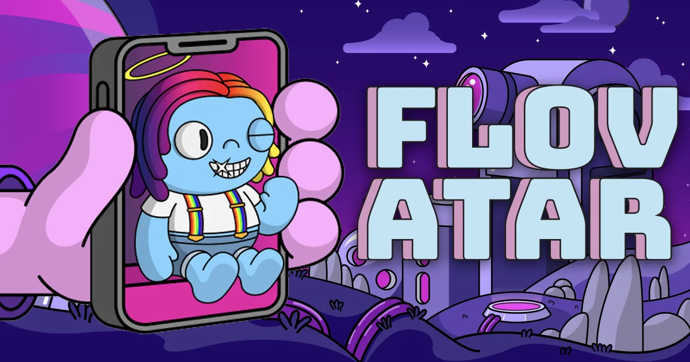
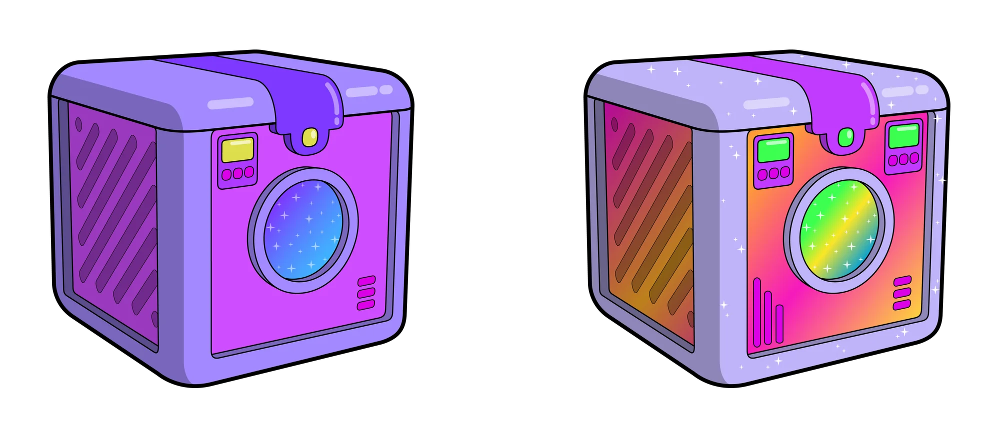
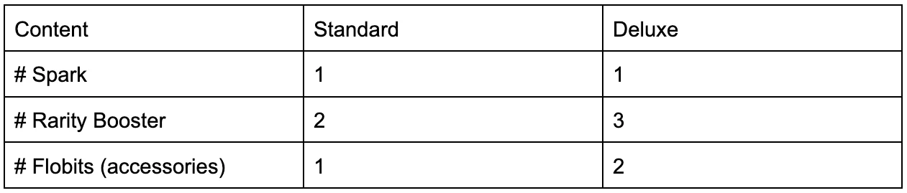
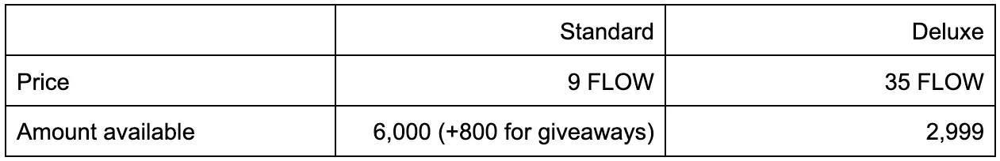
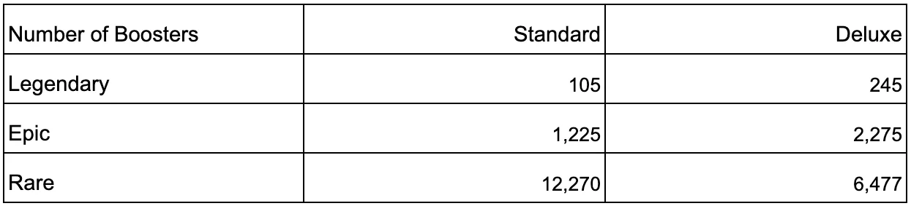
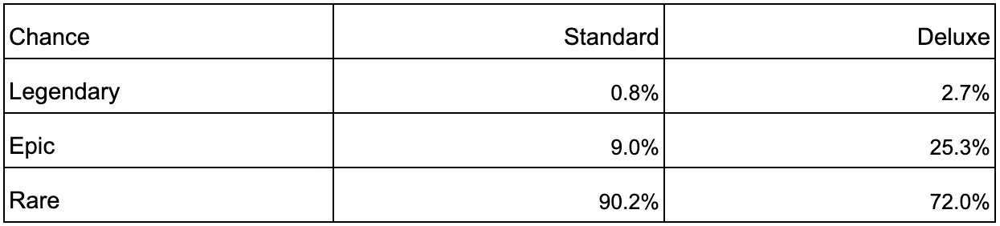
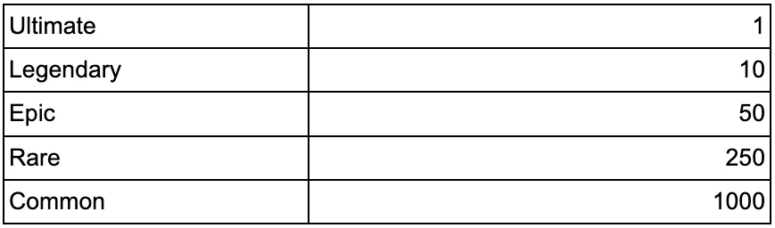
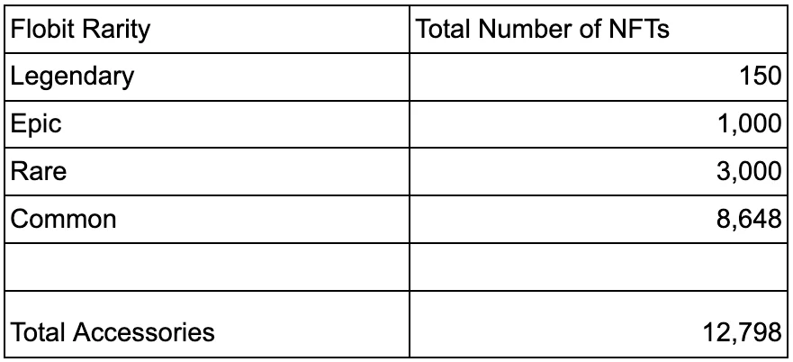
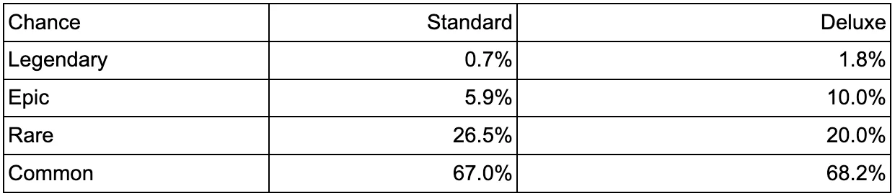

[Flovatar](https://flovatar.com) is the next generation PFP project built on Flow where collectors take the creative lead to shape their own unique characters. Participants will be able to select their favorite combinations across seven main categories with over 3 billion different combinations. No more trade-off between rarity and your own individuality.

<figure class="img"></figure>

**Only 9,999 can be minted** as the original series and each of them come with superpowers:

- Commercial rights license to your own Flovatar (swag, toys, or movie deals anyone?)
- 1% lifetime royalty for each secondary trade to the original Flovatar creator (you)
- Early access to Stardust token ($DUST) and DAO participation
- Future airdrops, exclusive swag, and many surprises to come

## Drop date

The Genesis public drop will be on **Dec 16th at 9am PT / 12pm ET / 5pm UTC**. As previously [mentioned in this article](https://blog.flovatar.com/flovatar-lite-paper-b2a1824e1a45), there will be a total of **8,999 packs** available for purchase between the **pre-sale on Dec 14th at 9am PT lasting 24 hours** (for whitelisted members, [join Discord](http://discord.gg/flovatar) to learn more) and public sale on Dec 16th.

## Pack structure and pricing

There will be two types of packs available for purchase: Standard and Deluxe. Inside each pack, you will find a single Spark needed to give life to a Flovatar. Where they differ is the number of rarity Boosters and Flobit components.

<figure class="img"></figure>

Standard and Deluxe packs will present different chances of getting epic and legendary Boosters and Flobits.

For a primer on Spark, Boosters, and Flobits, you can [take a look here](https://blog.flovatar.com/flovatar-lite-paper-b2a1824e1a45).

<figure class="img"></figure>

### Price

<figure class="img"></figure>

We wanted to ensure that Flovatar is as accessible as possible to most members, so that is why we decided to keep the Standard pack below the average price of many previous PFP projects, while the Deluxe packs can be quite attractive for collectors. Each pack will contain a single Spark, ensuring a fair distribution for all participants. Please find below additional details on Boosters distribution and the chances for each tier in a pack.

<figure class="img"><figcaption>An example of of our Legendary body traits that can be unlocked with the Rarity Booster</figcaption></figure>

## Rarity Boosters Distribution

<figure class="img"><figcaption>Amount of Rarity Boosters minted and their Pack distribution</figcaption></figure>

### Boosters Chances

<figure class="img"><figcaption>Chance to find a corresponding rarity tier for each Rarity Booster in the Pack</figcaption></figure>

If you ever wonder how we randomized the distribution for all items, here is the [link to the randomize function](https://github.com/crash13override/flovatar-randomizer/blob/main/RandomizePacks.php).

## Team Allocation

As an additional token of fairness, we are not reserving any packs for the team, but simply allocating 200 Sparks for team members and key contributions/advisors. This means **there won’t be any Boosters or Flobit components allocated to internal team members**, ensuring total alignment to maximize value for the community. Of course, each team member will have the freedom to join the drop and purchase packs like every member if they decide to do so (no preferential queuing will be given) or participate in the marketplace.

## A bit about Flobits

Flobits can be added to your favorite Flovatar like accessories or to enrich the story of a character. Differently from the main body components, each Flobit is a unique NFT that can be applied to a Flovatar but also be traded on the Marketplace. They can be viewed like skins that you can change in a video game, but as NFT, with the option of applying multiple Flobits from different categories on the same Flovatar.

The main categories are:

- Hat
- Eyeglasses
- Accessories   
(sport items, tools, gadgets and more)
- 4th category? (To be revealed post drop)

Flobits will come in various rarity tiers, with different edition sizes described below.

<figure class="img"><figcaption>Flobits Rarity tiers</figcaption></figure>

Please note that for the Genesis drop, Flobits up to the Legendary tier will be available. The Ultimate Flobits will be announced at a later date after the drop.

Based on the current number of Flobits already designed, we expect 25k-35k total Flobit NFTs to be minted for this round following the mint size chart presented above for each component. The good news is that all Legendary and Epic components currently available in the Builder will be included in the Genesis drop. However, given the total number of Flobits NFTs in this drop will be capped at 12,798 based on the pack structure mentioned earlier, Rare and Common components will be randomly selected to fill the rest.

The remaining NFTs will be part of an upcoming Flobits release, where we will also allow the community to submit new accessory proposals. A portion of Flobits will be also used as rewards for various community contests.

### Flobits Allocation

<figure class="img"><figcaption>Amount of total Flobits minted and their Pack distribution</figcaption></figure>

### Flobit Chances

<figure class="img"><figcaption>Chance to find a corresponding rarity tier for each Flobit in the Pack</figcaption></figure>

## How to Purchase

[**Blocto wallet**](https://blocto.portto.io/) will be the main one supported, so we highly suggest anyone create a wallet in advance and load it with the needed FLOW you are planning to spend during the drop. There is a good chance the drop might sell out quickly. Especially for members who have their FLOW token staked, you will probably want to **unstake right away before Tuesday, Nov 30th**, because it takes a two weeks period to be able to withdraw your staked FLOW (just in time for the drop ;))

We have also integrated with [**Moonpay**](https://www.moonpay.com/), which allows you to purchase FLOW with Credit Card or other payment systems (ApplePay, GooglePay) and send the tokens directly to your Blocto wallet. If you wonder which exchanges can be used to get FLOW, feel free to take a [look at this link](https://coinmarketcap.com/currencies/flow/markets/) for the one that fits you best.

Pro tip: To best prepare in advance of the drop, we also suggest visiting our website Flovatar.com a week before the drop in order to connect your wallet and initialize your account to create the Flovatar Collection in your wallet. This will possibly save you some precious time during the drop. When the date comes, you will notice a “Connect” button on the portal that will trigger a simple popup for you to connect. Once initialized your wallet will be able to interact with Moonpay too.

## Queueing system

In order to ensure a good user experience, we implemented a queuing system integration that will create a waiting room approximately 15 minutes before the drop.

At the time of the drop each person will receive a randomized seat order and we will allow a controlled amount of users every minute to complete the purchase, so that there won’t be any overloads on the system.

Each user will be able to buy **just one pack at the time.** Once a user completes the pack purchase, if they like to buy another pack, they will be sent to the back of the queue. There is no limit to the maximum number of pack each member can buy, they’d simply go through the queue each time till the drop is sold out.

## Long Term Sustainability

Flovatar was created to be community-driven and much more than a simple PFP project. We are aware that the long-term success of the project hinges on us all working together to bootstrap the best community and ecosystem surrounding the Flovatar Universe. That is the reason why the team decided to allocate the majority of the revenue into the project Treasury that will be mainly used to grow the ecosystem, bootstrap needed components, and support individuals, artists, or entire teams building on top of Flovatar.

For the Genesis drop, upcoming Flobits drops, and Marketplace transaction fees, 60% of all the revenues will go directly into the project Treasury while only the remaining 40% will be distributed among the core team members. We will make the Treasury wallet public before the drop for transparency. Along the way, it is our goal to empower the community of Flovatar owners to be able to assist us in the roadmap and Treasury management via the upcoming DAO.

We will need more time to structure the DAO appropriately, in a thoughtful way, that allows large participation without hindering the speed needed for an early-stage project. Rest assured that all Flovatar owners and early adopters will have a voice in it and we are in this together for the long term.

## Commercial Rights

Each Flovatar will grant their owners additional benefits something kin to a full commercial license lease in perpetuity. This means a Flovatar owner can independently pursue collaborations, sponsorships, or commercial deals independently. 90% of any potential revenue from these deals will be retained by the Flovatar owners, while only 10% would need to be distributed back to the DAO to continue the support of the Flovatar ecosystem, further increasing the utility and global awareness for all owners.

The project entity will retain the full copyright of all Flovatars in order to be able to provide legal support and a united front in case of external attacks or challenges, but in turn, it will lease the commercial right to each owner via the DAO in perpetuity. For transparency, we would like to note that there might be extreme circumstances in the future when the DAO might need to revoke the commercial rights lease from a specific Flovatar owner if the usage of Flovatars were to be redeemed unethical or plainly illegal (e.g. crimes recognized by UN and/or including but not limited to using Flovatars as a symbol of hatred, violence or discrimination). We expect this to never happen, but it is very important to ensure there are processes in place to avoid a few bad actors ruining the entire ecosystem. That said, it will require at least 70% of all votes in the DAO to be cast in favor of the action of this magnitude to take effect. $DUST will play a very important role in the DAO voting and global consensus coordination. We will be sharing more info on this front in the coming months as each process needs to be planned very carefully.

## Conclusion

While we have tried to lock in as many details as possible in this blog, there are a lot of variables to consider. We kindly ask all our community members to be understandable in case we need to make some final edits before the **public drop on Dec 16th**. In case of any major changes, we will ensure to communicate as early as possible across all channels (we highly suggest [joining us on Discord](http://discord.gg/flovatar) or [follow us on Twitter](https://twitter.com/flovatar) to get the latest updates).

Now go play with our awesome [Builder](https://flovatar.com/builder) and go with the Flow!

* * *

_Update 12/2/20201: In order to reward our growing community, we decided to keep aside 30 Deluxe Packs as well, to be distributed among the winners of a series of contest. So the total available Deluxe pack will be 2,969 and no longer 2,999._
