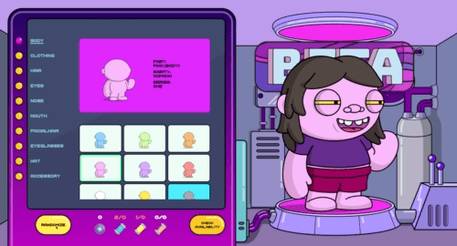
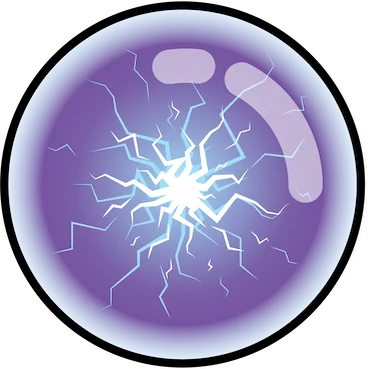
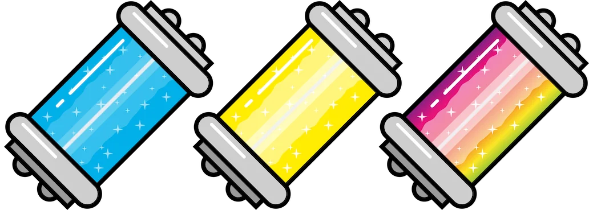
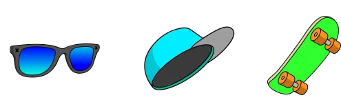
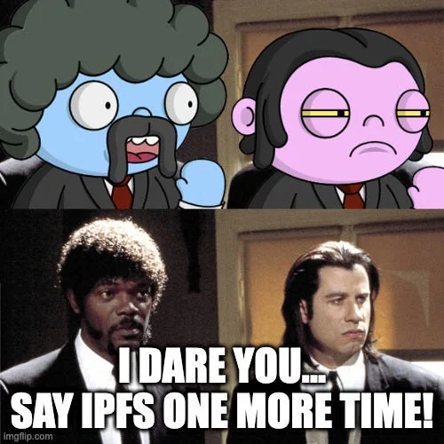

## Flovatar Introduction

## Intro

[Flovatar](https://flovatar.com) is the next generation PFP project, built on Flow where collectors take the creative lead to shape their own unique characters. Participants will be able to select their favorite combinations across seven main categories with over 3 billion different combinations. No more trade-off between rarity and your own individuality. (**Only 9,999** can be minted as the original series)

While the fundamental value of blockchain lies in the finality of transactions (irreversible) and true digital ownership, there is no reason why NFTs must stay static and immutable forever. With Flovatar, you can create your favorite PFP NFT that speaks most to you, while still providing the collectibility factor thanks to varying rarity traits, and with the guarantee to be unique. With Flovatar, the signature and **SVG art** itself will live forever **on-chain**.

<figure class="img"><figcaption>Our Flovatar Builder</figcaption></figure>

The immutable core of a [Flovatar](https://flovatar.com) is just one part of the whole; the unique name bestowed, the environment (background), the accessories and tools all determine each Flovatar’s identity. The richness of their story will be determined by each and every owner who holds them over time, and they will carry the proud scars of every battle, the unforgettable memories of festivals attended, and friendships formed. They will be the subject of tales spanning decades if not centuries.

When you start thinking of NFT in these terms, then it becomes almost natural to give aspiring Flovatar owners the building blocks and let their imagination and creativity take from there.

If you want to see to believe, visit our [**Flovatar Builder**](https://flovatar.com/builder) page and have fun exploring all the crazy combinations!

## Spark

The first building block of a Flovatar is the **Spark of life** that each future Creator will receive in their Pack or available via the Marketplace for secondary sale.

<figure class="img"></figure>

Spark is the essential element to give birth to a new Flovatar and will allow its owner to choose between all the wide range of Common traits for all the 7 main categories (Body, Hair, Eyes, Nose, Mouth, Facial Hair, Clothing) before making a final decision and to set it in stone forever. Each Flovatar is guaranteed to be unique, so if a user tries to copy the exact components of an already minted Flovatar, the smart contract will simply reject the transaction.

## Rarity Booster

If you are a collector looking for the rarest traits, then we have you covered. There will be some very exclusive traits that can be unlocked via Rarity Boosters.

There are four **Rarity Tiers** in total:

- Common
- Rare
- Epic
- Legendary

<figure class="img"></figure>

In order to use a Rare/Epic/Legendary trait on your Flovatar (like the Ninja clothing, laser sword or rainbow mustache for example), you will have to use a Rarity Booster of the same Rarity Tier to cover its cost. So for example, if you would like to create a Flovatar with 2 Epic traits and 1 Legendary trait, you would need to use 1 Spark (as always), and then also 2 Epic Booster and 1 Legendary Booster.

## Flobits components

Within a Pack collectors will also find a variable amount of optional Flobit components.  
These Flobits can be added to your favorite Flovatar like accessories or to enrich the story of a character. Differently from the main body components, each Flobit is a unique NFT that can also be traded on the Marketplace. They can be viewed like skins that you can change in a video game, but as NFT.

Flobits are divided into four categories, where the last one will be revealed after the drop.

- Hat
- Eyeglasses
- Accessories (sport items, tools, gadgets and more)
- ???

<figure class="img"></figure>

Each Flobit will follow the same four rarity tiers, which will impact the edition size of each Flobit. There are rumors going around about super legendary 1/1 Flobits out there!

## Marketplace

Right at launch, there will be a dedicated Marketplace at [Flovatar.com](https://flovatar.com) that is fully non-custodial and ready to be used after the unpacking. We predict many creators will be looking to get their hands on the additional Rarity Boosters needed to complete their ideal Flovatar or chase down the matching Flobits for that final touch.  
In the **Marketplace** people will be able to buy and sell the following NFT:

- Spark
- Rarity Booster (Rare, Epic, Legendary)
- Flobit component (Hat, Eyeglasses, Accessories)
- Full set Flovatar

For each sale processed on a fully minted Flovatar, a **1% Royalty** will be paid to the original creator of that Flovatar. Yes you heard it right, Flovatar creators will enjoy a lifetime 1% royalty on secondary trades.  
On any purchase processed on the Marketplace a 5% transaction fee will be applied for the service. Part of the marketplace fee will go to the project treasury to fund future developments and community initiatives (more info to follow).

## Whitelist, team & community allocation

First of all, a personal disclosure: the very first mint of common-traits Flovatar has been promised to my 6 year old daughter that helped me develop the concept and choose the accessories. If I break my promise she will kill me, and if I die all the Flovatars will be really sad, so that is not negotiable. :)

### Whitelist

We have reserved **1,500 Whitelist spots** for all you early community members that will be rewarded across giveaways, contests and trivia on Discord and Twitter. The winners of these Whitelist spots will have a guaranteed pack they can purchase during the pre-sale period (to be announced later). Any packs left unclaimed from the pre-sale will be released to the general sale pool.

### Team allocation

**Only 200 Sparks** will be distributed among team members who contributed to making this project possible during the last six months. This decision was made to ensure fairness, so no team member will be getting any Rarity Boosters or Flobits.

### Community allocation

We will reserve **800 Standard packs** for community related events, contests and awards. Some might be leveraged to form collaborations with other pfp projects or communities. We predict a portion will be awarded to various early adopters before the main drop, while the remaining packs will be distributed in the coming months.

So at the moment of the drop there will be a total of 9,999 -800 community giveaways -200 Spark for the team = 8,999 Packs in total for the pre-sale and main drop combined.

## D&D ($DUST and DAO)

Once the majority of the original series Flovatars are minted and the community starts solidifying, we will kick off the discussion for a possible **$DUST** token that will serve as a key component to unlock the many experiences being built in the Flovatar Universe. Flovatar owners will be the first to learn about it.

In parallel, we will also start planning on how to best design a **DAO** mechanism to allow Flovatar creators an easy way to participate in some of key decisions and roadmap discussion, in addition to helping us manage the project treasury.

## Peak into the future

This genesis drop marks only the beginning of the Flovatar multiverse. Being part of this amazing community means you will receive many IRL benefits like swag, exclusive events as well as gaming & metaverse integrations we have in the plan.

You might be delighted to learn we recently completed an integration with [Twitter](https://twitter.com/flovatar) allowing Flovatar creators an easy one click update of their profile picture every time they upgrade/change their Flovatar (Christmas hat anyone?).

We can’t wait to see you all on our [Discord server](https://discord.gg/flovatar) to join our growing community and to participate in our many activities like the **meme contest**, one of my favorites! :)

<figure class="img"></figure>
