## Flovatar — Milestone Updates

### Continuing to make strong progress

If we want to be honest with ourselves, the entire NFT space is experiencing its version of a bear market, and we expect [Flovatar](https://flovatar.com/) will be affected by this to some extent. However, contrary to many short-term driven projects out there, you can rest assured knowing we will be here for the long haul. How long the winter will last is impossible to say, it could be next week or next quarter, but one thing is sure: the fundamentals of Flovatar haven’t changed. Regardless of the market cycle, we are doubling down on our progress and long-term ambitions.

## Our New Head of Marketing

To that point, we are super excited to welcome Jason Fleagle as Flovatar’s first Head of Marketing. His priority is to lead Flovatar through the next growth phase now that we have a robust foundation set, and BIG plans for the future! Jason has been quick on his feet and has already suggested a series of initiatives to roll out in the coming months: exciting new content updates, live streams & show content, improvements to our brand image, exciting influencer and celebrity engagements, and crafting compelling use-cases for strategic partnerships. Feel free to [welcome Jason (@jasonf) in our Discord](https://discord.gg/flovatar) community!

## Summary of Our Exciting Progress

Notwithstanding the high level of noise and lack of clear direction across the entire NFT ecosystem, we are delighted to share some fantastic progress we have made in the past month alone:

- [**Flovatar’s New Branding**](#a86f)
- [**Mobile Apps with Our First Mini-Game**](#b29d)
- [**3D Design Updates**](#f00c)
- [**Flobits Second Collection Updates**](#6d90)
- [**Overview of the $DUST Token Allocation**](#9aac)
- [**& What’s Coming Next!**](#8564)

## Flovatar’s New Brand — Same Great Community {#a86f}

In order to grow as a brand beyond the crypto space, into traditional digital platforms, and even into the physical world, we came to the realization we needed to evolve our official logo into something representing the world and ecosystem we are growing. We also wanted a symbol that would be easily recognizable across all media including apparel and swag.

**After a lot of brainstorming, iterations and refinements, we’re very proud to present you the new official Flovatar brand!**

<figure class="img">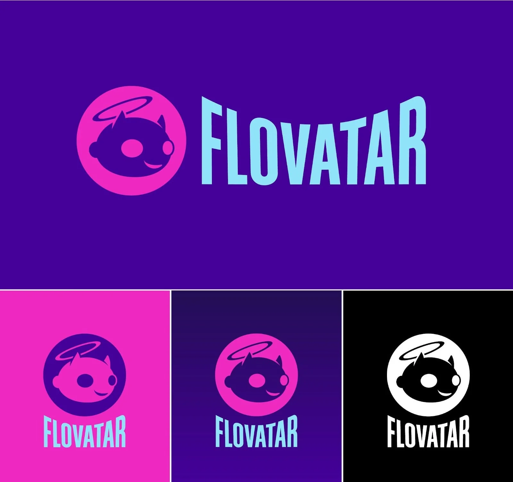<figcaption>Flovatar Brand Logo Images</figcaption></figure>

<figure class="img">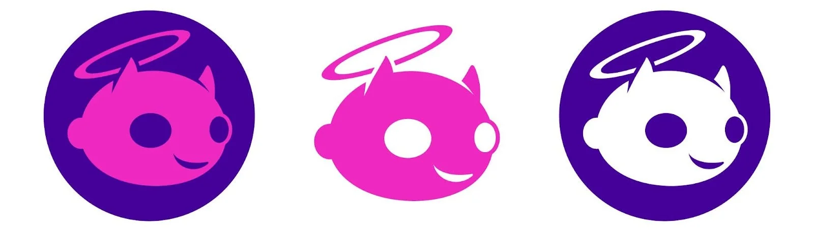</figure>

<figure class="img">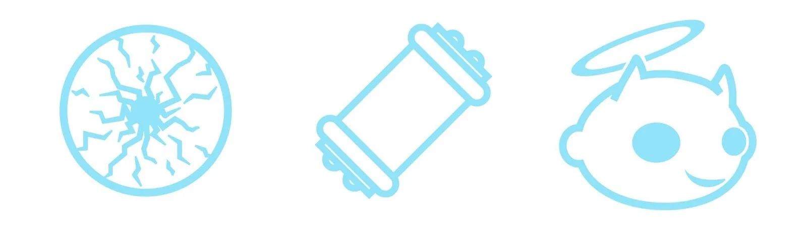<figcaption>Flovatar Brand Variations</figcaption></figure>

Now that we have such an awesome new logo, we decided to start the production of the first official Flovatar swag items and merchandise, starting of course with T-shirts and stickers.

**Stay tuned in [our Discord](https://discord.gg/flovatar) or [join our email list](https://flovatar.com/) for more info on this front!**

<figure class="img">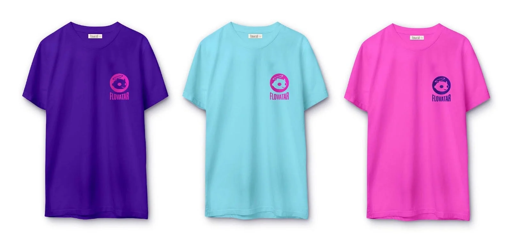</figure>

<figure class="img">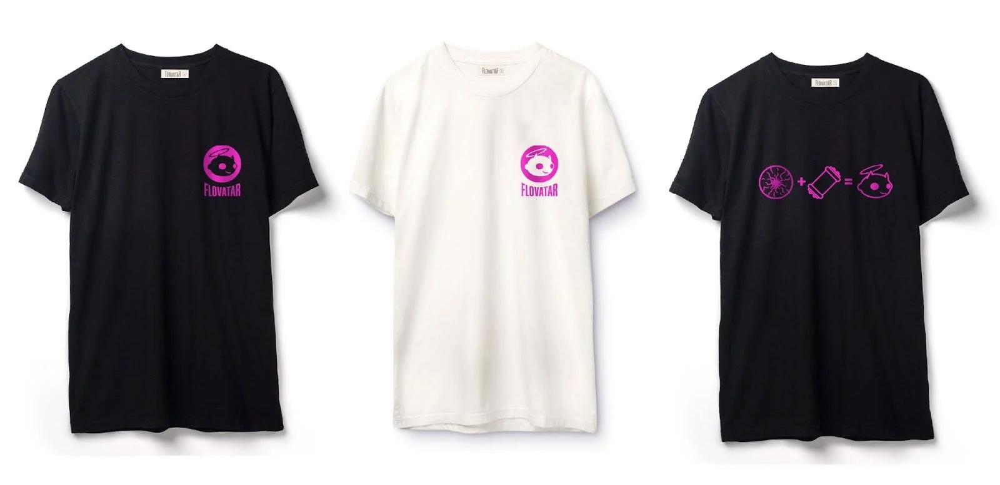<figcaption>Flovatar Swag T-shirts</figcaption></figure>

## Mobile Apps — Let the Fun Begin {#b29d}

We released an initial Flovatar app for iOS during the project launch last quarter, but that was just a teaser. Our team has been hard at work on both [iOS](https://apps.apple.com/us/app/flovatar/id1598146099?l=en) and [Android](https://play.google.com/store/apps/details?id=com.flovatar.mobileapp) apps for the past two months, and our first mini-game _Where’s Floldo_! is now live. **Please note:** this is still in the early beta phase, and we will keep iterating and improving it (sorry for the super long loading screen :) )

<figure class="img">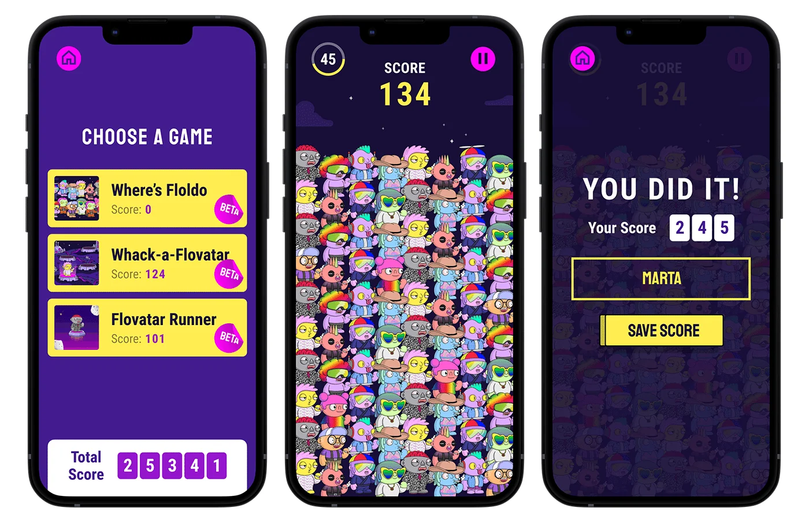<figcaption>Where’s Floldo Mini Game</figcaption></figure>

We will not sell you the narrative that the mobile app will be the next big thing after hot water. By now, our community knows well our _modus operandi_ — **underpromise and overdeliver**. In the beginning, the mini-games being released will be primarily casual ones. We know they will bring a lot of fun to your family and kids. That said, just because they are simple doesn’t mean we cannot add some additional layers of competitiveness and fun, like our scoring system.

Our primary aim is to release a suite of casual play mini-games accessible to all ages, so we can further foster a sense of competition within our community, as well as showcasing the breadth of experience we plan to build on top of our core NFT product.

This will also be a great way for us to illustrate the depth of our ambition for our IP to potential partners and collaborators. As usual, what we have shown here is just a subset of what we have in the works.

<figure class="img">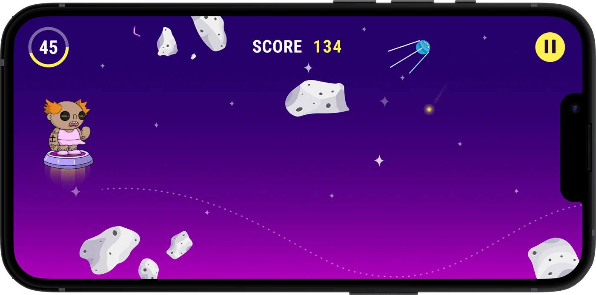<figcaption>Flovatar new Mini Game Example</figcaption></figure>

## 3D Designs — Metaflo {#f00c}

<figure class="img">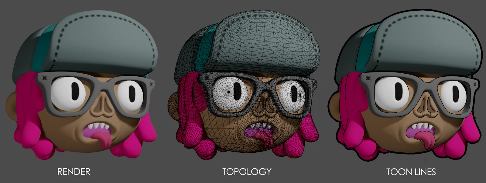<figcaption>3D Designs and Render process for Flovatar</figcaption></figure>

We have shared some previews with the community in the past few weeks, but we felt this was an essential update for everyone who missed the initial announcement. In addition, last month, we kicked off the 3D rendering workstream to allow any owner to download or export the 3D version of their Flovatars.

**The initial goal is to test out a modular system with 3D components for each Flovatar.** That way, similar to the current Builder, we can compose the final 3D rendering by combining components & Flobits, rather than trying to render ad-hoc each minted Flovatar. 3D printing or virtual rendering will likely be the initial use-cases, with metaverse integration coming soon after, once we can convert the output to be **compatible with the Roblox, Decentraland, MatrixWorld, or Cryptovoxels** of the world**.**

<figure class="img">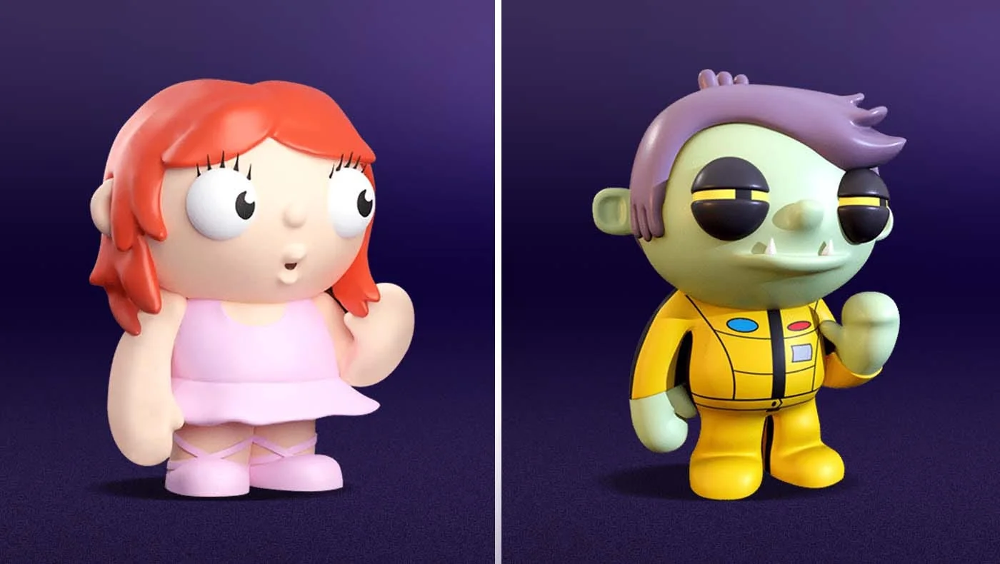</figure>

<figure class="img">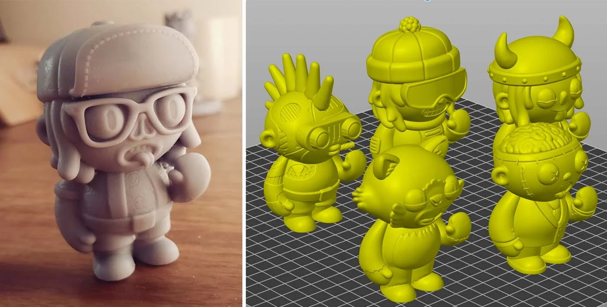<figcaption>Flovatar 3D Rendering Examples</figcaption></figure>

## Flobits 2nd Collection Updates {#6d90}

Flobits are standalone NFT accessories that can be applied to a Flovatar and taken off anytime. This is where true composability comes into play, fully on-chain and user-owned. The initial set of Flobits delivered over 100 different accessories. Still, we quickly noticed it wasn’t nearly comprehensive enough for the community to express the wide range of personalities of their Flovatars.

You will be delighted to hear that among the 50+ Flobits selected for the upcoming drop, there are a few super fun ones that we couldn’t resist sharing here:

- 3D glasses
- Dragon egg
- Gold chain
- Flow token and money stack
- Pacifier
- Racing helmet
- NBA Headband
- Wolverine hands

<figure class="img">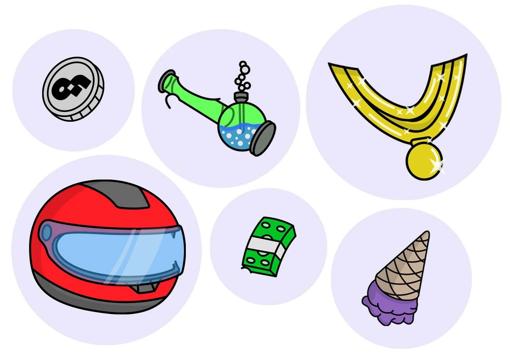<figcaption>New Flobits Accessories Collection</figcaption></figure>

## $DUST — The Connector of Cosmos {#9aac}

**We have saved the best for last!** Many of you have been waiting to get more details on the $DUST distribution. While the actual distribution details are pretty nuanced and require a deep dive by itself, we wanted to share with everyone the high-level picture of $DUST allocation to our community, Flovabank, and core team members.

Since day one, **the core philosophy of the project has been building an open and welcoming ecosystem, where most of the value will be accrued to Flovatars**, the netizens of this universe we are building together. In short, we want to truly create a community-centric ecosystem. One of the early signs of our commitment was granting full commercial licenses to all Flovatar owners.

_We want to take a step further with the $DUST token._

## $DUST Token Allocation

As you can see from the graph below, 40% of the total supply of $DUST will be allocated to Flovatars and their respective owners. They will be distributed daily to each Flovatar owner for free for the next ten years. However, the good news doesn’t stop there. We are allocating another 35%, combined, of the total supply to fund the development of the Flovatar ecosystem and all future initiatives, including much-needed grants to bootstrap different verticals (gaming, comics, products, IP deals, and more).

<figure class="img">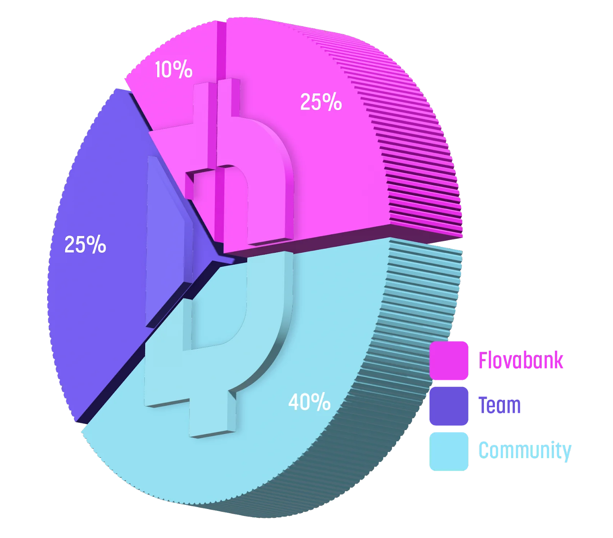<figcaption>Flovatar $DUST token allocation</figcaption></figure>

Currently, of that 35% allocated, 10% is put aside for VC fundraising, and the remaining 25% will be allocated to Flovabank, the community treasury. Please consider the breakdown as a relative reference. Depending on the market cycle of the coming months, the percentage of tokens used for fundraising might vary. The core objective is to ensure the treasury has enough stable assets to ensure project longevity. The funding raised will be entirely put into the development and growth of the ecosystem, including paying the salary of new team members we will hire.

Only 25% of the total supply will be allocated to the founding team members, with a lock-up period varying between two to three years and a one-year cliff (meaning nothing is distributed to team members until one year from now). We have seen too many projects launching lately with a no lock-up period or just a short time period of 4–6 months.

**With Flovatar, we will ensure no team members or investors will access token liquidity before the community does.**

## What’s Coming Next {#8564}

### Testnet $DUST

We will keep working on the $DUST smart contract and its utility resources (we already coded the Flovatar Inbox to distribute airdrops and the daily community DUST) and as we get closer to defining all the details we will make a proper announcement with a dedicated article.

### FlovaShop

Another area we will work very hard is the launch of the FlovaShop where both vendors and buyers can gather to create the best place and experience to browse through all the Flovatar related physical products.

### Narrative and animations

We can’t reveal much about this yet, but we’ve been working very hard to create a whole storyworld for Flovatar that will make it a proper trans-media experience full of surprises and twists, but more especially where your Flovatars will be the protagonists!

### Flovatar of the Week (FOTW) Competitions

We have exciting events regularly planned for our community, like Flovatar of the Week (FOTW) competitions, where we choose a particular theme and the community managers vote on who’s Flovatar aligns best with the theme. We share more information about these events in the #announcements channel in our Discord server. Enter your Flovatar to win some cool Flobits or other cool prizes!

### Flovatar Poker Showdown Event

We also do a Flovatar Poker Showdown, with the exciting guest DJ Jimboslicer throwing down some awesome tunes while going all-in on the poker game. You don’t want to miss this. Watch the #announcements channel in our Discord for more information.

### More Exciting Content Coming Soon

We are also launching new content on our blog, on our video and audio channels, and will be featuring interviews with special guests coming soon. We will notify our community members in Discord and via our email newsletter. So be sure to watch [Discord](https://discord.com/invite/flovatar), and [sign up for our email list](https://flovatar.com) if you haven’t already.
