## La creatividad es para todos, no sólo para los artistas

_“Todo niño es un artista hasta que se le dice que no lo es…_”, afirmó una vez John Lennon.

Nunca subestimes la diversión de lo no fungible porque la creatividad, y los juegos de palabras divertidos, son simplemente tu inteligencia en juego.

Tu creatividad es la clave para abrirlo todo.

### TL;DR

Todos los miembros de la comunidad Flovatar tienen la posibilidad de dar forma a su propio avatar NFT como quieran y de personalizarlo con increíbles accesorios Flobits. Ahora llevamos el mismo concepto a un nivel completamente nuevo y te damos la posibilidad de crear tu propia serie de NFT que formará parte de un Universo Flovatar más amplio.

Si no tienes experiencia en la codificación de contratos inteligentes, pero siempre has pensado en tener un papel más activo en el espacio web3 y expresar tu creatividad mientras te monetizas de ello, ¡ahora es el momento de actuar porque hemos eliminado todas las barreras para que puedas empezar!

Con el Flovatar TerraKit Land Pack te damos la plataforma de lanzamiento, la infraestructura y todas las herramientas para ayudarte a dar forma a la realidad del Universo Flovatar a través de tu propia creatividad y creación de historias.

<figure class="embed"><a class="yt" href="https://www.youtube.com/watch?v=gx0URojOZTM" data-yt="gx0URojOZTM">Play video: Introducing the Flovatar TerraKit</a></figure>

## Breve introducción

Como muchos miembros de la comunidad de Flovatar suponían, Flova Labs no sólo forma parte de la Búsqueda del Tesoro de Flovatar. Juega un papel muy importante para ayudarte a desbloquear tu creatividad y utilizarla para dar forma a mundos y realidades completamente nuevos.

Flova Labs está llevando el enfoque único orientado a los creadores al siguiente nivel, y revelando otra visión revolucionaria y ambiciosa que está sacudiendo el mundo de la NFT. Flova Labs está mostrando en última instancia todo el potencial de la creatividad cuando se aplica a la verdadera propiedad y la alineación de su objetivo.

**Nuestro objetivo siempre ha sido potenciar tu creatividad.**

Con el exitoso lanzamiento de Flovatar Genesis en diciembre, y nuestra reciente venta de Flobits S2 Pack, dimos a la gente la posibilidad de expresar su artista interior, proporcionando la capacidad de crear cualquier Flovatar único de la manera que quisieran.

Ahora, con el Flovatar Universe Builder (también conocido como FUB), estamos aplicando el mismo concepto, pero llevándolo al siguiente nivel al permitir que cualquiera pueda crear no sólo un único NFT, ¡sino todo un Constructor NFT!

**Obtendrás un constructor como el de Flovatar, pero incluso mejor porque podrás personalizarlo y crear lo que quieras, ¡incluso tu propia serie de NFT independientes!**

Los usuarios podrán utilizar su nuevo Constructor de NFT y minar tantos NFT increíbles al precio que tú decidas.

Por cada nuevo NFT minado con tu Constructor, recibirás el importe íntegro pagado por el usuario (excepto un 5% de comisión por transacción que vuelve a la Tesorería de Flovatar) directamente a tu criptomonedero sin ningún intermediario y de forma totalmente no custodiada, segura y transparente gracias al contrato inteligente.

### Experiencia de crear para ganar

En lugar de un derivado del mecanismo habitual de jugar para ganar, siempre nos gusta pensar fuera de lo común y por eso **estamos orgullosos de ofrecerte la experiencia definitiva de “crear para ganar”**. Pero nada te impide aprovechar el FUB para el puro placer y la diversión de crear con tus amigos o familiares.

Estamos totalmente convencidos de que esto dará lugar no sólo a una economía muy singular, sostenible y activa que recompense la creatividad, sino que también será la herramienta definitiva que permitirá a las personas dar vida a grandes ideas. En el pasado, o en otros proyectos de NFT, existía un enfoque centralizado de forma vertical que limitaba la creatividad dentro de un pequeño conjunto de parámetros, pero nosotros hemos eliminado todas las barreras para dejar que la creatividad y la propiedad corran libremente.

### Si puedes pensarlo o soñarlo, ¡ahora puedes hacerlo!

Nuestra misión es proporcionar las mejores herramientas para sacar el creador que hay en cada uno de ustedes, y que puedan ser recompensados por sus increíbles creaciones. Porque después de todo, como dijo Albert Einstein: _“¡La creatividad es la inteligencia divirtiéndose”!_

El Flovatar Universe Builder (FUB) es una pieza importante para el futuro de Flovatar, pero también está la tierra -las islas de asteroides residenciales sobre las que puedes construir y añadir tus nuevas creaciones NFT personalizadas- y el Flobot, que te ayudará a terraformar y sentar las bases de tu nueva sección del Flovaverse.

Descubramos lo que recibirás en tus TerraKits.

## ¿Qué hay en los Packs TerraKits de Flovatar?

<figure class="img">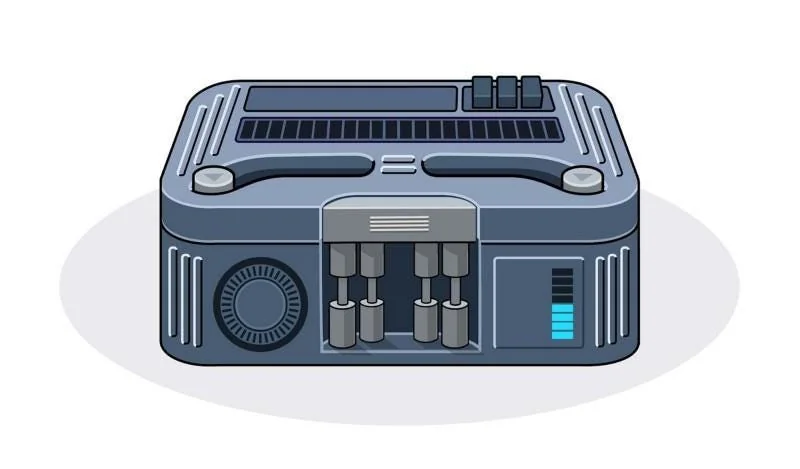</figure>

Cada TerraKit de Flovatar en el Pack de Tierras de Preventa incluye:

- **1 Isla Residencial de Asteroides:** Totalmente personalizable (al estilo Flovatar) que puede albergar al menos otros 5 NFT en ella (como los Flovatar de la serie 1, pero también cualquier otro personaje o edificio que esté disponible con el tiempo).
- **1 Flovatar Universe Builder (FUB):** Te permite crear la Serie NFT de tus sueños con al menos 25 ranuras diferentes disponibles para distintos rasgos y potenciadas por el impresionante y renombrado Flovatar Builder.
- **1 compañero Flobot:** Permitiéndote ayudar a colonizar y terraformar nuevos lugares. Podrás personalizar y minar completamente tu Flobot al igual que los Flovatars gracias al constructor personalizado y su selector de rasgos.

Para cada uno de los 3 componentes del pack (Isla, FUB y Flobot) tendrás la oportunidad de encontrar también niveles de rareza Épicos y Legendarios que desbloquearán más ranuras y rasgos.

<figure class="img">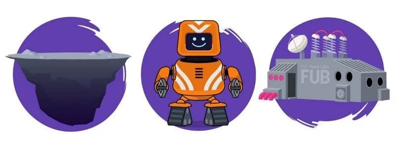</figure>

### El Constructor del Universo Flovatar (FUB, por sus siglas en inglés)

El FUB es el último invento revolucionario de los científicos locos del centro de investigación Flova Labs.

Ya que hacer el Constructor NFT más innovador no era suficiente, los científicos de Flovatar plantearon una idea que llevaría a una desafiante empresa para crear algo nunca antes visto: Un Constructor de NFT que te permita construir lo que quieras en lugar de rasgos, características y accesorios preseleccionados.

**Y así nació el proyecto con el nombre en clave de FUB.**

Después de miles de horas de retoques, pruebas y muchos fracasos, se creó una combinación ganadora para el FUB.

### ¿Cómo funciona todo esto?

Necesitamos más creadores que creen cosas increíbles para ayudar a construir y generar nuevas oportunidades para otros creadores con ideas afines. Para lograr estas nuevas creaciones, también necesitamos eliminar la empinada curva de aprendizaje para saber cómo comunicarse con los computadores y con las blockchains.

El concepto central del FUB es ofrecerte la oportunidad de crear tu propia serie de NFT sin necesidad de escribir una sola línea de código y con la ayuda de una de las mejores tecnologías que existen: **el Constructor Flovatar.**

Esta será la mejor plataforma para creadores de todo tipo (desde artistas profesionales aclamados internacionalmente hasta aficionados e incluso niños) para ofrecer una forma divertida y entretenida de crear e incluso vender tus propias colecciones de NFT con un control total de los activos, el número máximo de minados y el nivel de precios para cada rasgo diferente.

El Constructor Flovatar original es la increíble herramienta que permite a los usuarios minar su propio Flovatar de la forma que deseen para personalizarlo. Está estructurado con 7 capas diferentes para los distintos rasgos (Cuerpo, Ropa, Nariz, Boca, Pelo facial, Pelo, Ojos) y tiene 4 capas extra para los Flobits (Accesorios, Sombrero, Gafas, Fondo), ¡para un total de 11 capas de diversión y creatividad!

<figure class="img">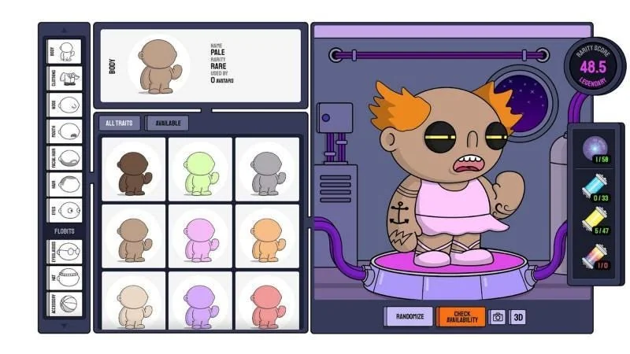</figure>

Ahora imagina un Constructor como éste, pero con todas las ranuras vacías y listas para ser llenadas por tu creatividad. Eso es lo que es el FUB en su esencia.

<figure class="img">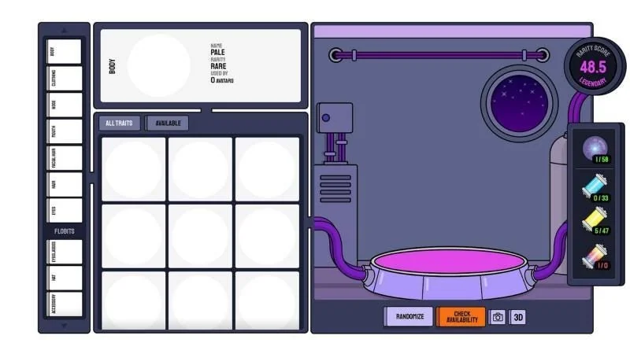</figure>

**¡Aquí es donde empieza la diversión!**

Al hacer clic en cualquiera de los elementos vacíos se mostrará un editor SVG personalizado en línea que te permitirá dibujar fácilmente cualquier cosa que crees utilizando la entrada del ratón, el tacto o incluso el lápiz. También podrás importar archivos SVG generados con herramientas profesionales, convertir JPG/PNG existentes en forma vectorial (aunque con ciertas limitaciones), o, para todos los verdaderos nerds, incluso escribir todo a mano ya que los SVG son archivos de texto después de todo. ;)

<figure class="img">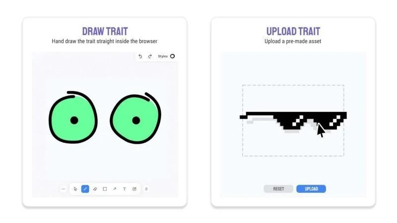</figure>

Una vez que hayas dibujado o cargado los rasgos, se guardarán en tu borrador de la Serie NFT, donde podrás previsualizar y probar en el Constructor en cualquier momento.

<figure class="img">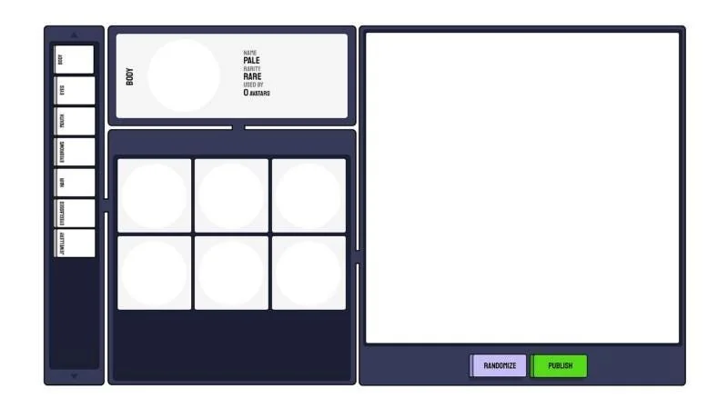</figure>

Para cada rasgo podrás elegir un precio específico en $DUST (**o potencialmente cualquier otro token también**) que te gustaría recibir de una venta, siendo el precio total de minado para el NFT la suma de cada rasgo seleccionado.

También podrás elegir un número máximo de minado para toda la serie de NFT y otros detalles importantes como los porcentajes de regalías.

Una vez que estés satisfecho con todos los rasgos y opciones que has creado, podrás transformar mágicamente, con un solo clic, tu nuevo NFT de FUB en un constructor de NFT de pleno derecho donde cualquiera puede utilizarlo para comprar tus impresionantes creaciones mientras se divierte jugando con las diferentes combinaciones que has creado.

### ¡Este es el máximo poder de creación!

Para garantizar la inmutabilidad y la estabilidad a todos los clientes que minen a partir de tus series, la operación de publicar tu Constructor NFT es absolutamente irreversible y no será posible modificarlo de ninguna manera ni volver a su estado anterior de FUB. Sólo tendrás la posibilidad de ampliar la colección añadiendo más rasgos a la misma, pero nada más. ¡Así que elige con cuidado!

### La interfaz web

El FUB incluye un montón de herramientas y utilidades que te permitirán extraer todo el gran valor y potencial que tiene para ofrecer.

Todas las series de NFT creadas con el FUB estarán listadas y disponibles para que todo el mundo pueda navegar y visitarlas en el sitio web de Flovatar, al igual que lo harías en cualquier App Store móvil.

La gente podrá venir a visitar tu isla de asteroides tanto desde una vista de mapa interactivo que muestra todo el cinturón de asteroides, pero también desde una vista de lista web sencilla y más accesible que destacará los proyectos más populares y que permitirá aplicar filtros adicionales.

Además, cada FUB tendrá la capacidad de ser rediseñado con un simple código CSS que se puede aplicar, o eligiendo entre una amplia gama de opciones que prepararemos para ti, de modo que se adapte aún más a tu concepto.

Por último, podrás incrustar el FUB en tu propio sitio web como una versión totalmente etiquetada que se integrará perfectamente con el resto de tu proyecto de forma fluida, sin necesidad de dirigir a las personas al sitio web de Flovatar si no quieres hacerlo.

<figure class="img">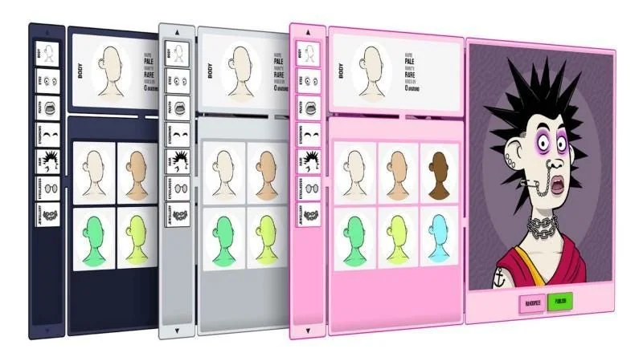</figure>

### El poder del FUB

Cada FUB estándar incluye un total de 25 ranuras de rasgos disponibles que pueden separarse en múltiples capas. Para dar un ejemplo de cómo se combinan las capas y las ranuras, imagina un FUB con 5 capas diferentes (como el cuerpo, la boca, los ojos, etc. para Flovatar) y que cada una contenga 5 ranuras por capa, terminarás con un total de ⁵⁵ = 5 x 5 x 5 x 5 = 3125 combinaciones posibles disponibles para tu serie NFT.

Así que por defecto, el FUB debería dar a los creadores más que suficientes combinaciones para experimentar. Sin embargo, si necesitas aún más variedad, tienes la posibilidad de fusionar dos o más FUB, de modo que las ranuras se sumarán y te proporcionarán exponencialmente más espacio para tu creatividad. Por ejemplo, la fusión de 2 FUBs diferentes que tienen 25 rasgos cada uno resultará en un único FUB más grande que tendrá 50 rasgos en total. Este proceso se denomina Actualización del FUB. Usando el ejemplo anterior de 5 capas, con ahora 10 ranuras por capa, tendrías 10x10x10x10 = 100k combinaciones posibles 😎.

Para darte una referencia, Flovatar Serie 1 tiene actualmente 517 ranuras diferentes, entre rasgos y Flobits, lo que resulta en más de 100 mil millones de combinaciones disponibles. Para replicar lo mismo con los TerraKits, necesitarás un montón de packs (21 para ser específicos). Sin embargo, nuestro generoso límite de fusión significa que puedes fusionar hasta 30 TerraKits diferentes, ¡lo que te daría un constructor con 750 ranuras!

Cada FUB estándar también incluye un número máximo básico de minado de 500 NFT para la serie que vayas a construir, y también se puede aumentar fusionando varios FUB.

Aquí encontrarás una tabla con los diferentes niveles de rareza que puedes encontrar en los packs o que puedes conseguir fusionando varios FUB.

<figure class="img">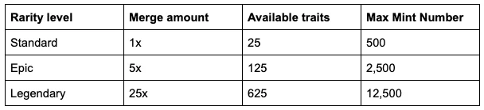</figure>

### Cómo construir tu isla de asteroides

Al igual que un Flovatar puede contener en sí mismo un Flobit accesorio, la Isla Asteroide estándar podrá contener hasta 5 NFTs diferentes, dándote la oportunidad de adaptarla a tu propio estilo individual.

Tu(s) Isla(s) Asteroide(s) será(n) tu hogar digital personal donde mostrarás e interactuarás con todas tus nuevas creaciones del Universo Flovatar. Puedes añadir Flovatares, por supuesto, pero también puedes añadir futuros NFTs de la serie $DUST, los Flobots, mascotas de compañía, casas, naves espaciales, ¡e incluso más gracias al FUB!

<figure class="img">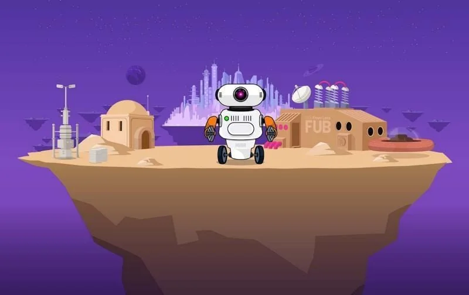</figure>

Al igual que el FUB, puedes fusionar varias islas para desbloquear muchas características ocultas aún no reveladas. El proceso se denomina Fusión de Islas.

<figure class="img">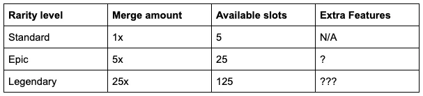</figure>

**En el futuro compartiremos más secretos sobre lo que ocurre cuando se fusionan las islas…**

Tu isla personal es también el lugar en el que vivirá tu Constructor NFT, así que cualquiera que la visite podrá tener una experiencia de diversión totalmente inmersiva minando NFTs de tu propia serie.

Al igual que con cualquier cosa dentro del mundo de Flovatar, podrás personalizar completamente tu isla para establecer el ambiente general como lo imagines. ¿Te gusta el terror? ¡Crea una isla con temática de terror! ¿Te gusta la fantasía? Crea una isla con temática de fantasía. Podrás elegir muchas opciones diferentes para la forma y el estilo, pero también decidir parámetros como los colores y el brillo.

**Dijimos que íbamos a potenciar tu creatividad, ¡y así es como puedes dar rienda suelta a esa creatividad!**

Terraformar una nueva isla de asteroides puede ser un trabajo duro, así que hemos querido echarte una mano con tu nuevo compañero robot llamado Flobot.

## El Flobot

¡Si eres nuevo en Flovatar, puede que no hayas experimentado el Constructor de Flovatar original, así que queríamos darte la oportunidad de probarlo dándote la oportunidad de crear tu propio robot ayudante hecho a medida en tu(s) isla(s) llamado Flobot!

En cada paquete de TerraKit encontrarás un “Kit de Constructor de Flobot”, que será muy similar a las Chispas de Vida que se utilizaron para minar nuevos Flovatars en los paquetes de la Serie 1 que se agotaron en diciembre de 2021.

Estos simpáticos, locos, divertidos, terroríficos o como quieras que sean Flobots, serán tu asistente oficial en el Flovaverse y estarán encantados de ayudarte con el mantenimiento diario de tu(s) isla(s).

<figure class="img">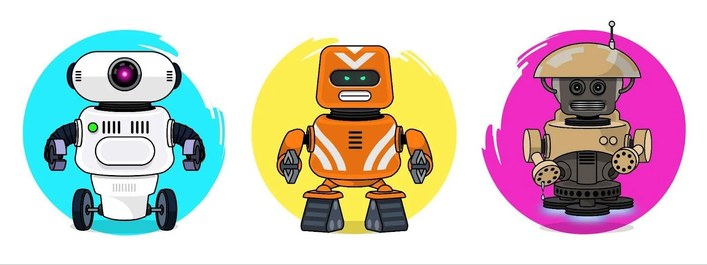</figure>

Aquí encontrarás una tabla que muestra las posibilidades de conseguir cada nivel de rareza para el Kit de Constructor de Flobot.

<figure class="img">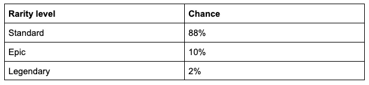</figure>

Hemos oído algunos rumores que dicen que algunos rasgos especiales de rareza desbloquearán nuevas capacidades y funcionalidades también en relación con la Isla, pero Flova Labs se niega a confirmar o desmentir tales acusaciones por el momento ;)

## La visión general

Tendremos muchas nuevas islas de Flovatar creadas a partir de los TerraKits, pero ¿qué les deparará el futuro? En el centro de este cinturón de asteroides flotantes, que proporciona la atracción gravitacional y evita que se pierdan en el espacio, se encuentra la principal isla comercial llamada Nova City.

El Universo Flovatar tendrá todas las islas residenciales flotando alrededor de una isla comercial principal que actuará como eje del multiverso. Nova City albergará las principales marcas y proyectos NFT de la franquicia Flovatar, además de otras cosas súper secretas.

Los detalles de Nova City y su estructura se revelarán más adelante, pero los propietarios de las islas residenciales que flotan alrededor de ella tendrán los primeros derechos de saber cómo esta isla central desempeñará un papel crucial en el Flovaverse y cómo formar parte de él.

<figure class="img">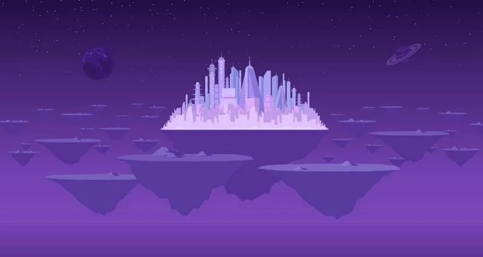</figure>

Nuestra visión es que puedas recorrer, interactuar y experimentar un impresionante mundo digital compuesto por increíbles creaciones artísticas realizadas por la comunidad. Podrás experimentar todas las coloridas, impredecibles y extravagantes creaciones que tú y la comunidad elaboren para poblar este nuevo sector del Flovaverse.

**Esto es algo mucho más grande de lo que cualquier enfoque vertical podría lograr.**

### Algunos ejemplos de uso de este nuevo sector del Flovaverse

Vemos claramente un gran potencial creativo en este nuevo archipiélago flotante habitado y en la revolucionaria tecnología FUB que albergará cada isla. Para ello, hemos destacado algunos ejemplos de cómo esto podría alimentar diferentes posibilidades creativas:

- Artistas profesionales que quieran lanzar su serie de NFT pero no tengan los recursos o conocimientos técnicos para desarrollar un contrato inteligente personalizado, o simplemente porque les encanta nuestro enfoque único con el Constructor.
- Proyectos de cualquier tipo (tanto cripto como no cripto) que quieran dar capacidad creativa a los miembros de su comunidad para dar forma a sus propios avatares únicos y participar de una manera mucho más divertida y colaborativa
- Marcas de renombre mundial que quieran posicionarse en nuestro único y exclusivo espacio digital y utilizarlo como plataforma para promocionar sus productos gracias a nuevas y frescas formas de relacionarse con el público (imagina “Construye tus propias Nike Air Jordan”, por ejemplo)
- Cualquier artista amateur que simplemente quiera escapar de la gris monotonía de nuestra vida digital como consumidor, y convertirse en un jugador activo y un creador que exprese libremente sus ideas de cualquier manera gracias al FUB
- Niños que quieran divertirse y compartir su propio Constructor NFT con sus amigos y familiares.
- Desarrolladores web que quieren explorar la madriguera del conejo de los estándares SVG y ver hasta dónde se puede llegar aplicando filtros especiales y creando visuales generados por puro código
- Inversores privados que quieran asegurarse múltiples islas para fusionarlas en un mega parque de atracciones donde las personas podrán minar series creadas por artistas famosos a los que podrían contratar o colaborar
- ¡Y mucho más! ¡Si tienes una idea creativa déjala correr libremente y únete al Flovaverse!

Estamos seguros de que aparecerán muchos más casos de uso de forma orgánica a lo largo del camino, y podrás idear tantas formas únicas de utilizar las Islas Flovatar, el FUB y los Flobots de maneras que nunca podríamos haber imaginado. Si hay una cosa que hemos aprendido de nuestra corta pero intensa experiencia con Flovatar hasta ahora, es que el enfoque ascendente y distribuido vence al enfoque descendente y centralizado sin lugar a dudas.

**Siempre ayudaremos a dirigir y guiar a nuestra comunidad hacia una experiencia mucho más amplia y diversa que sea realmente única, innovadora y que te proporcione los poderes para liberar tu creatividad.**

## Números y detalles del lanzamiento

Durante esta preventa, distribuiremos solo 5.000 packs de TerraKit de Flovatar Land del total de 20.000 que se minaran, a un precio especialmente rebajado a la mitad en comparación con la venta oficial principal que se producirá una vez que esté completamente construido en el 1er/ 2do trimestre de 2023. Distribuiremos un primer lote de 2.500 paquetes en un primer lanzamiento que se anunciará en los próximos días, y guardaremos otros 2.500 para un segundo lanzamiento en las próximas semanas después de eso.

La participación en la preventa no sólo te garantizará un descuento del 50%, sino que también te permitirá participar activamente en el desarrollo de las herramientas y la interfaz de usuario, de modo que se adapte al máximo a los deseos de la comunidad.

**Así que actúa rápido para conseguir el descuento del 50% ahora o pagar el precio completo más adelante.**

El Flobot estará disponible desde el día 1, mientras que el FUB y los componentes de la Isla del pack serán un Bono NFT que se podrá canjear y transformar en la forma final a medida que estén disponibles en los próximos meses:

- Kit de Constructor Flobot — septiembre de 2022
- Isla de asteroides — tercer trimestre de 2022 / primer trimestre de 2023
- Constructor del Universo Flovatar — T1 / T2 2023

Puedes inscribirte para recibir notificaciones sobre cómo reclamar tus packs aquí.

### PERO ESPERA, ¡HAY MÁS!

**¿Recuerdas que reservamos unos cientos de paquetes de la Serie 2 de Flobit para una iniciativa especial? ¡Aquí está el regalo para nuestros principales seguidores! Por cada paquete de TerraKit que compres obtendrás un paquete de Flobit Serie 2 gratis, igualando la cantidad total de paquetes de Flobit Serie 2 que hayas comprado en el pasado.**

**Por ejemplo, si has comprado 3 paquetes de Flobit Serie 2 y compras 3 o más paquetes de TerraKit, ¡recibirás 3 paquetes adicionales de Flobit gratis!**

<figure class="img">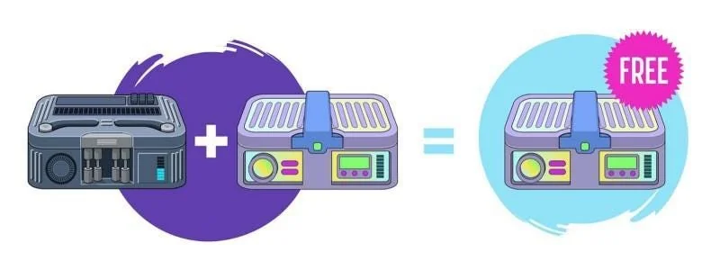</figure>

## Cómo empezar

Para asegurarte de que no perderás tu lugar en la cola de la preventa de los TerraKits, puedes ingresar aquí para conectar tu monedero y suscribirte al boletín de Flovatar.

**Asegúrate también de unirte al Discord de Flovatar porque muy pronto daremos a conocer más detalles como el precio y la fecha de lanzamiento, ¡y habrá muchas oportunidades de poder conseguir un pack GRATIS también si tienes suerte!**

## Hacia dónde vamos

En los últimos 8 meses desde nuestro lanzamiento de Genesis en diciembre de 2021, hemos escuchado a muchas personas decir lo mucho que les hubiera gustado hacer su propia serie NFT usando nuestra tecnología. Muchos proyectos pidieron replicar lo que habíamos hecho, marcas y empresas, e incluso artistas que se sentían atraídos por nuestro enfoque único buscaban replicar nuestro mecanismo de construcción.

Ahora, con la preventa de Flovaverse Land, queremos dar una respuesta ofreciendo una solución a todas esas peticiones y estamos deseando que el público empiece a jugar con ella cuando se lance oficialmente en la red principal de Flow a principios de 2023.

Estamos seguros de que nuestra creatividad superará nuestras más salvajes expectativas, ¡como siempre lo ha hecho en el pasado!

## Contando un nuevo tipo de historia

Ya han empezado a surgir destellos del mundo de las historias de Flovatar, y con el tiempo se irá revelando más de ese mundo. Sin embargo, a diferencia del modelo tradicional de narración en el que el público es un mero consumidor pasivo, nuestra historia será contada en gran parte por ti.

Todas las formas de vida del Flovaverse conocido dependen de la misteriosa fuente de energía conocida como StarDust, y StarDust depende de tu creatividad. De hecho, el StarDust no sólo es esencial para la vida actual, sino también para la creación de vida.

Imagina el Bar Cantina de La Guerra de las Galaxias, en el que todas las formas de vida extraterrestre habían sido creadas por diferentes miembros del público, o el Replicador de Star Trek, que los espectadores podían utilizar para insertar objetos directamente en el episodio a medida que se desarrollaba, ¡entonces puedes empezar a imaginar nuestra visión del Flovaverse!

¿Quieres crear plantas y fauna exóticas para tu isla de asteroides? ¡Entonces enciende tu FUB y créalas! Una vez que hayas terminado, tus vecinos pueden visitarte y pagar por usar tu FUB para hacer plantas para sus propios asteroides.

¿Quieres crear una especie completamente nueva nunca vista en el Flovaverse? Entonces pulsa el interruptor de tu FUB y ponte a trabajar. Nuevos accesorios, casas, mascotas, naves espaciales; dondequiera que su imaginación valla su FUB le ayudará a hacerlo realidad tanto para usted como para todos los demás habitantes del Flovaverse — ¡ninguna idea es demasiado loca!

Puedes inscribirte para recibir notificaciones sobre cómo reclamar tus packs aquí.
