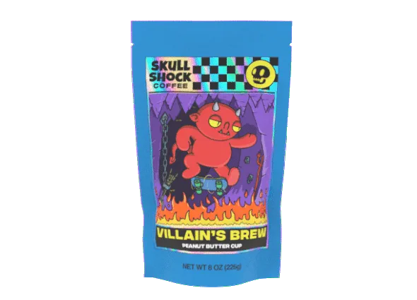
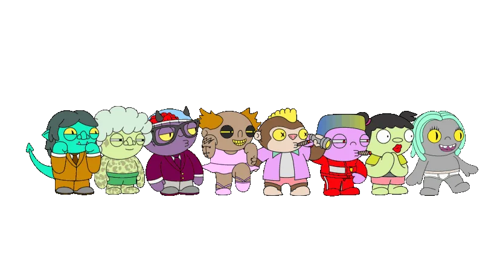
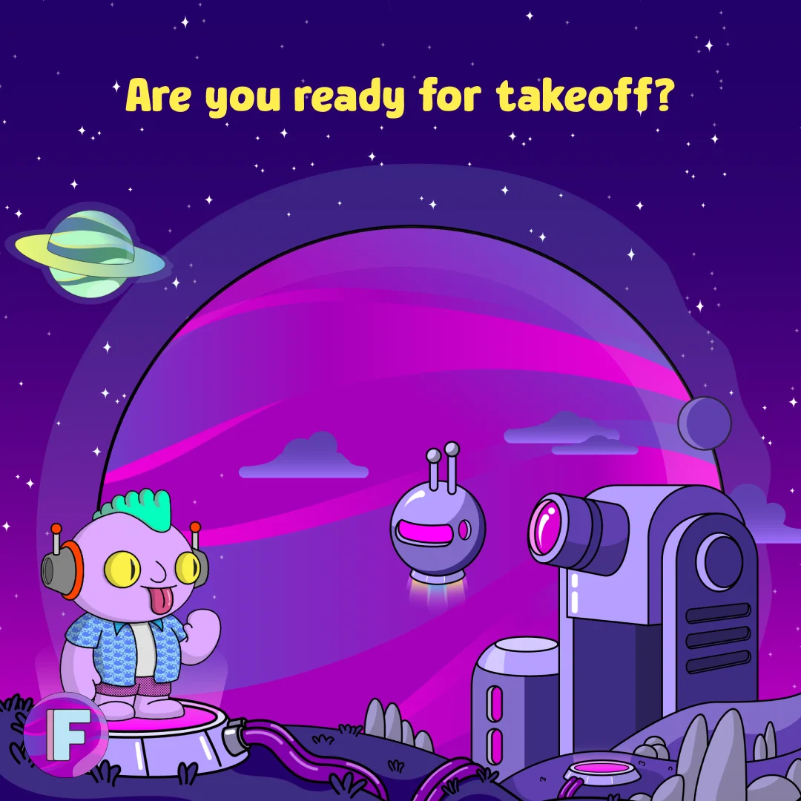

It has been a month since we officially launched the [Flovatar](https://flovatar.com) project. Within this short period, we successfully deployed a fully functional non-custodial marketplace, published a mobile app on the AppStore, completed our first special airdrop to all minted Flovatars, witnessed the Sparks floor raise more than 5x, and even had a coffee brand collaboration spearheaded by some of our community members. It is fair to say a lot has happened, yet it is just the tip of the iceberg compared to what we have planned for 2022. This is where the journey truly begins.

<figure class="img"></figure>

As we start preparing for the 2022 roadmap, it seemed the right timing to share with everyone in the community the vision we have for the future of Flovatar.

Before jumping into the main section, we also wanted to redefine what Flovatar is about. In our previous communications, we referenced [Flovatar](https://flovatar.com) as a PFP project. However, we felt it was a bit restrictive given how dynamic and rich the project is from the start. We see [Flovatar](https://flovatar.com) as an evolving ecosystem that will ideally bridge the gap between Web2 and Web3. It is also a bold take on IP creation and shared ownership. We envision a future spanning gaming, consumer goods, entertainment, education, and metaverse.

Of course, we could promise you the moon all we want, but if we cannot get the spaceship built or the fuel needed to get there it is all just smoke and vaporware. That is why the first major topic we would like to cover is how we are going to fund all the initiatives we have planned.

## Treasury

We have a long-term vision for Flovatar and that is why we are putting the money where our mouth is. 60% of the entire project revenue, including past and future drops and the ongoing 5% marketplace fee, will be allocated to the project treasury, the FlovaBank. FlovaBank is the wallet that holds the treasury of the project and one day it will be ultimately managed by the community via the DAO. The mandate is to finance initiatives that will help the Flovatar ecosystem grow or elevate the branding and prestige of the project.

The treasury will be used to cover the costs of production of new art pieces (Flobits, future series, and much more), salaries for new team members or collaborators, and more importantly, to finance community-driven projects that will help grow the project, positively enrich the ecosystem and bring value added benefits to all Flovatar owners.

Some examples of ecosystem initiatives that we would like to help bootstrapping include the creation of comic books using a selection of Flovatar characters, animated mini-series (e.g. South Park), educational content (e.g. Once Upon a Time anatomy series), 3d models that can be printed by anyone at home or brought over into multiple metaverses.

FlovaBank will be used also to fund collaborations with external projects, artists or blockchains, and anything that might ultimately benefit the [Flovatar](https://flovatar.com) project as a whole. In the early stage, it is likely the core team will share a series of initiatives for Flovatar owners to vote in Discord, where a minimum of 5% of total owners vote is needed to validate the proposal and the majority of votes being in favor to pass. Over time, we hope the DAO can fully manage end-to-end all the initiatives.

## Flobits

Flobits play a vital role in the [Flovatar](https://flovatar.com) ecosystem. Currently, they allow owners to give their Flovatars a whole new dimension and richness. Another advantage is Flobits allow owners to update the look of a Flovatar over time based on their personal preference, seasonality, or trend without having to create another derivative project.

While all that might already exceed what most PFP projects would offer, the truth is there are many more utilities we haven’t revealed yet behind Flobits. Below is a peek into some of upcoming developments we have planned.

## Gaming

Gaming is going to be one of the first strategic initiatives that we are aiming to kick off with a FlovaBank proposal. However, we have seen too many projects promising blockbuster, AAA style games that end up taking years to deliver and most likely still come below the expectation. For context, a traditional AAA game takes approximately $100+ million to produce. That is why for Flovatar we would like to take a different approach of delighting early on and then progressively deliver richer experiences.

The first few games released are going to be the very simple, leisure type, purely for fun purpose only and likely won’t have any utility embedded. In parallel, we are also planning to commission a few games in the mid-term that will incorporate Flobits as part of the game-play. The inspiration for these games is going to be retro arcade style: games that are simple to play yet hard to master.

## Upgrading Mechanism

A few concerns were raised from the community regarding the Flobits supply. While it is our intention to empower a healthy economy in the long run with scarcity in mind, we wanted to also share a bit of our philosophy.

The majority of Flobits should be easily accessible and relatively affordable to most Flovatar owners at the beginning of each collection drop. That is because fun and creativity are foundational components for [Flovatar](https://flovatar.com) and Flobits play a big role in enabling all of that. At the same time, we are aware that the curation process might not be perfect and not every Flobit released will have similar popularity. So while we want to keep the supply relatively broad during each drop, especially with common Flobits, we want to also provide a way for the community to select over time which ones are worth keeping.

That is why we are planning to introduce an upgradeability feature for all Flobits. The way it works is allowing same tier Flobits to be merged together (burned) in order to produce a higher rarity tier Flobit. The resulting new Flobit would come from new designs, so they won’t impact the existing higher tier Flobits. It is still work in progress so details are subject to change, but just as an example, one might need to merge 10 common Flobits + $DUST in order to generate a new rare Flobit. Similarly, to generate a new epic Flobit, one would need to merge 10 rare Flobits + $DUST and so on. This mechanism will provide the community a curation mechanism and an opportunity to obtain higher tier Flobits that doesn’t involve trying to liquidate on the marketplace the undesired ones.

<figure class="img"></figure>

## $DUST

We want to preface by repeating that the project is only one month old. This means there is a lot that still needs to be planned out properly and important components like the $DUST token cannot be rushed. We are aware the community is eager to learn more about the token model, so we will try to share some high level thinking. However, please bear in mind this is far from the final draft and many details might change along the way. One thing is certain, most of the value will be accrued to Flovatars.

At high level, each [Flovatar](https://flovatar.com) will qualify for $DUST distribution on a recurring interval basis. It is likely we will design for the distribution to last between 5 and 10 years. In addition to a flat amount, there will be some additional multiplier factors determining the total amount each [Flovatar](https://flovatar.com) will receive periodically. One of these factors that we have previously confirmed is the rarity score. It is not certain, but likely there will be few other factors that might be applied as extra bonus that are yet to be discussed. The ultimate goal is to design the incentive in a way that ultimately benefits the ecosystem and economic stability in the long run.

We want to also briefly mention the various utilities we have planned so far. The good news is that the [Flovatar](https://flovatar.com) ecosystem is an ever growing one, which means as new experiences are built on top of new, there is high likelihood new token utility will be introduced too. In no particular order, below are some of token utility for $DUST:

- Naming the Flovatar
- Creating a bio for the Flovatar
- Flobits upgrade mechanism
- Flovatar 3D upgrade mechanism
- Special swag purchases
- Participate in the Ultimate 1/1 Flobit auction
- Metaverse/gaming unlocks
- DAO voting participation

## DAO

Flovatars are the real founders of the [Flovatar](https://flovatar.com) World and for that reason they will always have guaranteed rights to vote in any DAO proposal. All minted Flovatars will have equal voting power, regardless of the rarity tier; after all, we are all equals when it comes to rights and decision making.

Additionally, $DUST owners will gain additional voting rights based on the amount of $DUST held. The rationale is that the token will allow the project to expand participation to a broader audience, allowing new members to participate in the decision making. It is likely we will consider a qualifying holding period in order to avoid short term manipulation.

We have successfully integrated the [Emerald Bot](https://github.com/jacob-tucker/blocto-auth-discord-bot) in our Discord server to allow Flovatar owners the ability to verify their status and access exclusive sections and channels. This will allow a more representative voting in Discord, until the proper DAO smart contract will be ready.

We don’t want the DAO discussion to be taken lightly and we really want to think through how we will handle the transition from the current state to a fully autonomous setup. It won’t be easy and there will be a lot of trials and errors along the way, but we will definitely work very hard to implement it in the best way possible.

<figure class="img"></figure>

## Marketing and Commercial Rights

Marketing is going to be a key focus for us in the coming months as the project grows. We will kick off an official job position as Marketing Director to help us launch various marketing initiatives and grow the project awareness across a much larger audience.

As mentioned earlier, we will use the treasury from the FlovaBank to seek potential collaborations with other projects, artists and influencers, integrate with key metaverse platforms and possibly bridge the Ethereum side too. All these initiatives will provide us many promotional opportunities to reach a broader audience.

Another key area of focus is going to support and amplify upcoming community projects to show how thriving our ecosystem is. We are also planning to build tools like a meme generator that could help us generate social buzz and show a glimpse of our community creativity.

Finally, another area that we will actively be looking towards, is the potential collaboration with other brands to eventually create branded Flobits collection drop. The opportunities are limitless and we welcome any community suggestion or collaboration.

## Conclusions

As you can imagine 2022 will be a year packed with updates, challenges, and many other surprises we haven’t mentioned in this article. Our approach is to show by action and often prefer to under-promise and over-deliver. That is why sometimes we find it a bit challenging to decide what we feel confident sharing in advance.

At the same time we thought it was important to keep the community informed and share the vision we have for [Flovatar](https://flovatar.com) in the long run. There are so many initiatives we want to launch with you all and we can’t wait to see what our growing community will also come up with by their own initiative. If what we have seen so far is of any evidence, there is so much creativity waiting to be unlocked.
