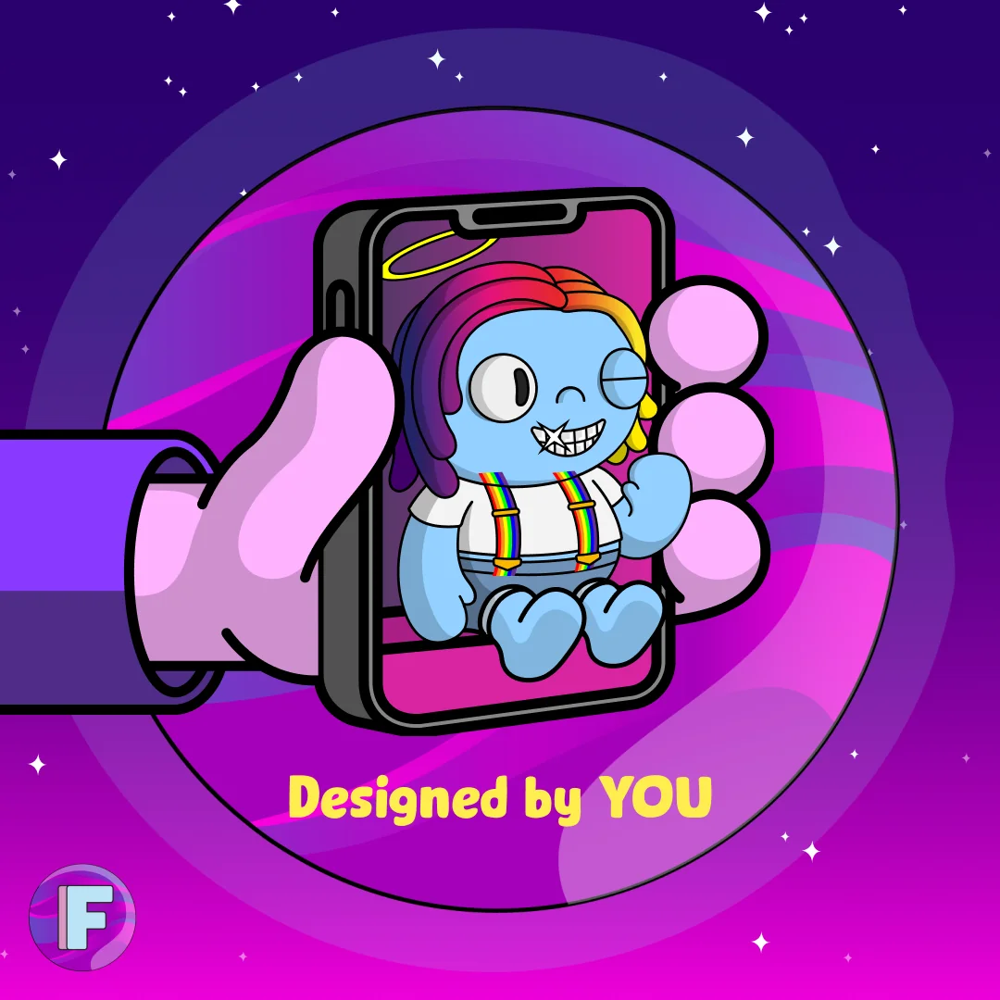
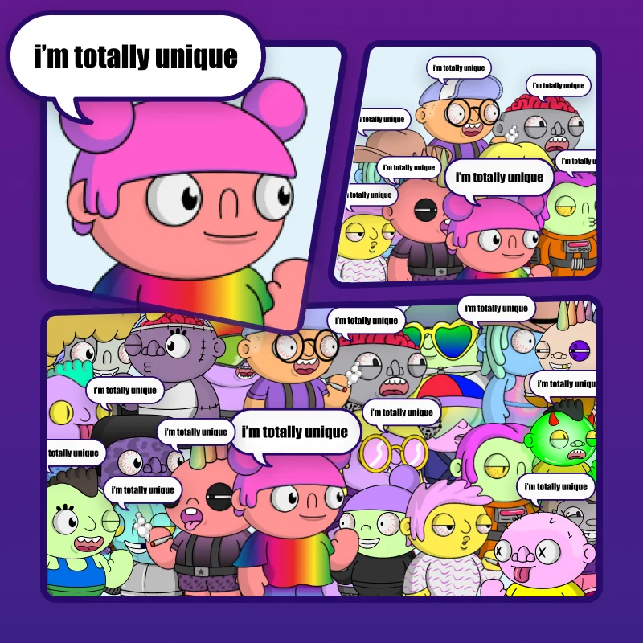
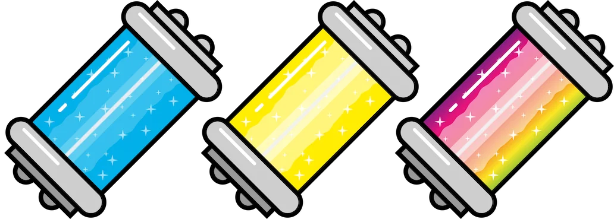
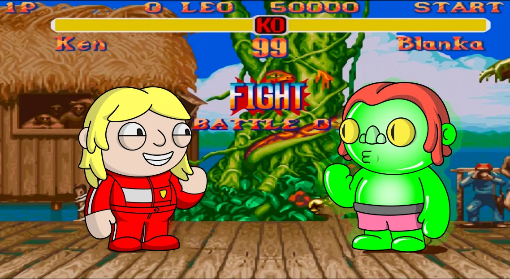
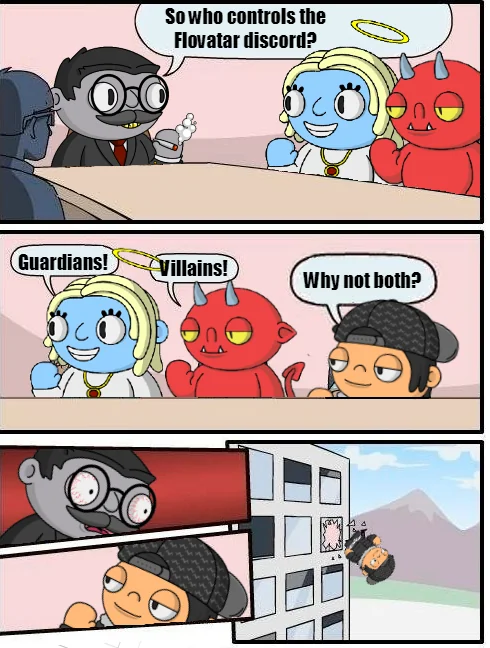
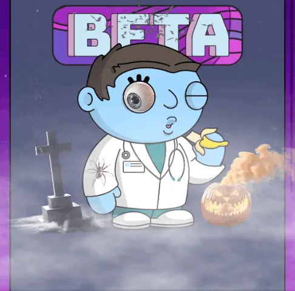
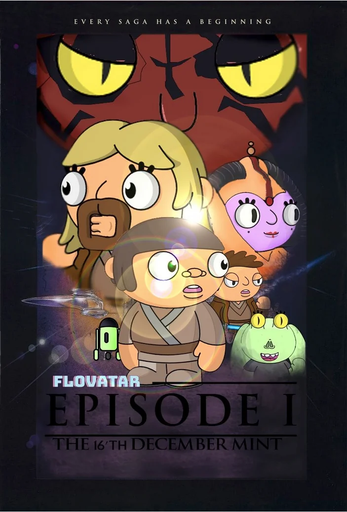
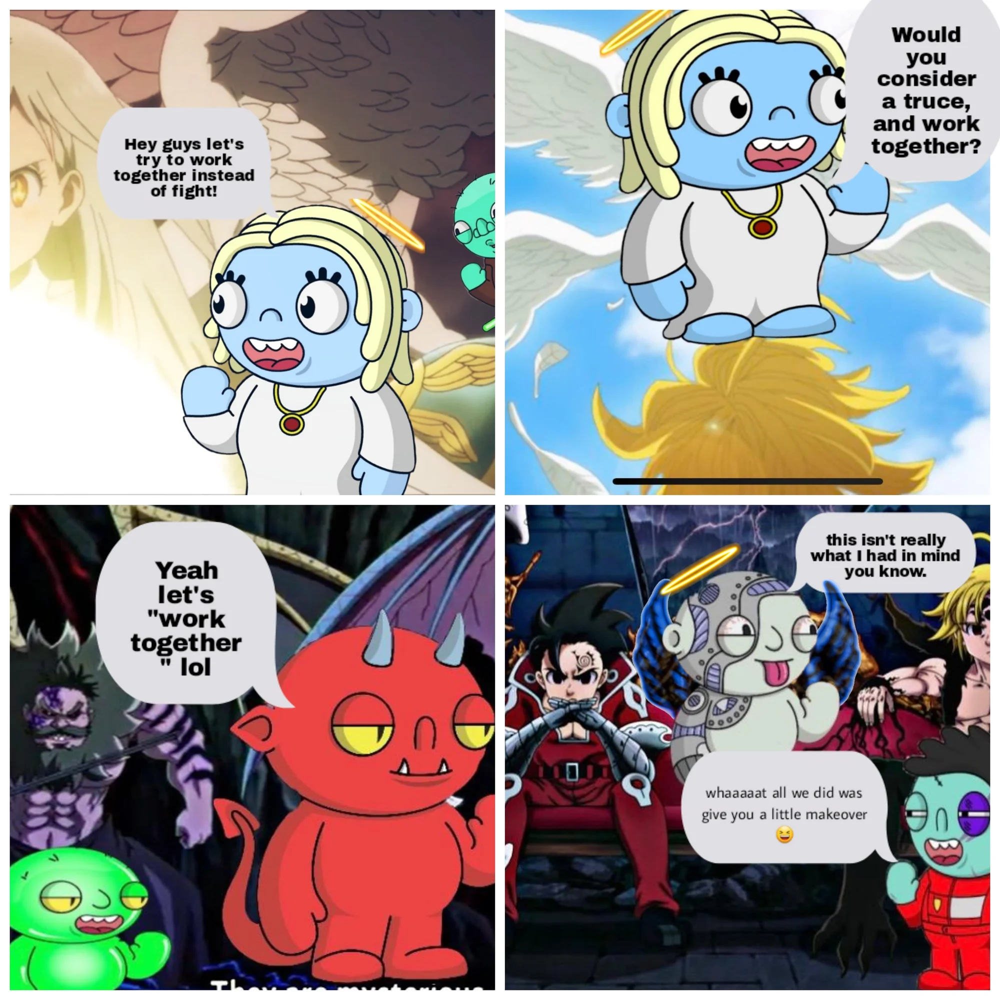

## Flovatar — to Mint or not to Mint

First, wow. What an incredible response from the community as we get close to our December 16th mint date. After just 3 weeks from the announcement Discord is at 7k already and climbing fast!

Today we wanted to talk a bit more about the different layers of gamification behind the Flovatar design. For us, the whole point is to make things just a bit more fun than a simple PFP minting. However, before jumping into the details of how it all works, we wanted to let you in on the story behind the idea to launch Flovatar and the central role you all, our beloved community, will play post-launch.

As you know, only 9,999 can be minted in the genesis series and each of them come with superpowers:

- Commercial rights license to your own Flovatar (swag, toys, or movie deals anyone?)
- 1% lifetime royalty for each secondary trade to the original Flovatar creator (you)
- Early access to Stardust token ($DUST) and DAO participation
- Future airdrops, exclusive swag, and many surprises to come

<figure class="img"></figure>

## Short Manifesto

Flovatar is a bold experiment that believes the essence of creativity is inside all of us, waiting to be unlocked and it really only takes the smallest amount of guidance and framework for a resourceful community to take off to an unprecedented level.

We have seen the building blocks of digital ownership starting to take shape, thanks to many bold visionaries in the crypto and NFT space who paved the way for us. NBA Top Shot showed it is possible to onboard mainstream consumers to Web3 with its seamless user experience and BAYC shocked the world on what a truly committed community of fewer than 10k members could achieve if each of them felt they were co-owners of the ecosystem and captain of their own _apestiny_. (Each BAYC NFT owner has a full commercial license to their Apes).

Flovatar is a bold experiment building on top of these learned experiences, it is a homage to Web3 and the people who believed in this new era. It is a bet on the power of thousands of minds working in parallel together, unlocking way more opportunities than any single or group of artists could ever fathom. The belief that each of you might have specific insights on the potential for each Flovatar that we could not have even imagined.

Flovatar is a community of individuals. The source of strength lies in the reciprocal support, a unified front to any adversity, and the success will come from the ingenuity, creativity, and resourcefulness of each member; you.

Together we shall raise and individually shine.

<figure class="img"></figure>

## What to Mint

Differently from many traditional PFP projects, Flovatar allows each participant almost unlimited freedom, more specifically over 3 billion possible combinations. For us, this means decisions you might consider when minting might include:

- Minting a Flovatar that speaks to you
- Maximizing rarity traits for possible collectibility
- Selecting a Flovatar that might be popular with different audiences
- Choosing to maximize uniqueness (e.g. least used components combo)

It is important to note that each Flovatar has seven core component categories that will make them unique and are immutable on-chain once minted: Body, Hair, Eyes, Nose, Mouth, Facial Hair, Clothing. Each combination is unique and enforced by the smart contract, which means once minted no other participant can create another Flovatar with the exact same combination.

While the core components are immutable once minted, Flobits are individual NFTs that can be applied to each Flovatar to augment and enrich the character: hat, eyeglasses, accessories, and more. There is a rumor there might be a few special modifiers in the future, after all, even heroes and villains need an alter-ego to get some rest. It is also true about the opposite, there could be few hidden supernaturals among you.

<figure class="img"></figure>

## When to Mint

With Flovatar, when to mint might play an equally crucial role. Below are a few things to pay attention to:

- Minting as early as possible to lock in desired combination (there is no certainty in tomorrow)
- Trying to acquire the right combination of Rarity Boosters or even the highest rarity for all components (a seven legendary components Flovatar?)
- Waiting to see which combinations will yield the most unique Flovatar in terms of diversity
- Holding onto the Spark because it is just so beautiful and mysterious

As our beloved and most likely under-appreciated then teachers used to say, it is never too early to start your homework. You probably don’t want to just wing it on this one.

## What in the Flobits is going on here

We’ve introduced Spark and Rarity Boosters, but remember — there are also the Flobits!

Flobits are the interchangeable components that give your Flovatar it’s ultimate look and distinctive design.

Unlike the Flovatar traits where each trait is limited by the amount of rarity boosters which anyone can have (so in theory there could be 350 different Rainbow superheroes), Flobits will have a limited number available for mint by design. So even if many people can get a specific type of clothing for example, very few of them will be able to get the final special accessory that will complete the full set for a given character (think like a knight with or without a sword).

During the initial drop Flobits will play a smaller role because we want people to concentrate on the Flovatars themselves, but we will be releasing a number of updated Flobits following the genesis drop. The cool thing about Flobits, though, is you can change them as much as you want. You might add a Christmas hat or Halloween costume and then switch it back later.

Oh, and one more thing — in addition to the Hat, Eyeglasses and Accessories, there’s one final special Flobit that you don’t even know about yet…

<figure class="img"></figure>

## Commercial Rights and Infinite Possibilities

We briefly mentioned in the previous blog that while the Flovatar project entity owned the IP rights, each Flovatar owner will be granted a full commercial license lease to their Flovatar. With that lease they will be entitled to 90% of all commercial revenues and only the remaining 10% will be allocated to the DAO to be used to grow the ecosystem further.

Each Flovatar owner will be the master of their own _flovistiny_. Any member or a group of the community could decide to pursue potential collaborations, IP deals, or build their own content with full confidence. Below are just some of the many possibilities for the Flovatar Universe:

- Animated series
- Comic books or webtoons
- Games and metaverse
- Apparel and sneakers
- Toys and swag

While the opportunities are endless, the bootstrapping part is never easy. That is why we decided to allocate the majority of the revenue from the Genesis Series drop, 60%, to the Flovatar treasury vault to be used to bootstrap the initial components needed to guide the ecosystem. What those might be? Some possible ideas are below, but you all will help us decide and prioritize after the drop:

- First simple mobile app to render Flovatar via on-chain SVG data
- A mini-series of comic and webtoon collaboration
- A simple game with an indie game developer/team
- A short clip animation series to be aired on Youtube

If there was one thing we learned in the last few weeks, it is the enormous creative potential that could be unlocked. We wanted to give a big shout-out to:

Jawwut#0555

<figure class="img"></figure>

JPmighty#6532

<figure class="img"></figure>

Utena#3781

<figure class="img"></figure>

purple\_rose#9501

<figure class="img"></figure>
