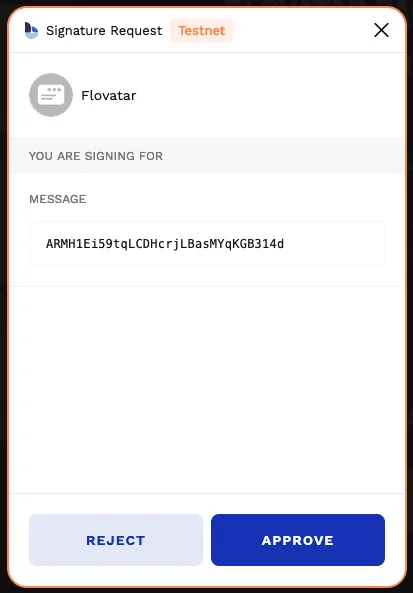

**TL;DR** I’m going to walk you through a real life example on how I managed to verify user identity using Flow FCL on the front-end and a generic PHP back-end. On the second part you will see how I secured the fully on-chain [Flovatar](https://flovatar.com) pack sale for our first drop thanks to the usage of cryptographic digital signatures.

* * *

First of all I want to make things clear: I have ton of experience on the web because I’ve been creating websites and web apps since the early 2000’s, but I don’t consider myself a crypto expert at all. Even though I started buying Bitcoin and all types of cryptos starting late 2017, as a developer I started writing my first smart contract just in April 2021 on the [Flow](https://flow.com) blockchain using the [Cadence](https://docs.onflow.org/cadence/) language. So take this as a way of sharing my journey into the crypto world from a web developer point of view, trying to create bridges between web 2.0 and web3.

I strongly feel that web3 will be the future of how we’ll consume the internet. Or to say it better I believe that the blockchain will replace most of the current back-end infrastructures while continuing to keep a similar user experience and the front-end interfaces we have today.

Of course the switch will have a lot of consequences in how a website will be structured and what its core purpose is. From a monolithic entity that stores and guards all the data with limited portability, to a more slim and simple service that relies on the blockchain as its main data source.

Digressions aside, while I was building my second web3 dapp [Flovatar](https://flovatar.com/), I stumbled upon a problem that after a few talks in Discord many developers seem to be having when building web3 dapps. What I noticed is that the key ingredient for the transition from web 2.0 to web3 revolves around authentication: being able to login a user with any standard back-end and keeping control over who can or cannot perform a specific action in your smart contract.

As [Chris Dixon](https://twitter.com/cdixon) very well described in one of his many interesting articles about web3 and NFT, “[Blockchains are special computers that anyone can access but no one owns.](https://future.a16z.com/why-web3-matters/)”  
I find this definition to be very true, but in my case I initially misinterpreted it as a way of saying that you can forget about trying to control a public minting or pack sale function. If it’s in the smart contract and it’s public, you will always keep having gas wars when a big project drops on Ethereum and you will always have bots taking advantage of it.

Well, after a lot of trials and errors I found out that it’s not really the case at all! You can still have full control over who calls your public function, you just have to zoom out a little bit to see where the exact gaps between the classic web2 experience and the new web3 paradigm are, so that we can then finally fix them with some creativity and our good friend: crypto signatures!

I’ll give you now two real world examples that I had to solve while developing [Flovatar](https://flovatar.com). These would have been trivial to implement with traditional web technologies, but are a bit more tricky on web3: back-end login and purchasing a pack.

* * *

## LOGIN

Preface: I’m considering a pure web3 dapp setup, and not custodial configurations where the private key is stored by the website and not with the user. In cases like that the login and register will work just like any old website, but we’re not interested in this hybrid approach, we want the real full on-chain experience! :)

On a classic website the concept of login is attached to the fact that you store the user’s email and password, so that you can easily match them when the user tries to authenticate. But on web3 there are just addresses and the only password is the private key that the user should never share obviously. But how will we know if someone is actually the owner of an address if they can’t share their password? Fortunately the solution is much simpler than expected once you shift away from the old paradigm. All the user have to do is to prove that they have control over that address and its private key, and that they can perform any action on it, that’s it. So all we have to do is to find a way to send a cryptographic test to the user to prove their identity!

Thankfully on the Flow blockchain it can be achieved very easily by using the awesome [Flow Client Library](https://docs.onflow.org/fcl/) (FCL) which allows the user to interact with their Blocto and Ledger account within a simple web interface (without the need to install extra browser plugins like Metamask for Ethereum).  
Flow FCL provides a very useful function called [signUserMessage()](https://docs.onflow.org/fcl/reference/user-signatures/) that will take any hex string you want as input, and will produce a [CompositeSignature](https://github.com/onflow/flow-js-sdk/blob/master/packages/fcl/src/wallet-provider-spec/draft-v2.md#compositesignature) with the generated signature and the extra information needed to verify it (like the public key and its index).  
FCL provides also a [verifyUserSignatures()](https://docs.onflow.org/fcl/reference/user-signatures/) function that you can run in the back-end with NodeJS, but for the purpose of this article I want to assume that, like in my case, we can’t use NodeJS in the back-end and we just have some generic PHP or Go server.

You might be wondering: how does this actually help me to log in the user?

Ok, let’s go through all the steps together.

1. The user lands on your website and you create a session variable that contains a random string in it, that you pass to the user’s front-end as well as a JS variable.
1. The user clicks on “Connect your wallet” to login with FCL on the front-end and is now able to start interacting with it.
1. Once the user’s wallet is accessible on the front-end, he clicks the “Sign message to login” button, and at this point you will ask him to sign the random generated string with FCL’s signUserMessage() function that will open a popup similar to this one.

<figure class="img"></figure>

\4. You can now send the generated signature with a simple HTTP POST request like this.

```
window.sendLogin = function(msg, compSigs) {

    let compSig = compSigs.length > 0 ? compSigs[0] : null;

    if(window.user && compSig) {
        axios.post('/login', {
            message: msg,
            address: compSig.addr,
            signature: compSig.signature,
            keyId: compSig.keyId
        })
            .then(function (response) {
                console.log(response);
                //Here you can check the response from your back-end
```

```
            })
            .catch(function (error) {
                console.log(error);
            });
    }
}
```

\5. At this point all you have to do on the back-end is to verify if the signature that was sent is valid or not.

This last point is like asking the blockchain: did the owner of the address 0x1234567890 sign my random string correctly or is someone trying to impersonate him? If the blockchain tells us that the signature is correct, we can from this point on assume that the user has total control over that specific wallet and for this reason we can log him in the back-end as well and associate his session with a full user account.

So the big question is: how do we actually do this from any back-end? We can achieve this by executing this simple Cadence script with any SDK available (the official [Go](https://github.com/onflow/flow-go-sdk) one or even the [PHP](https://github.com/mayvenstudios/flow-php-sdk) one I created that for the moment is just a wrapper around [Flow CLI](https://docs.onflow.org/flow-cli/)).

```
import Crypto

pub fun main(
  address: Address,
  message: String,
  signature: String
  keyIndex: UInt64
): Bool {


    // Gets the Crypto.KeyList and the public key of the collection's owner
    let keyList = Crypto.KeyList()
```

```
// Gets the Public key at the specified index (Blocto accounts will have 3 keys for example but just the second one is used to sign messages)
    if let accountKey  = getAccount(address).keys.get(keyIndex: Int(keyIndex)) {
        if(!accountKey!.isRevoked){
        keyList.add(
                PublicKey(
                    publicKey: accountKey!.publicKey.publicKey,
                    signatureAlgorithm: accountKey!.publicKey.signatureAlgorithm
                ),
                hashAlgorithm: HashAlgorithm.SHA3_256,
                weight: accountKey!.weight
            )
        }
    }

// Create a signature set from the string passed in the arguments
    let signatureSet: [Crypto.KeyListSignature] = []
    signatureSet.append(
        Crypto.KeyListSignature(
            keyIndex: 0,
            signature: signature.decodeHex()
        )
    )
```

```
// Verify that the signature was generated from the provided public key of the address we passed
    return keyList.verify(signatureSet: signatureSet, signedData: message.decodeHex())
}
```

There are 2 important things to consider here.

First of all, the main difference from the old web paradigm is that we now have 2 separate “logins”. One for the front-end (the common “connect your wallet”) and one for the back-end (the “sign message”). This might be confusing both for users and developers at first, but I think that over time it will eventually become almost like a natural thing or maybe someone will come up with a way to do it in a single user interaction.

The second thing is that there is no “Register” button anymore. If you go the full web3 dapp way, you will never need to ask for the user’s name, email or to create a password. Any blockchain wallet should be considered as if it’s an already registered user, and the only thing you will need to do is to add them to your SQL database the first time they login with a signed message. The downside of it is of course that you will be able to just know the user’s wallet address and it will be hard to get in touch with them without even an email address, but you can still ask the user to subscribe to your email newsletter or use Discord and Twitter to build up your community in a more modern approach.

* * *

## PACK PURCHASE

So, you have now your user logged in your back-end and you want to sell him or her a pack for your first very big drop, but now you face another problem. How can I be able to decide which user should be allowed to buy a pack and which should not? A common example is in case you have a whitelist where you want to allow users to buy packs before the official sale, or even during the main sale itself if you have a queuing system where you allow a few people at the time to buy the packs in an orderly way.

On the Flow blockchain the most common solution so far has been to make the drop sale happen off-chain using credit cards (with a normal Stripe account for example), that would then trigger a function in your back-end that will send the pack to the address of the customer.

This of course causes a big issue in terms of scaling up things and adds a lot of complexity in how the back-end needs to be structured. You have to create multiple keys that can sign transactions and make sure to rotate them properly and so on. Not to mention for all the merchant fees that you have to pay in order to process the transactions.

Wouldn’t it be much easier and simpler if people could just buy your pack with a simple transaction that can be executed by the user on the front-end with Flow FCL and a Blocto or Ledger wallet?  
The answer to this rhetoric question is obviously yes, but why isn’t everyone doing it already then? That’s because if you keep your purchase function “unprotected” anyone will be able to call it and buy a pack even outside of your website. This will open the doors to bots and advanced users that will find a way to get in front of the line and hoard all the best packages they want, while legitimate users will be left with the scraps.

So when I started building [Flovatar](https://flovatar.com/) I reached a point where it seemed I reached a fork in my path and I had to make a decision: keep full control of pack sales but complicate things with CC payments and thousands of transactions to be sent by my back-end in a short time, or keep things fully on-chain but lose control over the sale and let the law of the jungle rein over my drop?  
Fortunately I didn’t give up and thanks to the help of the awesome Flow community on [Discord](https://onflow.org/discord) (@bluesign especially), I finally managed to find a way to keep things fully on-chain while keeping control over who can buy a pack and when!

The concept is pretty similar to the login process outlined above with the message signature, but this time it will be the website owner that creates a signature and pass it to the user, who will then be able to use it as a form of permission token to execute a specific action.

Let me walk you through how it works and how you can take advantage of it for your next Flow project.

Imagine you have your awesome NFT project build and now you want to sell them to your users.

First of all you need to pre-mint all the NFT you want to sell and then put them in a “Pack” resource that will serve as a container for the NFT and as a way of controlling the purchase of the pack.

So you have now as an example 10k packs stored in your account, and each one will contain one NFT that you pre-minted and that is ready to be sold.

To allow anyone to buy a pack on-chain you need to have created a public function in your smart contract to receive a specific amount of FLOW (or FUSD) and in exchange it will return the Pack resource with the NFT contained in it.

Like mentioned before, now the problem is that if we keep the function “unprotected”, anyone will be able to call it as soon as we deploy it to the blockchain, and we won’t have any control over it.

So what if we could add an extra parameter that acts like a “secret key” to allow the purchase function to be executed only by the people we want? In this way we would have full control over who we want to share this secret with, and ultimately to who can buy the pack or not.

But I thought that in the blockchain there are no secrets and everything is visible to anyone? Yes, that’s true, but similarly to how the login worked above, the real secret is not the random string generated, but the fact that **only the smart contract owner can correctly create a signature from that random message**. And it’s exactly the signature that will serve ultimately as the secret key.

Here is how the process to secure the Pack purchase would look like

1. Add a random string as a String variable to each pack you are putting up for sale and store that value in a local DB like MySQL.
1. For each pack use the assigned random string to generate a signature using the private key of the smart contract’s owner and store the signature in the DB as well.
1. Set the purchase() function to receive an additional parameter with the signature (similar to the “verify signature” script shown above) and use it to validate it against the assigned random string. This will serve as a pre-condition to be validated before running the actual purchase code of the pack.
1. Log in your users with the back-end with the process shown previously, so that you can verify that you are giving away the permission to buy the pack to the actual owner of the wallet, and not to someone trying to impersonate them.
1. Take a random pack from your database and reserve it to the user’s wallet address for a few minutes to avoid giving it away to multiple people and to give the user enough time to complete the purchase.
1. Pass the pack ID and the generated signature to the user to give them the ability and permission to make the purchase.
1. With Flow FCL you can now execute a transaction where you simply pass the pack ID and the signature to the purchase() function and that will store the pack in your storage.
1. The user will be now able to call the open() function provided by the Pack resource and extract the NFT contained in it to be then finally added to the collection.

As you can see with this new way of selling packs, you will be able to not only remain on-chain because all transactions will be run by Blocto or Ledger, but also be able to retain full control over who should be able to buy each pack.

To go into more details, here is how the code looks to create a signature for any random string with the official [Flow Go SDK](https://docs.onflow.org/flow-go-sdk/). Please note that the execution of this code doesn’t interact with the blockchain at all, and the generated signature will be created and remain on your computer only.

```
package main

import (
   "context"
   "encoding/hex"
   "flag"
   "fmt"

   "github.com/onflow/cadence"
   "google.golang.org/grpc"

   "github.com/onflow/flow-go-sdk"
   "github.com/onflow/flow-go-sdk/client"
   "github.com/onflow/flow-go-sdk/crypto"
   "github.com/onflow/flow-go-sdk/examples"
)

func main() {
   MessageSignature()
}

func bytesToCadenceArray(b []byte) cadence.Array {
   values := make([]cadence.Value, len(b))
   for i, b := range b {
      values[i] = cadence.NewUInt8(b)
   }

   return cadence.NewArray(values)
}

func MessageSignature() {
   arg := flag.String("arg", "", "Message from Makefile")
   flag.Parse()

   ctx := context.Background()
   config := examples.ReadConfig()
   flowClient, err := client.New(config.Networks.Testnet.Host, grpc.WithInsecure())
   examples.Handle(err)

   sigAlgo := crypto.StringToSignatureAlgorithm(config.Accounts.Testnet.Keys[0].SignatureAlgorithm)
   privateKey, err := crypto.DecodePrivateKeyHex(sigAlgo, config.Accounts.Testnet.Keys[0].Context.PrivateKey)
   examples.Handle(err)
   publicKey := privateKey.PublicKey()

   message := cadence.String(*arg)

   signer := crypto.NewInMemorySigner(privateKey, crypto.SHA3_256)
   signature, err := flow.SignUserMessage(signer, []byte(message))
   examples.Handle(err)

   signatures := cadence.NewArray([]cadence.Value{
      cadence.String(hex.EncodeToString(signature)),
   })

   fmt.Println(signatures)
}
```

And here is how the [purchase function](https://github.com/crash13override/flovatar/blob/41506647400189e668b86054f2414413ed6f8d56/contracts/FlovatarPack.cdc#L326) on the [Flovatar smart contract](https://github.com/crash13override/flovatar) looks like.

```
pub fun purchase(tokenId: UInt64, recipientCap: Capability<&{FlovatarPack.CollectionPublic}>, buyTokens: @FungibleToken.Vault, signature: String) {

    // Checks that the pack is still available and that the FLOW tokens are sufficient
    pre {
        self.ownedPacks.containsKey(tokenId) == true : "Pack not found!"
        self.getPrice(id: tokenId) <= buyTokens.balance : "Not enough tokens to buy the Pack!"
    }

    // Gets the Crypto.KeyList and the public key of the collection's owner
    let keyList = Crypto.KeyList()
    let accountKey = self.owner!.keys.get(keyIndex: 0)!.publicKey

    // Adds the public key to the keyList
    keyList.add(
        PublicKey(
            publicKey: accountKey.publicKey,
            signatureAlgorithm: accountKey.signatureAlgorithm
        ),
        hashAlgorithm: HashAlgorithm.SHA3_256,
        weight: 1.0
    )

    // Creates a Crypto.KeyListSignature from the signature provided in the parameters
    let signatureSet: [Crypto.KeyListSignature] = []
    signatureSet.append(
        Crypto.KeyListSignature(
            keyIndex: 0,
            signature: signature.decodeHex()
        )
    )

    // Verifies that the signature is valid and that it was generated from the
    // owner of the collection
    if(!keyList.verify(signatureSet: signatureSet, signedData: self.getRandomString(id: tokenId).utf8)){
        panic("Unable to validate the signature for the pack!")
    }


    // Borrows the recipient's capability and withdraws the Pack from the collection.
    // If this fails the transaction will revert but the signature will be exposed.
    // For this reason in case it happens, the randomString will be reset when the purchase
    // reservation timeout expires by the web server back-end.
    let recipient = recipientCap.borrow()!
    let pack <- self.withdraw(withdrawID: tokenId)

    // Borrows the owner's capability for the Vault and deposits the FLOW tokens
    let vaultRef = self.ownerVault.borrow() ?? panic("Could not borrow reference to owner pack vault")
    vaultRef.deposit(from: <-buyTokens)


    // Resets the randomString so that the provided signature will become useless
    let packId: UInt64 = pack.id
    pack.setRandomString(randomString: unsafeRandom().toString())

    // Deposits the Pack to the recipient's collection
    recipient.deposit(token: <- pack)

    // Emits an even to notify about the purchase
    emit Purchased(id: packId)

}
```

A couple final considerations to be made.  
First of all, the proposed solution does not check within the smart contract if the address using the signature is actually the one we want to allow, but only that the user submitting the transaction is holding the “secret key” (the signature) to unlock the usage of the purchase function.  
Adding the check of the specific address is also totally possible, but would require you to create the signature by using the recipient address instead of the random string. For this reason it would need to be generated “on the fly” just before sending it to the user. I preferred to keep things simple and to generate all the signatures in advance because I consider the risk of intercepting the signature within an HTTPS connection really low, so that was my sweet spot between security and simplicity.

\2) When you sell a Pack in this way, you should not make it possible to be re-sold by the user, because the content of the pack (and the rarity of the NFTs it contains) will be visible by anyone on the blockchain, so it would give advantage to more technical people that would use their skills to keep the most valuable packs and sell the less valuable ones.

## FINAL NOTES

I hope that this article will help other developers to build great projects on [Flow](https://flow.com) because I strongly believe that it is the best blockchain to build the next killer web app, thanks to its great community, super low gas and storage fees, fantastic Cadence language, and especially the awesome FCL library that allows you interact with crypto wallets without the need of Metamask and similar browser extension that would limit the reach of non crypto native people.

If you are curious to see how this all works and are ready to be surprised with so much more, come visit us at [flovatar.com](https://flovatar.com/). We can’t wait to start our long journey in the Flow ecosystem with our imminent genesis drop. You don’t wanna miss it!

Go with the Flow :)

* * *

11/14/21 Update: A couple of days ago the [new v0.28 Flow CLI](https://github.com/onflow/flow-cli/releases/tag/v0.28.4) has been released and you can now generate and verify message signatures with a simple command. Thanks to the amazing Flow team for providing us with yet another great tool!
