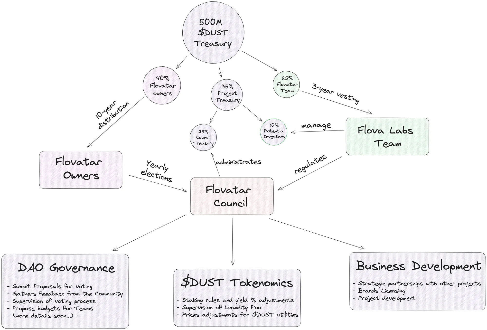

Since the last DAO vote resulted in a decision to wait on the $DUST release, there has been a lot of debate and thinking about what should be the next steps in moving forward. With this article, we want to address that and shed some light on the path ahead.

Now that the [Sportvatar](https://sportvatar.com) project has been launched and more work has been put toward preparing the $DUST release, it’s time to go back to where we left off and have two important DAO votes that will run in fast succession over the next 2 weeks.

The first one, starting on Monday, June 19th until the 26th, will be the proposal of this article; the potential DAO structure we are envisioning.

The second one, starting on Monday, June 26th until July 3rd, will once again ask you all, after these recent developments, if we’re ready to release the $DUST token.

This way, if everything is voted through and confirmed by the community, we could aim for a mid-July launch date and finally get the fun started by minting lots of Psyche Likees, giving names to our beloved Flovatars, and making the files to print them in 3D available and so much more!

But before all that, let’s dive into how we envision the $DUST treasury should be managed and how we can make sure it will be distributed in the right way to people that can bring Flovatar to the next level.

## Road to DAO

After a year and a half of constant developments and with a solidified community of a big core group of active members that have been supporting us since the beginning, the time has finally come to make one big step forward in the DAO direction and to start delegating and empowering the community much more.

The road to a fully Decentralized and Autonomous Organization is long and full of challenges, but as we promised from the beginning we believe that is definitely the right one to take and to allow all of you to have a more active and rewarding role in the growth process of Flovatar.

Before diving right into the details of the proposed structure, we want to make it clear that this article is just the start of a long transition period and during this time the Flovatar team will still act as a “benevolent dictator” overseeing all operations and decisions processes. That will guarantee a smooth transition over the next few months until reaching the next step that will push even more towards decentralization.

## DAO Council

The first cornerstone of this new proposed structure for the Flovatar DAO, is the Flovatar Council.

<figure class="img"><figcaption>Proposed initial DAO Structure</figcaption></figure>

The Council will be similar to a democratic parliament elected by the Flovatar owners, and it will come with a few important basic rules and details:

- Elections will happen every year, to make sure on a regular basis that the right people will be part of it. If needed and requested by the DAO they can be voted to be replaced every 3 months.
- A minimum bi-weekly participation to the council meetings will be required to discuss the pending matters.
- The Council will have some autonomy in taking smaller limited decisions, but for anything that will have an impact to the Flovatar project it will always need to go through a full DAO voting process where Flovatar owners will ultimately decide whether to proceed or not with each specific proposal.

For this reason, the main duty of the Council will be on one side to listen to what the community in all their different facets and opinions is saying, so that it can then be discussed internally to eventually decide what type of proposal to submit to the DAO for the final vote.

The other primary tasks of the Council will regard the $DUST treasury management and budgeting the proposals (to be approved via a DAO vote) for three main areas that we want to focus on: Creative, Development, Community.

Each of these 3 areas will have its own specialized team, also voted on a yearly cadence, that will have total freedom from the main Council to manage things however they see fit (of course pending validation from the DAO community as well). We will release more details on that front after the Council is elected and once the first proposals are submitted.

## Next Steps

In order to bring all this to reality, the first step will be to gather all the people interested in becoming candidates for the Flovatar Council and let them come up with a short intro to talk about themselves and especially what they envision for the Flovatar project and what would be their first proposals they would like to submit for a DAO voting.

If and when this DAO proposal passes, there will be 1 week for people to start assimilating the concept, think of questions, participate at the upcoming AMA and collect their ideas to propose their candidacy.

After that there will be 1 more week to allow Flovatar owners to go through all the candidates and vote for the one they like the most.

To start, there will be a maximum of 7 available seats in the Flovatar Council, but as with everything this can be increased or reduced if the DAO will vote it so.

Since Cast.fyi doesn’t provide multiple voting options, we came up with the idea to have people claim FLOATs associated with each candidate, so that we can automatically associate the wallet addresses with the Flovatar owners and easily count the votes received by each one.

The whole process is expected to last around 3weeks, but of course it can be adjusted along the way as the community sees fit, and it will not interfere with the ongoing parallel voting for the $DUST release that is expected to happen in the coming weeks.

## New Tools

To achieve the above goals, we are actively looking into many new tools to make the process as smooth and accessible as possible.

The first main tool will be the brand new [Flovatar Discourse forum](https://council.flovatar.com), where people will be able to post their candidacies and discuss upcoming and current proposals being voted on, so that they won’t get lost in the endless stream of Discord notifications.

You can reach this great new tool here at the following URL

[https://council.flovatar.com/](https://council.flovatar.com/)

On top of that we have also created an Emerald Toucans DAO that will allow us to experiment with a new voting platform that might eventually replace the current Cast if it will prove to fit our needs properly.

The new Toucans platform can be accessed at the following URL and more info will be released as soon as we will be able to integrate it with the $DUST token.

[https://toucans.ecdao.org/p/FlovatarDAO](https://toucans.ecdao.org/p/FlovatarDAO)

## Final words

We hope you will all take this as a great opportunity to make your voices heard even more, and especially to provide a way for making your ideas become reality if you really want them.

You just need to submit your candidacy on our new [Flovatar Council site](https://council.flovatar.com/) for one or more teams, and we will make sure to provide you with the best support for any initiative you come up with and that the DAO will approve.

Thanks as always to all of you for being awesome and for believing in the Flovatar mission: empowering creativity through web3 and any other technologies.

I can’t wait to meet you all in the Flovatar Council for the first discussions about the approval of this proposal and the release of the $DUST token!
