## Creativity is for everyone, not just artists

“_Every child is an artist until they are told they are not…_”, John Lennon once observed.

Never underestimate the **fun** in non-**fun**gible because creativity, and fun puns, are simply your intelligence at play.

**Your creativity is the key to unlocking everything.**

## TL;DR

Every Flovatar community member has the ability to shape their own avatar NFTs however they want and to customize it with awesome Flobits accessories. Now we bring the same concept to a whole new level and we give you the ability to create your own NFT series that will become part of the broader Flovatar Universe.

If you don’t have a smart contract coding experience, but always thought about having a more active role in the web3 space and expressing your creativity while monetizing from it, now is the time to act because we removed all barriers for you to get started!

With the [Flovatar TerraKit Land Pack](https://flovatar.com/land-sale) we give you the launchpad, the infrastructure and all the tools to help you shape the reality of the Flovatar Universe through your own creativity and story creation.

<figure class="embed"><a class="yt" href="https://www.youtube.com/watch?v=gx0URojOZTM" data-yt="gx0URojOZTM">Play video: Introducing the Flovatar TerraKit</a></figure>

## Short Intro

As many members in the Flovatar community guessed, Flova Labs was not just part of the [Flovatar Treasure Hunt](https://flovatar.com/treasure-hunting). It plays a very important role to help you unlock your creativity and use it to shape entire new worlds and realities.

[Flova Labs](https://flovalabs.com) is taking the unique creator-centric approach to the next level, and revealing another revolutionary and ambitious vision shaking up the NFT world. Flova Labs is ultimately showing the full potential of creativity when it’s applied to true ownership and alignment of your intent.

**Our focus has always been to empower your creativity**.

With the very successful [Flovatar Genesis Drop](https://blog.flovatar.com/flovatar-the-master-plan-3b5b4fae4723) back in December, and our recent [Flobits S2 Pack Sale](https://blog.flovatar.com/flobit-series-2-pack-sale-442410cbaad6), we empowered people to express their inner artist by providing the ability to create any unique Flovatar however they wanted.

Now with the Flovatar Universe Builder (aka FUB), we are applying the same concept, but taking it to the next level by empowering anyone to make not just a single NFT, but a whole NFT Builder!

**You get a builder just like the Flovatar one, but it’s even better because you can customize it and create whatever you want — even your own independent NFT series!**

People will be able to use your new NFT Builder and mint as many incredible NFTs at any price you decide.

For every new NFT minted with your Builder, you will receive the full amount paid by the user (except a 5% royalty fee that goes back into the Flovatar Treasury) directly to your crypto wallet without any intermediary and in a fully non-custodial, secure and transparent way thanks to the smart contract.

## Create to Earn Experience

Instead of a derivative of the usual play-to-earn mechanism, we always like to think out of the box and **we are proud to offer you the ultimate “create-to-earn” experience!** But nothing stops you from leveraging FUB for the pure joy and fun of creating with your friends or family members.

We are totally convinced that this will lead not only to a very unique, sustainable, and active economy rewarding creativity, but also that it will be the ultimate tool empowering people to bring to life great ideas. In the past, or in other NFT projects, there was a centralized top-down approach limiting creativity within a small set of parameters, but we’ve removed all barriers to let creativity and ownership run free!

**If you can think it or dream it, now you can make it!**

Our mission is to provide the best tools to bring out the creator in every one of you so you’ll be able to be rewarded for your awesome creations. Because after all, as Albert Einstein said: “_Creativity is intelligence having fun_”!

The Flovatar Universe Builder (FUB) is one important piece to the future of Flovatar, but there’s also the land — the residential asteroid islands you can build upon and add your new custom NFT creations — and the Flobot which will help you terraform and lay the foundation to your new section of the Flovaverse.

Let’s unpack what you’ll get in your TerraKits.

## What’s in the Flovatar TerraKits Packs?

<figure class="img">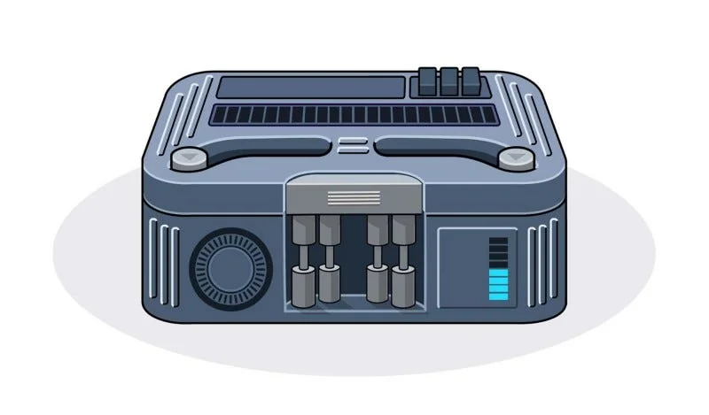</figure>

Each Flovatar TerraKit in the Pre-Sale Land Pack includes:

- **1 Residential Asteroid Island:** Fully customizable (Flovatar-style) and can host at least 5 other NFTs in it (like the Series 1 Flovatars, but also any other character or building that will become available over time).
- **1 Flovatar Universe Builder (FUB):** Allowing you to create the NFT Series of your dreams with at least 25 different slots available for different traits and powered by the awesome and renowned [Flovatar Builder](https://flovatar.com/builder).
- **1 Flobot companion:** Allowing you to help colonize and terraform new places. You’ll be able to customize and fully mint your Flobot just like Flovatars thanks to the custom builder and its traits selector.

For every one of the 3 components of the pack (Island, FUB and Flobot) you will have a chance to also find Epic and Legendary rarity tiers that will unlock more slots and traits.

<figure class="img">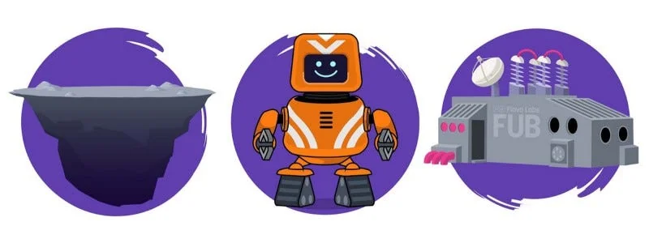</figure>

## The Flovatar Universe Builder (FUB)

The FUB is the latest revolutionary invention from the crazy scientists at the [Flova Labs](https://flovalabs.com/) research center.

Since making the most innovative NFT Builder was not enough, the Flovatar scientists seeded an idea which would lead to a challenging undertaking to create something never before seen: An NFT Builder allowing you to build whatever you want instead of pre-selected traits, characteristics, and accessories.

**And the project codenamed FUB was born!**

After thousands of hours of tinkering, testing, and many failures, a winning combination was created for the FUB.

## How does all this work?

We need more creators creating amazing things to help build and generate new opportunities for other like minded creators. To achieve these new creations, we also need to remove the steep learning curve to know how to talk to computers and to blockchains.

The core concept behind the FUB is to provide you with the opportunity to make your very own NFT Series without the need to write a single line of code and to be powered by one of the best technologies out there: **the Flovatar Builder.**

This will be the best platform for creators of all kinds (from internationally acclaimed professional artists to amateurs and even children) to offer a fun and entertaining way to create and even sell your own NFT collections with full control of the assets, maximum mint number, and pricing level for each different trait.

The original [Flovatar Builder](https://flovatar.com/builder) is the incredible tool that allows people to mint their own Flovatar in any way they want to customize it. It is structured with 7 different layers for the different traits (Body, Clothing, Nose, Mouth, Facial Hair, Hair, Eyes) and it has 4 extra layers for the Flobits (Accessories, Hat, Eyeglasses, Background), for a total of 11 layers of fun and creativity!

<figure class="img">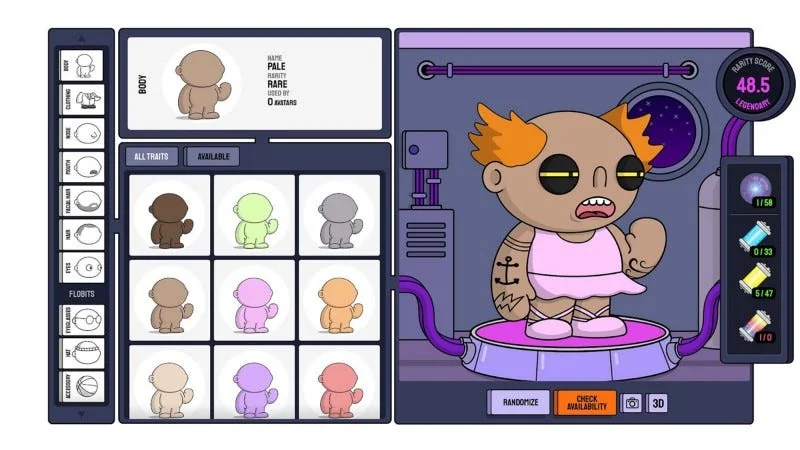</figure>

Now imagine a Builder just like this one, but with all the slots empty and ready to be filled in by your creativity. That’s what the FUB is at its very core.

<figure class="img">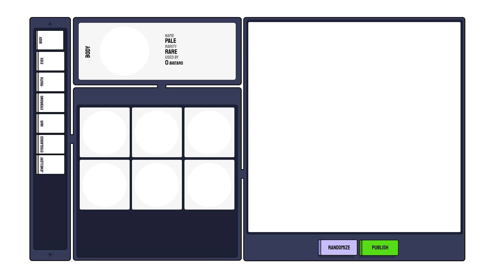</figure>

**This is where the fun begins!**

By clicking on any of the empty items you will be shown an online custom SVG editor that will allow you to easily draw anything you create by using mouse, touch, or even pen input. You will also be able to import SVG files generated with professional tools, convert existing JPG/PNG into vector form (with certain limitations though), or, for all the real nerds out there, even write everything by hand since SVGs are text files after all. ;)

<figure class="img">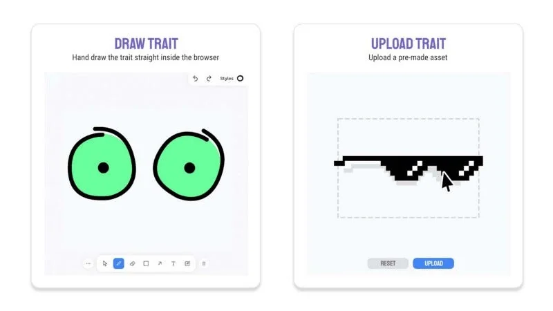</figure>

Once you have drawn or uploaded the traits it will be saved in your draft NFT Series where you can preview and test in the Builder at any time.

<figure class="img">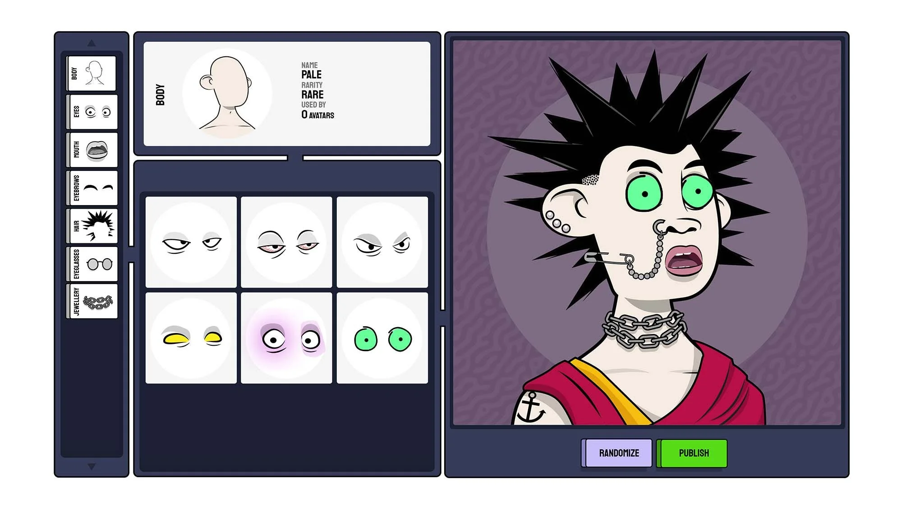</figure>

For each trait you will be able to choose a specific price in $DUST (**or potentially any other token as well**) that you would like to receive from a sale, with the total minting price for the NFT being the sum of each trait selected.

You will also be able to choose a maximum mint number for the whole NFT series and other important details such as royalty percentages.

Once you are happy with all the traits and options you created, you will then be able to magically transform with a single click, your new FUB NFT into a fully-fledged NFT Builder where anyone can use it to buy your awesome creations while having lots of fun playing with the different combinations you created!

**This is the ultimate power to create!**

In order to guarantee immutability and stability to all the customers minting from your series, the operation of publishing your NFT Builder is absolutely irreversible and it won’t be possible to modify it in any way or go back to its previous FUB state. You will only have the ability to expand the collection by adding more traits to it, but nothing else. So choose wisely!

## The Web interface

The FUB will come with lots of tools and utilities allowing you to extract all the great value and potential it has to offer.

Every NFT Series created with the FUB will be listed and available for everyone to be browsed through and visited in the Flovatar website, just like you would do on any mobile App Store.

People will be able to come and visit your asteroid island both from an interactive map view showing all the asteroid belt, but also from a simple and more accessible web list view that will highlight the most popular projects and that will allow additional filtering to be applied.

Moreover, every FUB will have the ability to be reskinned with some simple CSS code that can be applied to, or by choosing from a wide array of options that we will prepare for you, so that it will be tailored even more around your concept.

Finally, you will be able to embed the FUB on your own website as a totally whitelabeled version that will perfectly blend with the rest of your project in a seamless way, without the need to point people to the Flovatar website if you don’t want to.

<figure class="img">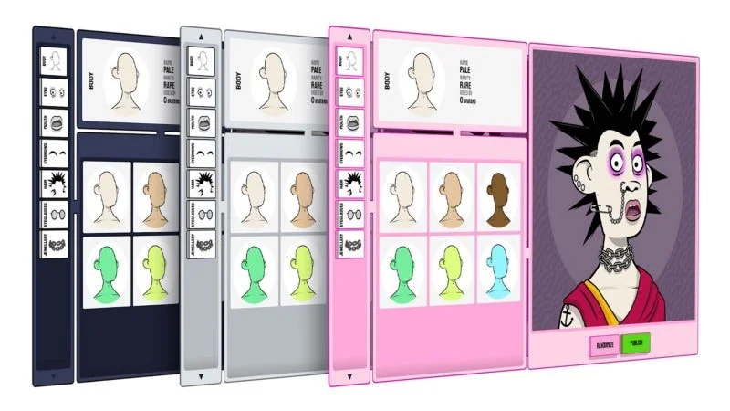</figure>

## The Power of the FUB

Each standard FUB will come with a total of 25 trait slots available that can be separated into multiple layers. To give an example of how layers and slots combine, imagine a FUB with 5 different layers (like body, mouth, eyes, etc. for Flovatar) and each one containing 5 slots per layer, you will end up with a total of ⁵⁵ = 5 x 5 x 5 x 5 x 5 = 3125 possible combinations available for your NFT series.

So by default, the FUB should give creators more than enough combinations to experiment with. However, if you need even more variety, you have the ability to merge two or more FUB together, so that the slots will be summed together and will provide you with exponentially more space for your creativity. For example, merging 2 different FUBs that have 25 traits each will result in a single larger FUB that will have 50 traits in total. This process is termed FUB Upgrade. Using the previous 5 layers example, with now 10 slots per layer, you’d have 10x10x10x10x10 = 100k possible combinations 😎.

To give you a reference, Flovatar Series 1 currently has 517 different slots, between traits and Flobits, resulting in more than 100 billion combinations available. In order to replicate the same thing with the TerraKits, you’ll need a bunch of packs (21 to be specific)! However, our generous merge limit means you can merge up to 30 different TerraKits which would give you a builder with 750 slots!

Each standard FUB will also come with a basic maximum mint number of 500 NFTs for the series you will build, and it can also be increased by merging multiple FUB together.

Here is a table showing the different rarity levels that you can find in the packs or that you can achieve by merging multiple FUB together.

<figure class="img">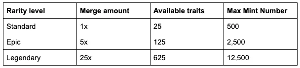</figure>

## Building Your Asteroid Island

Similar to the way a Flovatar can contain within itself an accessory Flobit, the standard Asteroid Island will be able to contain up to 5 different NFTs giving you the opportunity to make it suit your own individual style.

Your Asteroid Island(s) will be your personal digital home where you showcase and interact with all your new Flovatar Universe creations. You can add Flovatars of course, but you can also add in future $DUST series NFTs, the Flobots, pet companions, houses, spaceships, and even more thanks to the FUB!

<figure class="img">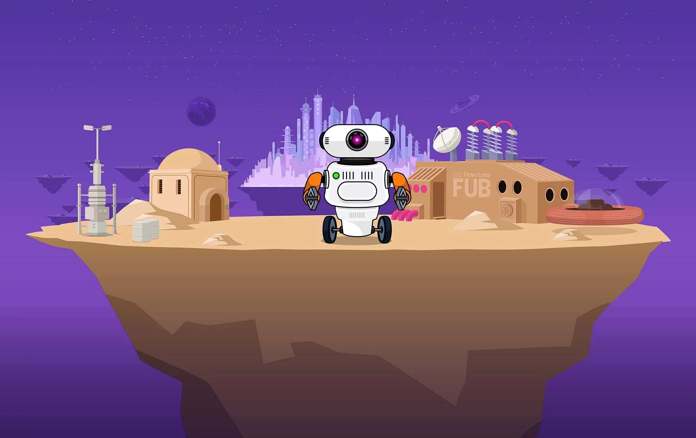</figure>

Just like the FUB, you can merge multiple islands together to unlock many hidden features yet to be disclosed. The process is termed Island Fusion.

<figure class="img">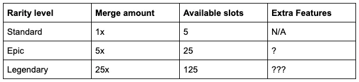</figure>

**More secrets will be shared in the future on what happens when you fuse islands together…**

Your personal island is also the place where your NFT Builder will live, so anyone coming to visit can have a fully immersive fun experience minting NFTs from your very own series.

As with anything within the Flovatar world, you will be able to fully customize your island to set the general vibe however you envision it! Do you like horror? Create a horror themed island! Do you like fantasy? Create a fantasy themed island! You will be able to choose many different options for the shape and style, but also decide parameters like colors and brightness.

**We said we’re going to empower your creativity, and this is how you can fully unleash that creativity!**

Terraforming a new asteroid island can be hard work, so we wanted to give you a helping hand with your new robot companion called Flobot.

## The Flobot

If you are new to Flovatar, you may not have experienced the original [Flovatar Builder](https://flovatar.com/builder), so we wanted to give you an opportunity to see what that was like by giving you the opportunity to create your own custom-made helper robot on your island(s) called the Flobot!

In each TerraKit pack you will find a “Flobot Constructor Kit”, that will be very similar to the Sparks of Life that were used to mint new Flovatars in the Series 1 packs sold out back in December 2021.

These cute, crazy, funny, scary, or however-you-want-them-to-be Flobots will be your official assistant in the Flovaverse and they’ll be happy to help you out with the daily maintenance on your island(s) as well!

<figure class="img">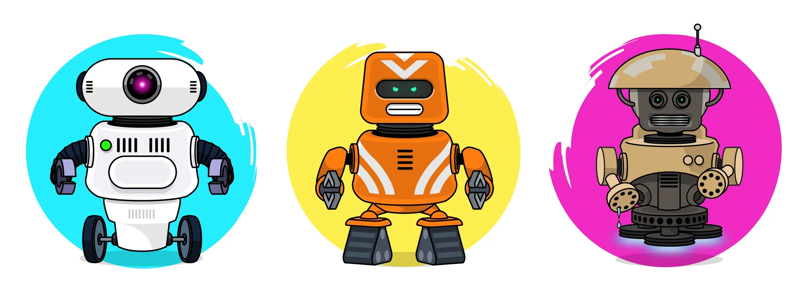</figure>

Here is a table showing you the chances of getting each Rarity tier for the Flobot Constructor Kit.

<figure class="img">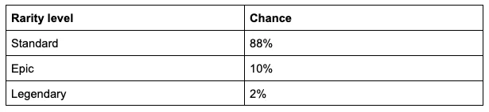</figure>

We have heard some rumors saying that some special rarity traits will unlock new capabilities and functionalities also in relation to the Island, but Flova Labs refuses to confirm or deny such allegations at the moment ;)

## The Overall Vision

We will have many new Flovatar islands created from the TerraKits, but what will the future hold in store for them? At the center of this floating asteroid belt of islands, providing the gravitational pull and preventing them from drifting off into space, is the main commercial island called Nova City.

The Flovatar Universe will have all the residential islands floating around one main central commercial island acting as a hub to the multiverse. Nova City will host the biggest brands and NFT projects from the Flovatar franchise, plus some other super secret things.

The details of Nova City and its structure will be revealed at a later stage, but owners of the residential islands floating around it will have the first rights of knowing how this central island will play a crucial role in the Flovaverse and how to become part of it.

<figure class="img">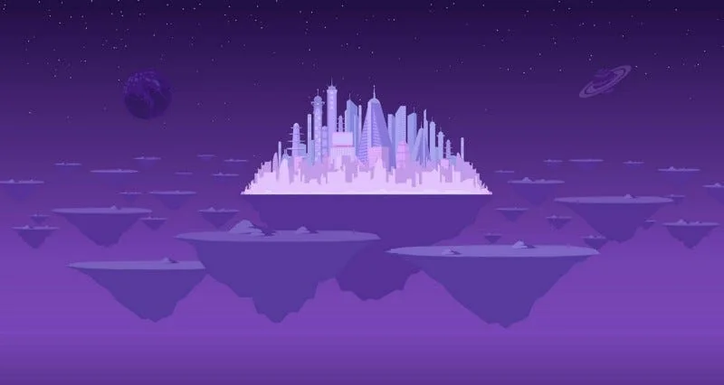</figure>

Our vision is for you to be able to walk around, interact and experience an awesome digital world composed of incredible artistic creations made by the community. You’ll be able to experience all the colorful, unpredictable, and quirky creations you and the community will make to populate this new sector of the Flovaverse.

**This is something far greater than any top-down driven approach could ever achieve.**

## Some Example Use-Cases for this new sector of the Flovaverse

We clearly see a lot of creative potential within this newly inhabited floating archipelago and the revolutionary FUB technology that each island will house. To that end we’ve highlighted some examples of how this could fuel different creative possibilities:

- Professional artists that want to launch their NFT series but don’t have the resources or technical knowledge to develop a custom smart contract, or simply because they love our unique approach with the Builder
- Projects of any kind (both crypto and non-crypto) that want to give creative ability to their community members to shape their own unique avatars and engage in a much more fun and collaborative way
- World renowned brands that want to position themselves in our unique and exclusive digital space and use it as a platform to promote their products thanks to fresh new ways to engage with the audience (imagine “Build your own Nike Air Jordan” for example)
- Any amateur artist that just wants to escape the grey monotony of our digital life as a consumer, and become an active player and a creator freely expressing ideas in any fashion thanks to the FUB
- Kids that just want to have fun and share their very own NFT Builder with their friends and their family members
- Web developers that want to explore the rabbit hole of the SVG standards and see how deep it can go by applying special filters and creating visuals generated by pure code
- Private investors that want to secure multiple islands to merge them together in a mega amusement park where people will be able to mint series created by famous artists they might hire or collaborate with
- And so much more! If you have a creative idea let it run free and join the Flovaverse!

We’re sure that many more use cases will organically appear along the way, and you’ll be able to come up with so many unique ways of using the Flovatar Islands, the FUB, and Flobots in ways we could have never imagined. If there is one thing that we learned from our short but intense experience with Flovatar so far, it is that the bottom-up and distributed approach beats the top-down and centralized approach hands down.

**We will always help lead and guide our community to a much wider and diverse experience that is truly unique, innovative, and gives you the powers to unlock your creativity.**

## Numbers and Release Details

During this pre-sale, we will distribute only 5,000 Flovatar Land TerraKit packs from the total of 20,000 that will ever be minted, at a specially discounted half price compared to the main official sale that will happen once it’s fully built in Q1/Q2 2023. We will distribute a first batch of 2,500 packs in a first release that will be announced in the coming days, and we will keep another 2,500 for a second release in the coming weeks after that.

Participation at the pre-sale will not only guarantee a 50% discount but will also allow you to be an active part of the development of the tools and the UI so that it will be tailored as much as possible around the core community desires.

**So act fast to get the 50% off discount now or pay the full price at a later date!**

The Flobot will be available from day 1, while the FUB and the Island components of the pack will be a Voucher NFT that will be redeemable and transformed into the final form as they will become available over the coming months:

- Flobot Constructor Kit — September 2022
- Asteroid Island — Q3 2022 / Q1 2023
- Flovatar Universe Builder — Q1 / Q2 2023

You can sign up to be notified on how to [claim your packs here](https://flovatar.com/land-sale).

**BUT WAIT, THERE’S MORE!**

**Remember we put aside a few hundred Flobit Series 2 packs for a special initiative? Here is the gift for our core supporters! For every TerraKit pack you buy you will get a free Flobit Series 2 pack with it, matching up to the total amount of Flobit Series 2 packs you purchased in the past.**

**For example, if you purchased 3 Flobit Series 2 packs and you buy 3 or more TerraKit packs, you will receive 3 extra Flobit packs for free!**

<figure class="img">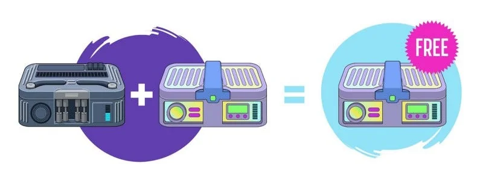</figure>

## How to Get Started

To make sure you won’t miss your spot on the queue for the pre-sale of the TerraKits, you can [go here](https://flovatar.com/land-sale) to connect your wallet and to subscribe to the Flovatar newsletter.

**Make sure to join the [Flovatar Discord](https://discord.gg/flovatar) as well because we will release more details like pricing and drop date very soon, and there will be plenty of opportunities to be able to grab a FREE pack as well if you’re lucky!**

## Where to Go From Here

In the last 8 months since our Genesis drop in December 2021, we heard a lot of people saying how much they would have loved to make their own NFT series using our technology. Many projects asked to replicate what we had done, brands and businesses, and even artists being attracted by our unique approach were looking to replicate our builder mechanism.

Now with the Flovaverse Land Pre-Sale, we want to give an answer by offering a solution to all those requests and we can’t wait to have people start playing with it when it’s officially released on Flow mainnet in Q1/Q2 2023.

We’re sure your creativity will exceed our wildest expectations, like it always has done in the past!

## Telling a New Type of Story

Glimpses of the Flovatar Storyworld have already begun to emerge, and steadily over time more of that world will reveal itself. However, unlike the traditional storytelling model where the audience is merely a passive consumer, our story will be told in large part by you.

All life-forms in the known Flovaverse depend on the mysterious energy source known as StarDust — and StarDust depends on your creativity. In fact StarDust is not only essential to ongoing life, it is essential to the creation of life too!

Imagine the Cantina Bar in Star Wars where all the alien life-forms had been created by different members of the audience, or the Replicator in Star Trek that viewers could use to insert objects directly into the episode as it unfolded,then you can begin to imagine our vision for the Flovaverse!

You want to make some exotic plants and fauna for your asteroid island? Then fire up your FUB and make them! Once you’re done your neighbors can come and pay to use your FUB to make plants for their own asteroids.

Want to make a completely new species never seen before in the Flovaverse? Then flick the switch on your FUB and get to work. New accessories, houses, pets, spaceships; wherever your imagination wanders your FUB will help you make it a reality for both you and all the other inhabitants of the Flovaverse — no idea is too crazy!

You can sign up to be notified on how to [claim your packs here](https://flovatar.com/land-sale)!
