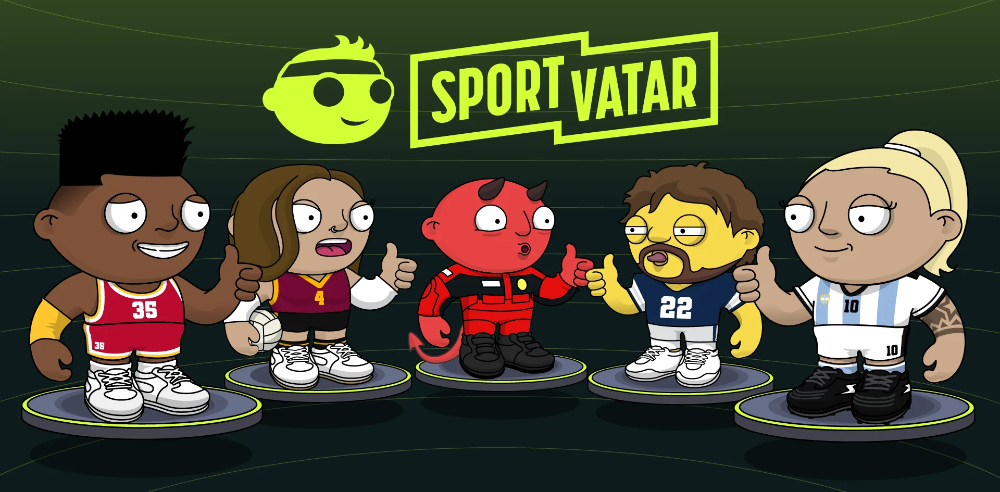
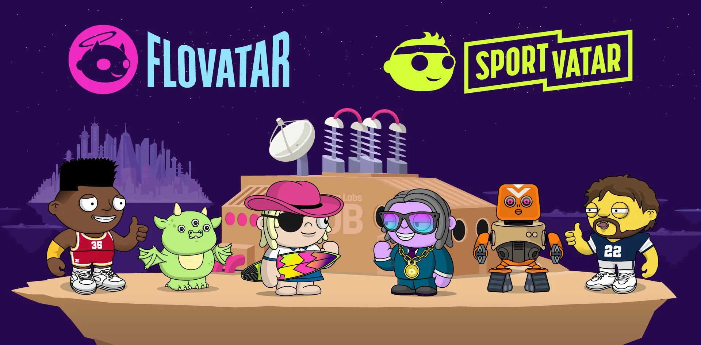
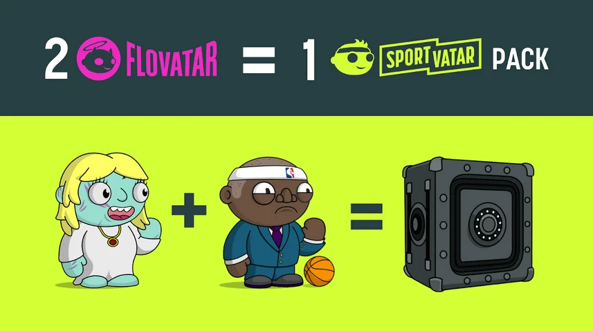
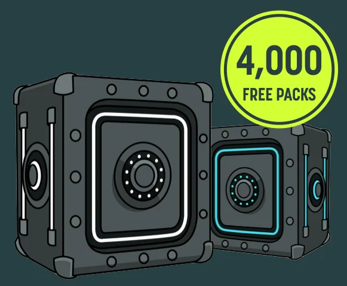
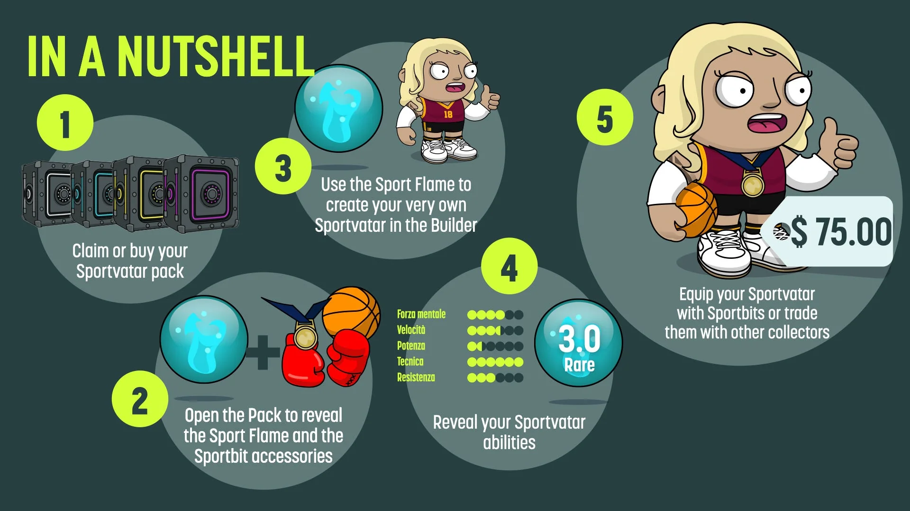
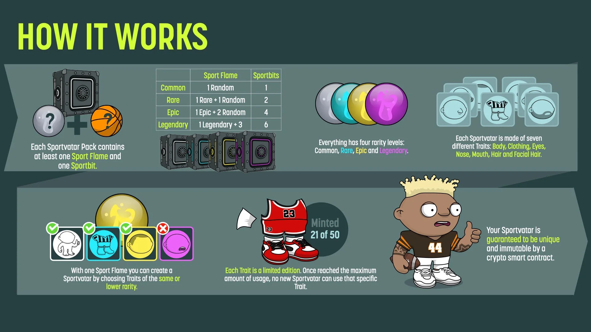
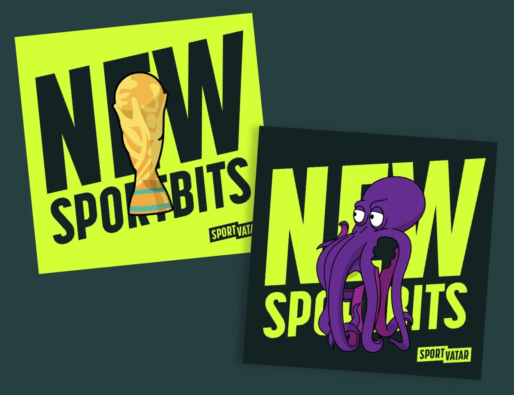

**The wait is finally over!** It is time to reveal what we have been busy with for so long and to unveil that mysterious **Project S.** Keep reading to learn about how this project will benefit our existing Flovatar owners.

Before diving into the details, I would like you all to take a moment and think back to December 16th, 2021 — the day it all started with the first Flovatar pack drops.

With the concept of composability, an emphasis on user-led creativity, and the technology of our revolutionary Builder, we knew we had something special on our hands and that it had endless potential when combined with blockchain technology. We were right, and we’ve been validated in many ways, especially thanks to you; the amazing community that joined us on this crazy journey and has been incredibly supportive all this time.

As things progressed, we knew that we needed to extend our core product and apply it to a wider audience, beyond the crypto-natives that we already can reach. To build a truly global brand for [Flovatar](https://flovatar.com), it’s essential to capture the attention of established IPs and brands to help reach those mainstream audiences. However, before we can lock in collaborations with the likes of Nike, Red Bull, or Ferrari, we have to demonstrate that we’re a serious project with strong ambitions. Even more important, we need to prove that we can attract and retain the attention of a large community.

With that intent in mind, let us introduce the first stepping stone — [Sportvatar](https://sportvatar.com).

<figure class="img"></figure>

In March 2022, we started talking with RCS Mediagroup, which owns some of the biggest media companies in Europe, like [MARCA](https://www.marca.com/en/) and [La Gazzetta dello Sport](https://www.gazzetta.it/). Their media spans across a very international and wide audience, with over 100M readers around the world. They loved the Flovatar concept and they envisioned it to be an excellent platform and technology to build a new home for all sports fans. Imagine a place where you can have fun talking, minting, playing and just hanging around with an overarching focal point; the passion for sports.

And just like that, the idea of [Sportvatar](https://sportvatar.com) was born. Their approach and their priority in having the interest of the community at heart convinced us that they are the perfect partner on this journey.

This collaboration with RCS Mediagroup is the first stepping stone in bringing our product to the rest of the world. It will show that we are able to seamlessly collaborate with global platforms and bring value to their user base. Once we successfully bootstrap to complete this project and reach this worldwide community of sport fans, we will have one more arrow in our quiver when reaching out to major brands for a collaboration with Flovatar. Not to mention, RCS can connect us to potential partnerships with brands and athletes all around the world.

<figure class="img"></figure>

Being on the [Flow](https://flow.com/) blockchain (the innovators of Sports-focused NFTs) and our partnership with [Dapper](https://dapperlabs.com) allow us to have the certainty of building and expanding on a rock-solid foundation. It will enable us to achieve what we had planned with a smooth and seamless user experience, intuitive enough for non-crypto natives.

[Sportvatar](https://sportvatar.com) launches in just a few short weeks so let’s dive more into what it’s all about and why you should care about it as a Flovatar community member.

## Why should I care as a Flovatar user?

With all the excitement, you might be wondering how launching a new series helps you as an established Flovatar owner.

1. We will get in front of 100M+ new people all around the world that will learn about Flovatar and why they should join our great community.
1. It allows us to prove to potential investors and other brands or companies that our vision and technology can be applied to a wide range of partnerships. This greatly increases our chances to secure funding to grow the wider Flovatar ecosystem.
1. All the generated revenue will be used to support the Flovatar and Flova Labs expansion plans and to grow the company by hiring new people, so that all our pending initiatives ($DUST release, FUB, Islands) will be sped up in process.
1. Flovatar owners will be able to build Sportvatars before anyone else and before the pack sales start. You will have a chance to experience the fun of playing with a brand new and much improved Builder, that will be the foundation of the FUB interface as well.
1. Broadening our offer allows us to greatly increase the utility and value of the pre-existing Flobit NFTs (get your Flobit backgrounds ready!), but also the upcoming $DUST token could potentially be used to mint exclusive assets for any project of our ecosystem (Flovatar, Sportvatar, FUB, Islands,… ).

This is the first of many new franchise opportunities that are there for us to grab, and for every single one, you as a Flovatar owner will be rewarded by having a central role.

<figure class="img"></figure>

To show you all how much we value your support and belief in the project, we have a really nice surprise waiting to be unveiled in your Flovatar Collection page.

<strong>For every 2 Flovatar you own you will receive one Sportvatar Pack redeem code for FREE!</strong>

<figure class="img"></figure>

Yes, you heard it right, so make sure that you get the Flovatar count in your wallets to a nice even number before we take the snapshot on May 5th at 10am ET (2pm UTC)! Codes for Flovatar owners will be found in the “My Collection” section of the website and the release date will be announced on Discord.

<figure class="img"></figure>

We have a **total of 4k packs to distribute among our community** and for project collaborations, so make sure you stay tuned and active on the [Flovatar Marketplace](https://flovatar.com/marketplace) in order to get your hands on the Genesis packs before anyone else.

## Project Intro — How Will Sportvatar Work?

We built [Sportvatar](https://sportvatar.com) specifically for all the Sports fans around the world, to make them feel like they are the center of the community like we always do at [Flovatar](https://flovatar.com).

It was quite the journey going through many of the steps that we already took more than one year ago. We felt the same adrenaline rush toward the final phase of the release, but we also were primed with all the knowledge and wisdom that we have built up after so many developments and activities over the last year and a half.

This meant that we had the incredible opportunity of being able to experiment and evaluate many different approaches that differ from the classic 10k limited edition. Instead, we worked with different core rules, that would allow us to achieve a much higher degree of flexibility, sustainability, and guarantee of being future-proof.

<figure class="img"></figure>

### How it works

The tried and true core concept of how to mint a Flovatar still applies to Sportvatar. Inside a Pack you will find a Sport Flame (Sportvatar’s Spark) and a Sportbit accessory. With one Sport Flame, you will be able to choose any trait you want from the same or lower rarity. Just like Flovatar, the traits can not be changed once minted and the combination has a guaranteed uniqueness, but you will be able to swap Sportbits any time.

<figure class="img"></figure>

Beside these initial similarities, there are a lot of important differences between Flovatar and Sportvatar:

1. Sport Flames are Open Editions and there is no hard limit on minting them. Instead, we’ll follow the market demand to keep releasing them in batches over time with multiple pack sales every few months as the community keeps growing.
1. All traits in the Builder are limited editions. Once the maximum mint number has been reached, nobody else will be able to use it anymore. So make sure to secure some of the most rare traits before they run out!
1. We will launch with 500 different Traits and Sportbits, but expect many more to be introduced regularly. There are also new functionalities that we have already developed that will be unveiled over time. It’s important to notice that, unlike Flovatar, we will introduce not just Sportbits, but also new traits and even entire new layers in the Builder. This allows us to have a natural series evolving over time without the need to have a separate smart contract each time.
1. Being that this is a project built for a mainstream audience, Dapper Wallet and USD will be the default currency and options at start, especially because of the KYC requirements. That being said, expect a lot of synergy between the Flovatar world and the Sportvatar one with many potential ways to interact and to open it more to crypto natives outside of Dapper.
1. Gamification will play a big role, thanks to the new abilities that each Sportvatar will have and that will be unveiled in more detail later. Depending on the Sportvatar’s rarity, they will be assigned a different amount of Ability points that will be distributed randomly.
1. We want people to be able to collect many of them at an affordable price, to build up their all-star team and to participate in upcoming challenges and fantasy leagues.

<figure class="img"></figure>

I know this is a lot and there is so much more to say, but I will leave all that to the many AMAs and other activities in the coming days and weeks. The party is just getting started!

Thanks again for all your awesome support and I can’t wait to open this new chapter together with you all to conquer the hearts of all the sport fans around the world.

We’ll be waiting for you all on the [Flovatar](https://discord.gg/flovatar) and [Sportvatar Discord](https://discord.gg/PNEpMk7vwV) to celebrate all together this big achievement and I can’t wait to answer the many questions you will probably already have popping into your head right now.

Now let’s have some fun in the brand new [Sportvatar Builder](https://sportvatar.com/builder) and keep the imagination and creativity flowing!
