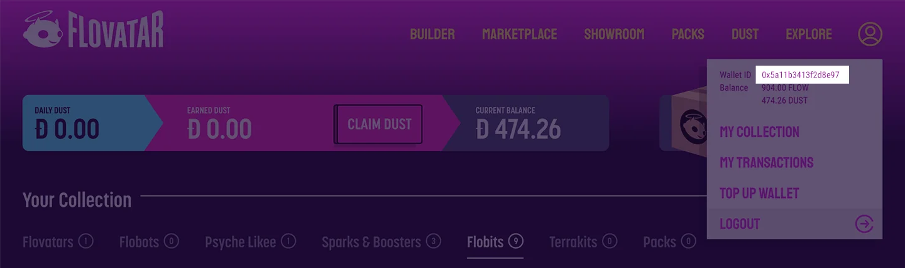
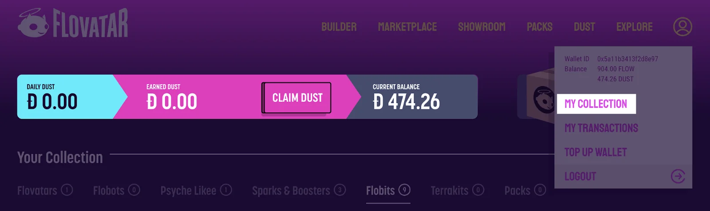
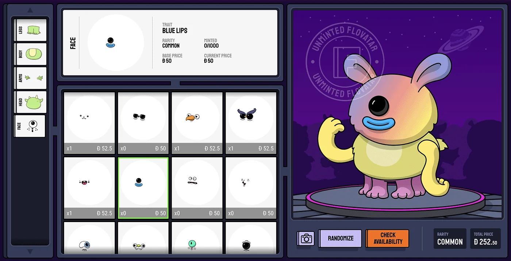
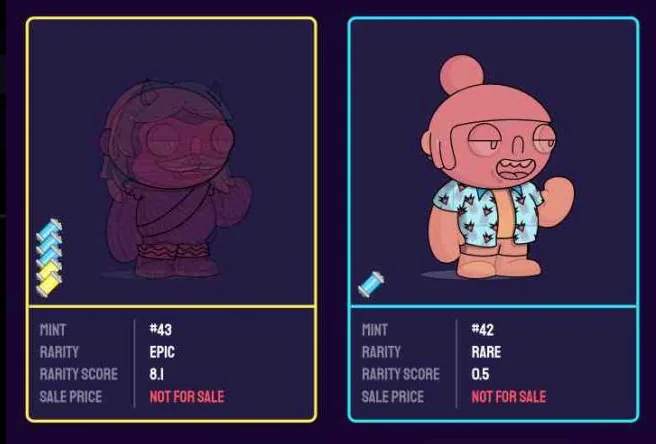

<figure class="img"></figure>

ÐUST, the utility token that will power the massive Flovatar Universe, is coming soon to your nearest teleport booth! To all new members, you can find a comprehensive overview of ÐUST in this [new landing page](https://flovatar.com/dust) we just added to the site and also in this previous blog article, [All about ÐUST](https://blog.flovatar.com/all-about-dust-613ce49cb51a).

## Timeline

Before diving into the details on how to test the token redemption process and explore the whole world of possibilities, here you can find a timeline outlining the next important steps that will lead to the final mainnet release.

- 3/2/23 — Testnet release on [https://testdust.flovatar.com](https://testdust.flovatar.com)
- 3/6/23 — First test DAO voting (Pineapple on pizza?!?!)
- 3/27/23 — DAO voting on mainnet release and Liquidity Pool
- 4/3/23 — ÐUST mainnet release (if approved by DAO)

## Road to DAO

With the release of the ÐUST token, we will gradually introduce many different DAO voting sessions to allow the community to have a more direct say in the project and to be able to shape it more to their will. We have been researching and testing various Web3 voting platforms. We have not finalized the selection yet due to limitations we found in each, but we will keep everyone posted as soon as we do.

In the meantime, our fallback option is to use the EmeraldBot voting functionality that will also check if the user is a Flovatar owner.

Please stay tuned in our [Discord](https://discord.gg/flovatar) or via [Twitter](https://twitter.com/flovatar) or through our [Newsletter](https://flovatar.com) for more information on how to participate in the proposal voting.

## Testnet Guide

In order to make sure that everything is working as expected ahead of the mainnet launch, we need your help to stress test the smart contract and the web interface as much as possible, so that once it goes live it will be the best and smoothest experience.

On top of that, by helping beta test ÐUST, you will be able to try out all the different utilities ahead of time and see which are the ones you like the most, and maybe also prepare a small personal strategy on how to spend your ÐUST as soon as it gets released.

To make things as easy as possible for you, here is a quick intro guide on how to use the Testnet version and to get started in no time.

### 1 — Create Testnet wallet

The first thing you have to do is to visit the [https://testdust.flovatar.com](https://testdust.flovatar.com) website and click the “Connect wallet” button on the top right. Please choose the Blocto option and make sure to use a new email address that you didn’t already use in the past for Testnet (if you used the same wallet back in 2021, it will likely not work because of some changes in the testnet version since then).

Once you have created or connected your Testnet Wallet for the first time, you will be asked to initialize the account as well. Please accept the transaction and wait until it’s sealed.

### 2 — Top-up Wallet

Now you’re all set to start interacting with the Flovatar Testnet site, but in order to be able to buy anything, you will first need to recharge your account with some “fake” Tesnet Flow tokens.

<figure class="img"></figure>

Please visit the following site and enter your Testnet wallet address (you can read it from the profile dropdown on the top right of the Flovatar website) to receive 1,000 Testnet Flow.

[https://testnet-faucet.onflow.org/fund-account](https://testnet-faucet.onflow.org/fund-account)

### 3 — Buy a Pack

Once you received the 1,000 Testnet FLOW, it is time to spend some of them to buy some Genesis packs!

Please head to [https://testdust.flovatar.com/pack](https://testdust.flovatar.com/pack) and buy a Deluxe or a Standard Genesis Pack, so that you will then be able to open it from your Collection page and take out the Spark and Boosters from it.

### 4 — Mint a Testnet Flovatar

Now that you have all the necessary ingredients, you can head to the Flovatar Builder page and create the Flovatar that you like the most, so that they can generate the daily ÐUST tokens for you.

[https://testdust.flovatar.com/builder](https://testdust.flovatar.com/builder)

Straight after minting your new Flovatar will have ÐUST to claim so head on over to your Collection.

### 5 — Claim your Testnet ÐUST

Go to your Collection page (link on the profile dropdown on the top right) and you will see a toolbar showing a recap of the ÐUST tokens that you are accumulating each day through your Flovatars, and also the amount of ÐUST that you can currently claim.

<figure class="img"></figure>

Just click on the “Claim ÐUST” button and approve the transaction to process it and transfer the ÐUST tokens from the inbox to your personal wallet.

### 6 — Have fun and spend your ÐUST

Finally, you’re all set and ready to have some fun by burning the ÐUST token in any way you want.

<figure class="img"></figure>

Make sure to head to the [Psyche Likee Builder](https://testdust.flovatar.com/builder/dust) to mint your Flovatar companion and visit your Flovatar details page to unlock many new features like the naming, bio, geo-location and 3D models. Also, the Flobit upgrade mechanism will be in place so that you will be able to use it from the Collection page when you select the Flobit section.

### 7 — Send us feedback and participate to DAO voting

As we mentioned before, it is crucial to receive as much feedback as possible during this phase to make sure that no bugs are released to production and also that the interface and user experience is as smooth as possible. So please don’t hesitate to join our [Discord](https://discord.gg/flovatar) server to leave your comments and suggestions, as well as to participate in the DAO voting related to the mainnet release of the ÐUST token.

### Known issues

Since it’s a test environment there are a couple things that won’t work as expected. The first and most obvious is that Flovatars will look weird and with strange artifacts. Don’t worry about it,it’s due to how the traits templates were minted on testnet a while ago. This will also prevent people from impersonating real Flovatars from mainnet 🙂

The second thing is that the 3D models will be unlocked on chain but the generation of the actual STL file is disabled until it will be released on mainnet. So the button to download it will appear, but the link will be broken.

Beside this, everything else should be working as expected, so please let us know if it’s otherwise!

<figure class="img"></figure>

## Final Notes

We’re really excited to enter this final phase of ÐUST release for two main reasons. The first, and most obvious, is that it will finally unlock so many utilities for the Flovatar NFTs and will also introduce the adorable Psyche Likee into our world.

The second one is probably even more important in the long run for the Flovatar project, and it’s about the many possibilities that will become available once it will be the main currency in the Flovatar ecosystem. It will allow us, on one hand, to vastly simplify the user experience by using it in the Builder to create dynamic pricings (1 Psyche Likee = X ÐUST vs. 1 Flovatar = 1 Spark + X/Y/Z Boosters) and to open up more easily to a wider audience, but also it will give us the ability to manage the project treasury and reward the most deserving people and projects with a certain amount of ÐUST that the DAO will be able to vote on each time.

Ok, enough talking for now! Let’s go [have fun with ÐUST](https://testdust.flovatar.com/builder/dust) and see you around in our [Discord](https://discord.gg/flovatar)!
