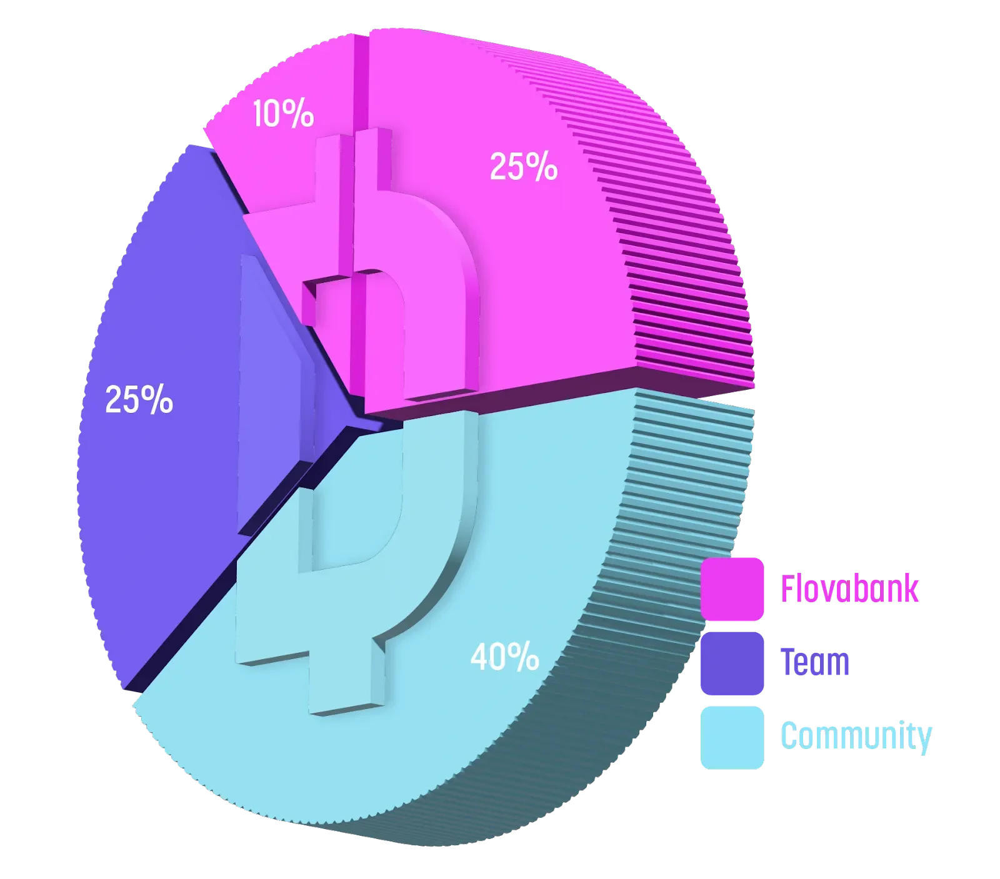
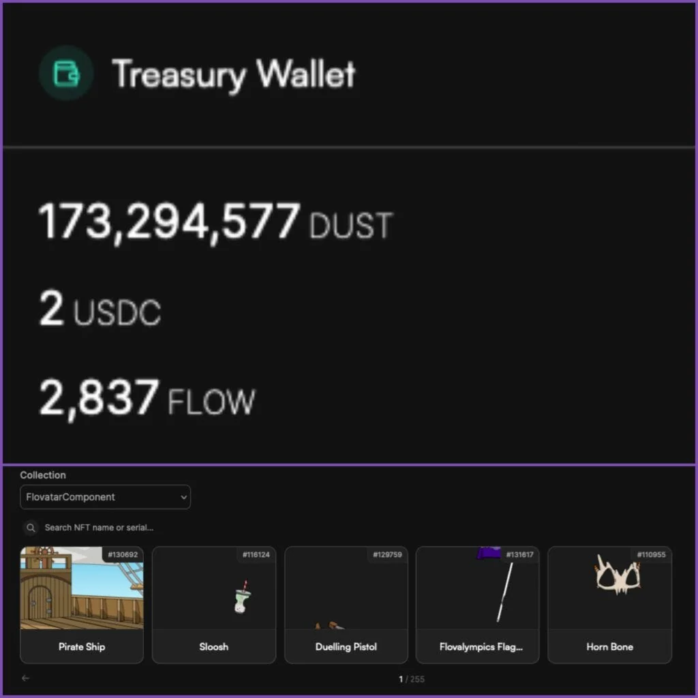

Over the last couple of months we have been busy behind the scenes doing some background work in preparation for two big changes that will be coming to [Flovatar](https://flovatar.com): the Cadence 1.0 smart contract (and transactions) upgrade and the Toucans DAO.

The first one will bring little to no changes for the way we interact with the Flovatar universe every day. It required a lot of code rewriting (and we have a lot built over these last few years!) to make sure it will keep working and that it will follow the new Cadence 1.0 paradigm built on top of entitlements and capabilities.

I am happy to report that we now staged all the code for all the different assets we have built until today (8302 lines of code in 18 files!) and that we can guarantee continuity to the project and be able to explore new potential avenues thanks to the EVM support. This can bring many benefits, especially for the $DUST token, by bridging it into other chains and using additional DeFi platforms like Uniswap.

But there will be time to dive deeper into that once the Flow Crescendo migration will be fully completed by the end of the summer.

Our goal today is to focus on a really exciting milestone that we actually announced from day one: the [Flovatar DAO](https://toucans.ecdao.org/p/FlovatarDAO)!

We have been saying that establishing the DAO would have been a gradual process and over the last few years we really tried to explore as much as possible many different tools and platforms to help us manage and organize the DAO. Among those were Cast.fi, the Emerald Bot, Discourse, and a few more. Unfortunately the Flow blockchain was not mature enough to offer a real proper platform that would allow us to both manage a token + NFT treasury and also to allow voting sessions based on the amount of NFT owned and not tokens.

Thankfully [Jacob Tucker](https://x.com/jacobmtucker) and the super awesome [Emerald City DAO](https://ecdao.org/) recently added the ability to use the $DUST token and also to NFT voting rounds on Toucans. Once that became available, we knew instantly that the time finally arrived to make the big leap of faith and empower the community with keys to the Flovatar treasury.

Let’s go straight to the important bits and give you some hard numbers of what has been accomplished already and what is about to come.

As promised on our [very first](https://blog.flovatar.com/flovatar-lite-paper-b2a1824e1a45) blog article and further detailed on our [milestone updates](https://blog.flovatar.com/flovatar-milestone-updates-c779bffd1f1a), we allocated 40% of the total $DUST minted to the Flovatar owners to be distributed over a period of 10 years through our custom built “Flovatar Inbox” that we use also for prize distribution. Another 25% has been allocated to the team (with a gradual vesting period of 3 years) and then finally a remaining 35% (175M $DUST) has been assigned to the project treasury that can now finally be managed through the Toucans [Flovatar DAO](https://toucans.ecdao.org/p/FlovatarDAO).

<figure class="img"></figure>

The regular readers of the awesome [FUD News](https://fudnews.com/issue-107-the-summer-movie-preview-edition/) will already be aware of it (damn Ron Flogundy that keeps leaking news all over the place!), but in case you have missed it, here are some numbers to show what we just officially completed over the last few days:

- **173M $DUST tokens** (35% assigned to the treasury — 2M $DUST already used for the Liquidity Pools and for prizes and rewards) have been transferred from the Flovatar smart contract account to the Toucans Flovatar DAO
- **1,270 Flobit NFTs** (all the Legendary and Epic ones, plus lots of rare ones too) have been sent over to the DAO treasury
- **2,837 Flow tokens** have been transferred as well (and left 1,000 Flow on the smart contract account for storage purpose and LP farm incentives for June)

<figure class="img"></figure>

Furthermore, 9 brave and valiant Council members have been nominated and accepted the offer to join:

- bjartek
- chaosmanis
- derp
- garlicdonut
- jenna
- lonestarsmoker
- marlin
- throop
- wildturkey

<figure class="img"></figure>

The idea of the Council is to be a group of trusted community members that will be able to guarantee that the following actions will be performed fairly, with honesty and in the interest of the project at large

\- Listen to requests from the community

\- Discuss and create new voting rounds based on the community input

\- Execute actions based on the results of the voting rounds (Distribute tokens or NFT mostly, but also refill Increment.fi farming rewards)

\- Evaluate new candidates for additional Council members and create voting rounds to let community decide whether to elect them or not

After an initial step of settling in, we are also working towards these additional goals to allow the DAO to have even more control over the project

\- Access to the Git repository to manage the Flovatar website and be able to change the code and extend it

\- Add multi-sign key signatures to the Flovatar smart contracts, to allow Cadence developments as well

\- Ability to add official Flobits to the Flovatar Collection and distribute or sell them

The ultimate goal is to finally realize the original vision that we published on day one and to empower the community to have full control over the project. This is not the finish line and we always knew that would be a gradual process but we also feel that we are finally mature enough to make that extra step and launch a new beginning for the Flovatar era.

We are sure that this new structure will bring many benefits and will incentivize the community to participate more and also rewarded properly for all their efforts and value added to the project. At the same time, it will remove many bottlenecks that a “benevolent dictatorship” inevitably brings, and will also free some precious time to be spent on the FUB and Asteroid Islands development that unfortunately has fallen behind schedule for many different reasons.

We can’t wait to celebrate this new beginning all together on a Twitter/X Spaces next week. When exactly? That is up to you to decide! Make sure to head over to our [Flovatar DAO](https://toucans.ecdao.org/p/FlovatarDAO) and [vote](https://toucans.ecdao.org/p/FlovatarDAO/voting-rounds/158) for the time and date you prefer among the available options. Keep an eye on our [Discord](https://discord.com/invite/flovatar) and our [Twitter/X](https://x.com/flovatar) feed for more info about the winner date and how to participate!
