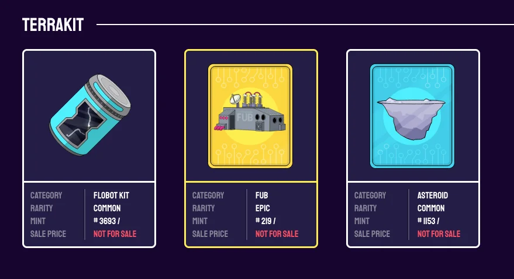
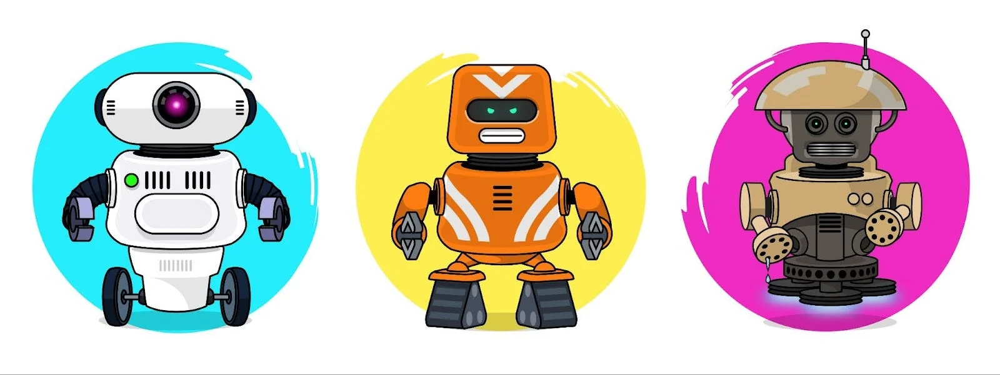
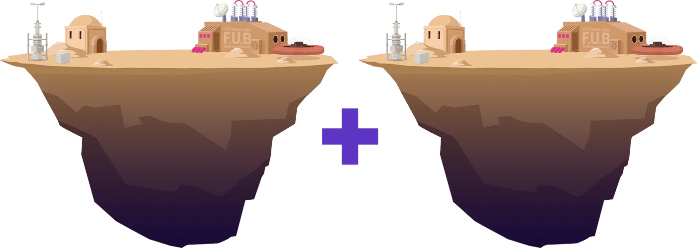
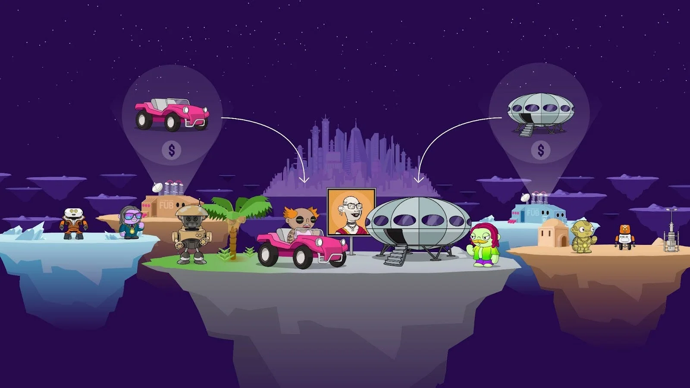

After our long and exhaustive [first article](https://blog.flovatar.com/introducing-the-flovatar-terrakit-pack-and-the-exclusive-land-pre-sale-735e697f0563) about the [TerraKit pack pre-sale](https://flovatar.com/land-sale), we thought it would be a good idea to take a step back and talk about our broader vision and why we believe it can ignite a new revolution powered by unfettered creators with unlimited potential.

## Our Thesis

**Web3 represents a completely new paradigm for consumer engagement and most brands and consumer-focused NFT projects are going the wrong way.**

By offering the same type of content, but simply repackaged under NFT, is akin to media outlets uploading their scanned publications to the internet.

**The Web 2.0 revolution was all about turning passive consumers into active creators/contributors**

- Social media (Instagram, Twitter, TikTok)
- Youtubers / podcasters
- Blogging / newsletters

_Even comments in NY Times or Webtoons pages are active contributions_

**Web3 is the shift toward shared ownership via participation.**

**We want to bring the Web 2.0 revolution into web3** and empower people even more by providing them a platform to bring their ideas to life, and by ensuring them the ownership of all the great things they will build and that will become the fabric of the Flovatar Universe.

The DNA of a platform is set in the early stage, you either start with a creator-centric design or it becomes a service / source of information people use.

With Web3, you have one more design factor to consider. You have to include the **user-centric ownership model from the get go**. If not, it is impossible to pivot later because of the too-much-at-stake dilemma.

**Up until now, only a small subset of adventurous creators and builders were able to enter Web3, but things are about to change.**

The next race is less about which collection has the highest floor price, but how to bring the unfettered wave of new creators into the ecosystem. **The bottom-up creator era is about to explode** and we want to be at the very center of it!

## Why we made the TerraKit

The TerraKit pack is the answer to the many requests we had since our Genesis drop to be able to take advantage of the incredible technology and approach we took with Flovatar and apply it to different use cases and creative ideas.

Our unique Builder with its gamified experience, on top of the awesome and fully on-chain SVG technology for the illustrations, opened up a world of possibilities and **we were obviously becoming the bottleneck to fully unleash its incredible potential**.

For this reason we decided to give the opportunity to anyone to take advantage of a revolutionary end-to-end solution, from ideation to minting and promotion, and **be able to create and sell their own NFT Series the “Flovatar way”**.

## What’s in the TerraKit

In the TerraKit you will find 3 NFTs

- 1 FUB (Flovatar Universe Builder) voucher
- 1 Asteroid Island voucher
- 1 Flobot Kit

<figure class="img"></figure>

## FUB

The FUB is the factory that allows you to **create, test, publish, sell and promote your ideas and bring them to life as an NFT Series** that anyone can buy from you.

Thanks to its easy to use interface and all the powerful tools we will provide, you won’t need to be a developer or an artist to make a successful collection; just come up with a great idea and we will help you all along the way!

It’s a **one stop solution to finally have an active role in the web3 revolution** and be able to monetize from your creativity.

<figure class="embed"><a class="yt" href="https://www.youtube.com/watch?v=rcRuQJ5zfdU" data-yt="rcRuQJ5zfdU">Play video: Explaining the FUB - Your Own NFT Builder</a></figure>

## Asteroid Island

The Asteroid Island is the **home to your beloved NFTs** and, if you want to, the **showroom of your awesome creations made with your FUB**.

You will be able to customize it as you please, like everything we do at Flovatar, and you will be able to populate it of course with your Flovatars, your Flobots, but also with the **NFTs minted from any FUB that we call F.U.N. (Flovatar Universe NFT)**.

## Flobot Kit

The Flobot is your assistant to maintain, operate and welcome people to your Asteroid Island.

You can **mint a Flobot by using the Flobot Kit included in the pack** and it will help to familiarize you with the Builder and how all the layers and traits work, so that you can then replicate them with the FUB.

## Rarities

Each of the 3 NFTs (FUB, Asteroid Island, Flobot Kit) that you find in the TerraKit pack comes with 3 different Rarity levels: **Common, Epic and Legendary**.

The **Common FUB** will come with **25 slots for different traits and 500 Maximum NFTs** that can be minted out of it.

An **Epic FUB will have 5x** the slots available (25 x 5 = 125) and 5x the Maximum Mint number (500 x 5 = 2500).

A **Legendary FUB will have 25x** the slots available (25 x 25 = 625), and 25x the Maximum Mint number (500 x 25 = 12500).

The **Common Flobot Kit** will give you access to all the **Common traits** in the [Flobot Builder](https://flovatar.com/builder/flobot), while the **Epic Kit** will also unlock the ones with a **yellow** background and the **Legendary Kit** will give you access to everything including the rarest, **purple** colored, traits.

<figure class="img"></figure>

The **Common Asteroid Island** will come with **5 slots** to put your favorite NFTs and you will have a set of Common options to choose from to fully customize your island when you terraform it and officially mint it.

An **Epic Asteroid Island will have 5x the slots** available (5x5 = 25) and it will unlock some extra options and features that we will introduce later on as we approach the release date.

Finally, a **Legendary Asteroid Island will have 25x the slots** available (25x5 = 125) and will unlock further options and features.

## Merging

For all the 3 NFTs (FUB, Asteroid Island, Flobot Kit), **you will be able to merge them** to increase their stats and get access to the next Rarity level, **but only before you transform them in their final state by minting them in their respective Builder**.

If you use 5 Common Flobot Kits you can mint an Epic Flobot, if you use 5 Epic Flobot Kits you can mint a Legendary one.

**You can merge 2 or more FUB and Asteroid Islands together** and this will increase their available slots and maximum mint by adding the values of each.

Every 5x that you merge you will jump to the next Rarity level (5x Common = 1 Epic and 5x Epic = 1 Legendary) and unlock further advantages that will be announced later on.

<figure class="img"></figure>

## How it all works

Once the FUB will be released to mainnet in Q1/Q2 2023 we will also open up the **FUB Marketplace** where everyone will be able to browse both with a **web interface** and also with a more visual and **interactive map** of all the islands that populate the Flovatar Universe.

Once you find the one you like the most you can click on it to zoom in and see in more detail all the FUN (Flovatar Universe NFTs) contained in it.

Finally, if you want you can **click on the FUB to open the Builder**, made by the owner of the island, which will be very similar to the [Flovatar Builder](https://flovatar.com/builder) you’ve enjoyed using already.

As you mint the FUN, you will pay 95% of the total to the creator, while the remaining 5% will go to the Flovatar Treasury for the Marketplace fees.

This will generate a very sustainable and more equal economy based on the **“create to earn”** experience that we envision. Everyone can be **both a Consumer**, enjoying a diverse range of great NFT Series made by the community, **and a Creator** by spinning up a FUB and bringing to life their own ideas.

Finally, you will also have the ability to **embed the FUB**, with a simple JS code snippet, **into your website**, so that your community can have a seamless experience without even the need to go to the Flovatar website at all.

<figure class="img"></figure>

## Who is this for

We envision that the FUB will be used by a **wide array of people and entities** that will want to take advantage of this huge potential and low barrier entry point into the web3 space.

Starting from other crypto projects like **Bobblz** that [recently announced](https://twitter.com/bobblznft/status/1573738113452720129?s=20&t=KmQ9_0OzNNgGRqOhf75qdg) their commitment to buy 10 TerraKit packs to build their own islands and FUB, to **artists** that want to try a new and more gamified way to distribute their great illustrations.

**Kids will absolutely love** making their own NFT Series and we are sure that they will surprise us all with their creative ideas on how to use the FUB in ways that we couldn’t have predicted.

And even if you are **not the creator type** at all, you can take advantage of it from a business point of view and see it as a **professional NFT Studio** that you can then resell or license to third parties.

Finally, it’s important to remember that you can **also use the FUB not for profit but just for FUN**, as a way to engage your fanbase or even to share it with your friends.

The list could go on much longer, but to sum it up we are targeting a very wide range of use cases and our job will be to create a seamless and streamlined experience that will allow anyone, amateurs and pro alike, to end up with a great NFT Series they can be proud of.

## How does it tie in with $DUST and Flovatar

From the very beginning we made it clear that **the whole Flovatar economy will revolve around the $DUST token** and we will continue to apply that concept also with the TerraKit and the Asteroid Islands.

Even if at the moment **Flovatars and TerraKit** might seem to be two very distinct things, in reality they **are very much intertwined** and in order to take full advantage of the Flovatar Universe you will need to own a Flovatar as well.

First of all **Flovatars and Flobits** are the only NFTs that can be **embedded within the FUN** (Flovatar Universe NFT) that people will mint from the FUB. This will open to **new utilities for the Flobits** themselves (using a Flovatar Background on another FUN NFT for example), but also create a **new economy** around people ideating new FUN that will become **accessories to their Flovatars**, similarly to how Flobits are doing already.

Looking a bit further down the line, we also see a whole world of possibilities to incentivise people to **burn their $DUST** in exchange for different **additional services** like for example **having your FUB featured at the very top** for X amount of days on the Flovatar Marketplace homepage for higher visibility.

And **as the $DUST utilities increase**, the more likely people will be to spend and burn their tokens in exchange for them, **making the Flovatars even more valuable** since after all they are the main and **only source of stable $DUST distribution for the next 10 years** to come.

## What happens with bad actors

We are conscious that opening up such a great tool and platform will also potentially attract **bad actors** that will try to take advantage of people by selling NFT Series that are not original but copied from someone else, or that perhaps will use the NFTs to share a message of violence and racism.

For all those cases we will have a **procedure** in place where the **Flovatar DAO** will be able to **vote** on case by case and come to a decision whether to **ban or not a specific FUB** from the Marketplace and from the Flovatar website in general.

In this way the community will be able to **maintain control** of what to display or not in the Flovatar Universe, and it will make sure that the general rules and guidelines are respected by everyone.

Moreover we will include a specific Terms & Conditions paper that everyone publishing their FUB will need to accept in order to be able to use the Flovatar platform.

## Sale Details

We decided to make this pre-sale before the full release in Q1/Q2 2023 because we think it’s important to start onboarding the next wave of creators and allow them to help us develop the platform and make it as user friendly and effective as possible.

For this reason we are giving everyone the great opportunity to join early on our adventure and **get the TerraKit pack for just 49 FLOW, half the price compared to when it will go officially live**.

And for the first time we will accept both **Blocto and Dapper and Lilico** wallets for the drop!

Moreover, to reward our awesome community, we will **airdrop a Flobit S2 pack** for every Flobit S2 pack you purchased on the previous drop and if you buy at least the same amount of TerraKit Packs!

The TerraKit pack will guarantee you **exclusive access to the FUB** as we keep developing it, and you will have the opportunity to prepare your NFT Series in advance, to **be ready from day 1** when we will open it up for everyone.

The TerraKit Pack Pre-Sale will start on **September 26th at 9am PT / 12pm ET / 4pm UTC** and it will have an efficient queuing system. Just make sure to visit the [Land Sale](https://flovatar.com/land-sale) page a few minutes before the drop and click the “Buy Now” button to join the queue with a couple simple steps described on the website. Once you are in the queue you will receive a randomized position and then it will start being processed pretty quickly. After you buy your pack you will have the ability to go back to the end of the queue and purchase more as long as they last.

Make sure to [**add it to your calendar**](https://www.addevent.com/event/sB14991516) and be ready to start riding the wave of the next web3 revolution!
